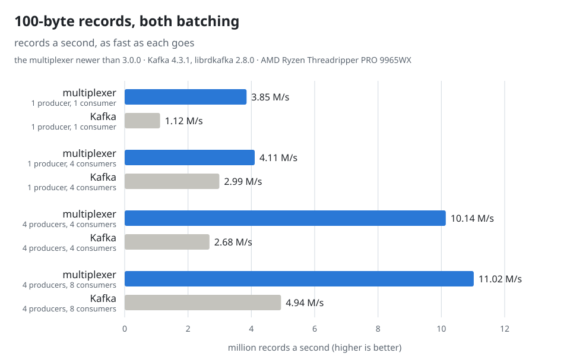
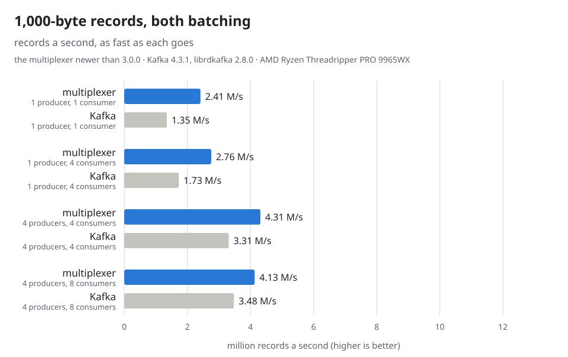
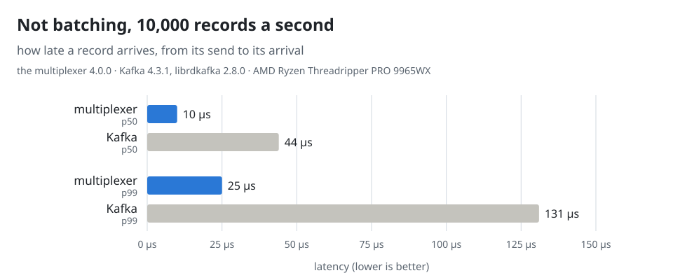
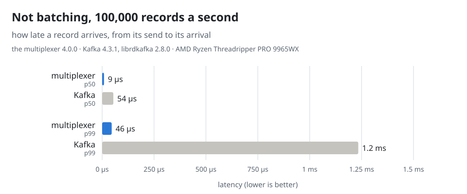

# The multiplexer and Kafka, measured

One multiplexer and one Kafka broker on one machine, the same records
through each, sent by C++ producers and counted by C++ consumers: how many
arrive a second and how late. Both are tuned two ways, for throughput,
their producers batching, and for latency, nothing batched. The two are
built for different jobs ([what the numbers leave
out](#what-the-numbers-leave-out)), so read the numbers as what each
design costs, not as a ranking. [tests/kafka/run.sh](#running-it-again)
runs it all again.

## At a glance

- **Batching:** the multiplexer moved 1.4 to 3.8 times as many 100-byte
  records a second as Kafka, and a fifth to four fifths more kilobyte
  ones.
- **The backlogs:** both sides' producers sent faster than their consumers
  took in some cases, Kafka's by far: up to 12.9 million 100-byte records
  a second against 2.7 million taken, the rest waiting in its log, the
  median record arriving 16.8 s late; the multiplexer's up to 11.3
  million against 10.1 million, the rest waiting in its queues, 1.4 s.
- **Not batching:** half the records arrived within 9 or 10 µs through the
  multiplexer and within 44 or 54 µs through Kafka; 99 in 100 within 25
  to 46 µs, and within 131 µs to 1.2 ms.
- **The brokers' CPU, batching:** 0.02 to 0.24 s for a million records in
  the multiplexer, 0.11 to 1.08 s in Kafka's broker.

In every chart the multiplexer is blue and Kafka gray.

<!-- kafka_charts.py: chart throughput-100 -->
<picture>
  <source media="(prefers-color-scheme: dark)" srcset="assets/kafka/throughput-100-dark.svg">
  
</picture>
<!-- kafka_charts.py: end -->

## Throughput, both batching

Each producer sends its records as fast as it goes, and the consumers
count what arrives a second. The multiplexer's producer, a
`ThreadedClient`, puts up to 1,000 records in one message
([batching](delivery.md)), each waiting 5 ms at most for the rest of its
batch, its io thread batching and writing while the program sends, as
Kafka's producer library does on threads of its own; Kafka's producer
gathers records for up to 5 ms, its client's default.

<!-- kafka_charts.py: chart throughput-1000 -->
<picture>
  <source media="(prefers-color-scheme: dark)" srcset="assets/kafka/throughput-1000-dark.svg">
  
</picture>
<!-- kafka_charts.py: end -->

<!-- kafka_charts.py: throughput -->
| Producers → consumers | Record | System | Records/s | Range over runs | Sent/s | p50 latency | Broker CPU s a million records | Lost |
|---|---|---|---|---|---|---|---|---|
| 1 → 1 | 100 B | multiplexer | 3,849,150 | 3,785,340–3,874,890 | 4,268,440 | 700.5 ms | 0.03 | 0 |
| 1 → 1 | 100 B | Kafka | 1,118,420 | 1,081,680–1,157,550 | 3,724,570 | 11.3 s | 0.15 | 0 |
| 1 → 4 | 100 B | multiplexer | 4,105,930 | 3,679,010–4,453,750 | 4,117,210 | 354 µs | 0.02 | 0 |
| 1 → 4 | 100 B | Kafka | 2,988,880 | 2,696,780–3,346,370 | 3,495,720 | 1.2 s | 0.12 | 0 |
| 4 → 4 | 100 B | multiplexer | 10,139,600 | 8,078,890–10,314,800 | 11,273,200 | 1.4 s | 0.04 | 0 |
| 4 → 4 | 100 B | Kafka | 2,677,440 | 2,589,630–2,784,460 | 12,939,000 | 16.8 s | 0.11 | 0 |
| 4 → 8 | 100 B | multiplexer | 11,023,900 | 8,651,340–11,693,200 | 10,751,900 | 424 ms | 0.04 | 0 |
| 4 → 8 | 100 B | Kafka | 4,936,030 | 4,136,330–4,979,410 | 12,939,100 | 7.1 s | 0.12 | 0 |
| 1 → 1 | 1,000 B | multiplexer | 2,414,710 | 2,409,540–2,424,870 | 2,747,710 | 618.4 ms | 0.24 | 0 |
| 1 → 1 | 1,000 B | Kafka | 1,348,200 | 1,265,830–1,426,760 | 2,175,290 | 2.5 s | 0.76 | 0 |
| 1 → 4 | 1,000 B | multiplexer | 2,756,350 | 2,666,270–3,091,560 | 2,755,800 | 1.8 ms | 0.16 | 0 |
| 1 → 4 | 1,000 B | Kafka | 1,728,080 | 1,479,560–1,935,540 | 1,688,110 | 42.4 ms | 1.01 | 0 |
| 4 → 4 | 1,000 B | multiplexer | 4,314,210 | 3,985,900–4,344,060 | 4,268,780 | 35.6 ms | 0.23 | 0 |
| 4 → 4 | 1,000 B | Kafka | 3,310,570 | 2,655,260–3,728,280 | 3,220,810 | 162.9 ms | 1.06 | 0 |
| 4 → 8 | 1,000 B | multiplexer | 4,131,950 | 4,031,080–4,215,390 | 4,130,030 | 36.6 ms | 0.24 | 0 |
| 4 → 8 | 1,000 B | Kafka | 3,475,200 | 3,413,430–3,858,310 | 3,478,670 | 82.7 ms | 1.08 | 0 |
<!-- kafka_charts.py: end -->

- **The multiplexer, small records: the clients are the limit.** A batch
  of up to a thousand records is one message to the multiplexer: 0.02 to
  0.04 s of its CPU for a million records, where a million sent alone
  cost it 2.2 s. One producer sends about 4.1 to 4.3 million records a
  second, four about 11 million, and a consumer takes about 3.8 million:
  with one consumer, or four producers for four, records wait in the
  multiplexer's queues, the median one 0.6 to 1.4 s late.
- **Kafka, small records: its consumers are the limit.** Its producers
  sent up to 12.9 million records a second into its log, and its
  consumers took 1.1 million a second from one partition, 2.7 to 4.9
  million from four or eight.
- **One producer for four consumers: the producer is the limit on both
  sides.** Both producer libraries work beside the program's thread: the
  multiplexer's `ThreadedClient` serializes a record on the program's
  thread and hands it to its io thread, which batches and writes it, and
  no thread frees a block another allocated ([what batching
  costs](delivery.md#what-it-costs)); librdkafka uses about one and a
  half cores (measured apart). The multiplexer moved 4.1 million 100-byte
  records a second against Kafka's 3.0, and 2.8 million kilobyte ones
  against 1.7, the median record 0.4 ms and 1.8 ms late against 1.2 s and
  42 ms.
- **Kilobyte records, four producers: the multiplexer's one thread is the
  limit,** at 4.1 to 4.3 million a second, 0.23 to 0.24 s of its CPU for
  a million records, most of it in the kernel: for each batch of a
  megabyte, a write of about 94 µs and two reads of about 31 µs. On two
  event loops ([several event loops](operations.md#several-event-loops),
  `MX_ARGS="--threads 2"`) one multiplexer moved 6.4 and 7.1
  million; two multiplexers on the same host, every producer and consumer
  connected to both, as a client of several does (`MX_MULTIPLEXERS=2`),
  6.3 and 6.5 million. Kafka moved 3.3 to 3.5 million, its broker
  spending 1.06 to 1.08 s of CPU on a million records and handing a
  consumer the bytes with `sendfile`.
- **The checksums cost little on either side.** XXH3 takes about 7 ns of
  a kilobyte record in each of the multiplexer's three passes, sender,
  multiplexer and receiver ([wire format](wire_format.md)); Kafka's
  CRC-32C about 25 ns in the producer and 13 ns in the broker, and its
  consumer, librdkafka, checks none.

## Latency

### Not batching

The multiplexer's producer sends each record as a message of its own, its
`send()` returning once the record is written, and Kafka's producer runs
with `linger.ms=0`, sending each record at once instead of gathering a
batch. Both send at a steady rate that each takes with room to spare.

<!-- kafka_charts.py: chart latency-10000 -->
<picture>
  <source media="(prefers-color-scheme: dark)" srcset="assets/kafka/latency-10000-dark.svg">
  
</picture>
<!-- kafka_charts.py: end -->

<!-- kafka_charts.py: chart latency-100000 -->
<picture>
  <source media="(prefers-color-scheme: dark)" srcset="assets/kafka/latency-100000-dark.svg">
  
</picture>
<!-- kafka_charts.py: end -->

<!-- kafka_charts.py: latency-not-batched -->
| Rate | Record | System | p50 | p99 | p99.9 | Max | Lost |
|---|---|---|---|---|---|---|---|
| 10,000/s | 100 B | multiplexer | 10 µs | 25 µs | 98 µs | 586 µs | 0 |
| 10,000/s | 100 B | Kafka | 44 µs | 131 µs | 2.2 ms | 4.1 ms | 0 |
| 100,000/s | 100 B | multiplexer | 9 µs | 46 µs | 324 µs | 4.2 ms | 0 |
| 100,000/s | 100 B | Kafka | 54 µs | 1.2 ms | 3.3 ms | 4.7 ms | 0 |
<!-- kafka_charts.py: end -->

The multiplexer hands a record over about five times sooner. The
slowest record took up to 4 or 5 ms on both sides, so the maxima say more
about this machine at the time than about either system.
Records a second are not compared this way: sending as fast as it can, Kafka's
producer with `linger.ms=0` still puts the records that pile up while a
request is on its way into the next one, so it batches after all, which
the throughput comparison above measures.

### Batching

<!-- kafka_charts.py: latency-batched -->
| Rate | Record | System | p50 | p99 | p99.9 | Max | Lost |
|---|---|---|---|---|---|---|---|
| 10,000/s | 100 B | multiplexer | 2.6 ms | 5.1 ms | 5.1 ms | 5.8 ms | 0 |
| 10,000/s | 100 B | Kafka | 2.7 ms | 5.2 ms | 5.3 ms | 7.5 ms | 0 |
| 100,000/s | 100 B | multiplexer | 2.8 ms | 5.2 ms | 5.7 ms | 6.6 ms | 0 |
| 100,000/s | 100 B | Kafka | 2.9 ms | 5.3 ms | 5.5 ms | 7.6 ms | 0 |
<!-- kafka_charts.py: end -->

A batch's wait is the same on both sides: a record waits up to 5 ms for
the rest of its batch, so half of them arrive within 2.6 to 2.9 ms and 99
in 100 within 5.1 to 5.3 ms, whichever carries them.

## Setup

| | Multiplexer | Kafka |
|---|---|---|
| Broker | one multiplexer, 4.0.0, on one event loop, its default | one broker, Kafka 4.3.1 from the official image, in KRaft mode with its default configuration |
| Clients | the C++ library through `make install` and pkg-config, each producer and each consumer a thread with a connection of its own: a `ThreadedClient` for a producer tuned for throughput, a `SyncClient` for one tuned for latency and for each consumer ([mx_bench.cc](../tests/kafka/mx_bench.cc)) | librdkafka 2.8.0, the C library Kafka's clients in most languages but Java are built on, with its defaults ([kafka_bench.cc](../tests/kafka/kafka_bench.cc)) |
| Where a record goes | an event routed by a rule with `whom: ANY` to one consumer in turn ([bench.rules](../tests/kafka/bench.rules)) | a topic with one partition for each consumer, one copy of each record, each consumer reading one partition from its start |
| Tuned for throughput | `set_delivery()` with `batch`: up to 1,000 records in one message, a record waiting 5 ms at most; `send()` returns at once, and the producer flushes every 100,000 records, so that what waits in it stays bounded | the client's defaults: records gathered into batches for up to 5 ms, the producer taking no more while its own queue is full |
| Tuned for latency | each record a message of its own, sent from the program's thread; `send()` returns once the record is written | `linger.ms=0` |
| Acknowledged | nothing: a record goes to a consumer connected now | a record acknowledged once every in-sync replica has it, the client's default; no compression |
| Changed from the defaults | nothing | `fetch.queue.backoff.ms=0` on the consumer: with the default it stops fetching for a second whenever 100,000 records wait in it unread, which held it to about 220,000 records a second |

The machine is an AMD Ryzen Threadripper PRO 9965WX, 24 cores, Linux
6.12; other work used about a tenth of it meanwhile, the two systems'
runs taking turns. Every process, both brokers included, runs in a
container on the host's network. Both sides' programs are built by one
[Dockerfile](../tests/kafka/Dockerfile) with one compiler and the same
flags, for any x86-64 as the release's packages are: the multiplexer's
checksum picks AVX-512 at run time where the processor has it, and the
broker's JVM compiles all of its code for this processor as it runs.
Built with `-march=native`, or at `-O3`, protobuf included, the
multiplexer's side moved as many records, within a few percent either
way, the runs' own spread (measured apart).

## Method

- **The records.** A record is a payload of 100 or 1,000 bytes whose
  first 8 bytes are the moment it was sent. One producer or four send
  them, each a thread with a connection of its own, and one, four or eight
  consumers receive them, each record reaching one consumer.
- **A run** sends about ten seconds of records as fast as the faster
  system goes: 20 to 100 million records, a run's figures not counting
  its first tenth, connecting and Kafka's first look-up of its topic
  among it.
- **A rate** is the middle of the run's, the records from the arrival of
  the tenth of them to the arrival of nine tenths, over the time between,
  measured at the consumers: what goes all the way through. A consumer
  that starts behind and catches up from Kafka's log arrives faster than
  the producers send, which a shorter run or a window to the last
  arrival counts as speed. The tables give the producers' own rate
  beside it, and how late the median record arrived: a backlog shows as
  both.
- **A latency** is a record's arrival time less its send time; the
  percentiles are over every record after the first tenth.
- **Runs.** Each configuration ran five times, the two systems taking
  turns, and a figure is the median of its runs; the tables give the
  range of the records a second over them.
- **Lost.** No run lost a record, on either side.

## What the numbers leave out

Kafka writes every record to disk, keeps it as long as it is told to,
seven days by default, copies it to other brokers when a topic asks for
copies, and lets a consumer read again from any point: a consumer that
was away misses nothing, so long as it comes back within that time. The
multiplexer keeps nothing: a record goes to a consumer
connected now or is dropped, at most once per multiplexer
([semantics](semantics.md)). In exchange it needs no disk and no tuning,
answers requests with replies and fails them over to another backend
([how a query is answered](query.md)), and routes by type, from a rules
file, by key ([keys](keys.md)) and to one instance. No run here lost a
record; a consumer that fell further behind its multiplexer than the
million messages bench.rules lets it hold, records or batches, would
have.

## Running it again

```
tests/kafka/run.sh
```

It needs Docker and python3, and the ports 9092 and 9093, Kafka's, and
19800, the multiplexer's, free on the host. It builds the image
`mx-kafka-bench` from the working tree, pulls Kafka's, runs every
configuration three times each way and prints the tables above, in about
forty minutes; this page's figures are from `REPEAT=5`. The containers are named `mx-kafka-bench-*` and removed
at the end.

| Setting | What it does |
|---|---|
| `SCALE=0.1` | a tenth of the records: a quick look at the scripts rather than the numbers, Kafka's start-up still in its figures |
| `REPEAT=1` | each configuration once |
| `SYSTEMS=mx` | one side alone, `mx` or `kafka` |
| `MX_MULTIPLEXERS=2` | the multiplexer's side as two multiplexers, on `MX_PORT` and the port after it, every producer and consumer connected to both |
| `MX_ARGS="..."` | more arguments for `mxcontrol run_multiplexer`, `--threads 2` for two event loops |
| `MX_CLIENT=sync` | the multiplexer's producers on that class in both flavours, `sync` or `threaded`, rather than a `ThreadedClient` tuned for throughput and a `SyncClient` tuned for latency |
| `MX_PORT=19800` | the multiplexer's port |
| `KAFKA_IMAGE=apache/kafka:<version>` | another Kafka |
| `RESULTS=tests/kafka/results.jsonl` | every run's line kept in that file as well, which [kafka_charts.py](kafka_charts.py) draws this page's charts and writes its tables from when `./format.sh` runs |

What is in [tests/kafka](../tests/kafka):

- [bench.rules](../tests/kafka/bench.rules): the system rules, a producer
  type, a consumer type that the multiplexer may hold a million messages
  for, and the record's type routed to one consumer in turn.
- [common.h](../tests/kafka/common.h): what both programs share: the
  options, the stamp on each record, the consumer's tally with its
  warm-up, and the line of JSON each program prints.
- [mx_bench.cc](../tests/kafka/mx_bench.cc) and
  [kafka_bench.cc](../tests/kafka/kafka_bench.cc): `produce` and `consume`
  for each side, one thread and one connection for each producer and
  each consumer; `mx_bench` batches with `--batch-records`,
  `--batch-bytes` and `--batch-delay`, and `kafka_bench` takes Kafka
  client settings with `--set name=value`.
- [Dockerfile](../tests/kafka/Dockerfile): Debian 13 with librdkafka, the
  multiplexer and its library built with the Makefile, their constants
  from bench.rules, and the two programs.
- [run.sh](../tests/kafka/run.sh): the runs and the tables.
- [results.jsonl](../tests/kafka/results.jsonl): the runs this page shows.
