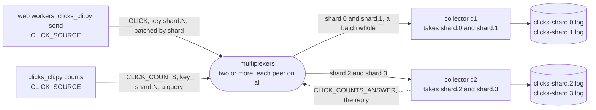

# clicks

A clickstream. Web workers send an event for every click, a few dozen
bytes each, many thousands a second, and collectors store them. The
clicks are sharded by user, `shard.0` to `shard.3`, the shard a CRC-32 of
the user's name, and each collector takes some of the shards with a key
filter ([keys](../../docs/keys.md)). The sources batch the `CLICK` type
([batching](../../docs/delivery.md)): a click waits up to 50 ms for others
of its shard, and they go together, up to a thousand in one message.
A batch goes by its type and its key, so the multiplexer routes it whole
to the one collector that takes the shard, as one message, and the
collector's library splits it back into the clicks: measured, a million
clicks cost the multiplexers over a hundred times less CPU batched than not.
Each collector appends every click to a file per shard, counts the
clicks per page, and answers `CLICK_COUNTS` for its shards.

The example is installed with pip: `mx-multiplexer` from PyPI, which
brings the multiplexer, `mxcontrol`, with it.
[walkthrough.md](walkthrough.md) builds it from nothing, every line of
the rules file, the source, the collector and the command line explained
as it is added. It ends with the measured steps, the clicks counted,
clicks a second with and without batching and what the multiplexers'
CPU did meanwhile, what the batches on the wire held and a shard nobody
takes, and with a walk through its test.

```
pip install -r requirements.txt
mxcontrol run_multiplexer --rules clicks.rules --address 127.0.0.1:1980 --allow-tap   # the package's mxcontrol
mxcontrol run_multiplexer --rules clicks.rules --address 127.0.0.1:1981 --allow-tap   # a second one, in another terminal
python collector.py 127.0.0.1:1980,127.0.0.1:1981 --shards 0,1         # a collector; another with --shards 2,3
python clicks_cli.py 127.0.0.1:1980,127.0.0.1:1981 send --clicks 1000000   # four processes clicking as fast as they go
python clicks_cli.py 127.0.0.1:1980,127.0.0.1:1981 counts                  # the clicks per page, from every shard
```

`--allow-tap` lets `clicks_cli.py watch` see what the multiplexers route,
and nothing else needs it. In a web worker the source is two lines, one
`ClickSource` per process, made in the process that uses it: a server
that forks its workers needs the holder of [the web server
recipe](../../docs/recipes/web_server.md).

```python
from source import ClickSource

clicks = ClickSource([("10.0.0.1", 1980), ("10.0.0.2", 1980)])   # once per process, every multiplexer
clicks.click("alice", "/pricing")                                  # in a request, from any thread
```

`test.sh` runs the test in a virtual environment against real
multiplexers.

## The peers

Every peer connects to every multiplexer. One rule routes the clicks, to
`ANY` collector whose key filter takes the click's shard, and since one
collector takes each shard, that is the one; a batch, one shard's clicks,
goes whole. A question for a shard's counts goes the same way, and its
answer back to whoever asked.



## What is what

- `clicks.rules`: the system rules, then `CLICK_SOURCE` and
  `CLICK_COLLECTOR`, `CLICK` and `CLICK_COUNTS` with their `ANY` rules,
  and `CLICK_COUNTS_ANSWER`, the reply; `multiplexer_constants.py` is
  what `mxcontrol generate_constants` wrote from it, and `clicks.proto`
  the payloads, compiled to `clicks_pb2.py`.
- `source.py`: `shard_key()` and `ClickSource`, what a web worker sends
  its clicks with: one `ThreadedClient`, `CLICK` batched by shard.
- `collector.py`: `Collector`, a `BaseMultiplexerServer` that sets its
  key filters before it connects, appends each click to its shard's
  file, counts them per page, answers a shard's counts, and leaves on
  `SIGTERM` with its files written out.
- `clicks_cli.py`: the command line the steps use: `send` from several
  processes at once, `counts`, and `watch`, a tap's view of the batches.
- `test.py`, `test.sh`: the test on the harness, and the script that
  makes a venv and runs it.
