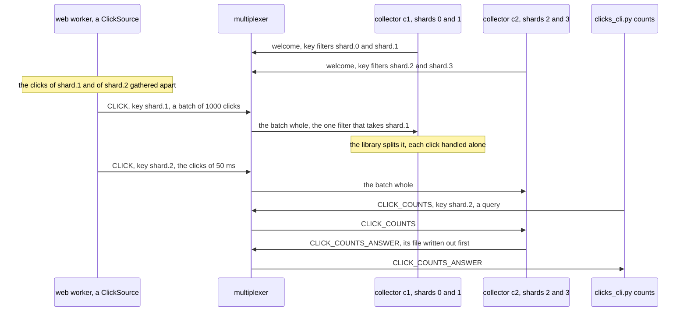

# Building the clickstream, step by step

This page builds the example from nothing: the rules file, the payloads,
the source, the collector and the command line, in that order, with
every line of those files shown as it is added. Every code block is a
piece of a file in this directory, and `examples/check_walkthroughs.py`
keeps them identical to the files, so what you read here is what runs.
[README.md](README.md) is the front door: what the example is, a picture
of its peers, and how to run it. How the messages go, drawn, the
measured steps, the test and what the example does not do are at the
end of this page.

The idea in one sentence: a click is an event keyed with its shard, and
each collector's key filter names the shards it takes, so the
multiplexers send a click only to the collector of its shard; the
sources batch the events, so that a batch holds one shard's clicks, and
the multiplexer routes it whole, up to a thousand clicks as one message.
[Batching](../../docs/delivery.md) and [keys](../../docs/keys.md)
describe the two in general.

## 1. The rules file

The file opens with the system rules every rules file starts from, the
protocol's own types 1 to 99 and the six the libraries and `mxcontrol`
use by name ([docs/rules.md](../../docs/rules.md)), which `mxcontrol
generate_rules clicks.rules` wrote; they are left out here. Then the
example's two peer types: `CLICK_SOURCE` for whoever sends clicks, the
web workers and the command line, and `CLICK_COLLECTOR` for the
collectors. Neither is marked `is_passive`: a source is built on
`ThreadedClient`, whose io thread runs the library's loop all the time,
and a collector on a server class, which runs it between its handlers.

```protobuf file=clicks.rules from="# The example's peers and messages."
# The example's peers and messages.

peer {
    type: 201
    name: "CLICK_SOURCE"
    comment: "whoever sends clicks: the web workers, and the command line"
}

peer {
    type: 202
    name: "CLICK_COLLECTOR"
    comment: "a backend on BaseMultiplexerServer that stores the clicks of the shards its key filters name; one collector takes each shard"
}

```

`CLICK` is the event, one click, keyed with its shard and routed to `ANY`
collector whose key filter takes the key. The rule says nothing about
shards. Which collector takes which shard is the collectors' to say, in
their key filters, so shards move between collectors without a change
to this file. Nobody answers a click, and a source has nothing to do
with a report that one went nowhere, so the rule asks for none,
`report_delivery_error: false`; the report would name the batch, besides,
a message the source never saw, not the clicks in it
([batching](../../docs/delivery.md#what-changes-for-a-program)). A shard
nobody takes is the multiplexers' to say, in their logs, as an error;
step 4 shows it.

```protobuf file=clicks.rules
type {
    type: 301
    name: "CLICK"
    comment: "one click, an event, key shard.N, payload Click; ANY collector whose key filter takes the shard stores it, nobody answers; its sources batch it"
    to {
        peer: "CLICK_COLLECTOR"
        whom: ANY
        report_delivery_error: false
    }
}

```

`CLICK_COUNTS` asks the collector of one shard for its counts, keyed the
same way, and `CLICK_COUNTS_ANSWER` is the reply, which needs no rule: a
reply is addressed to the peer that asked. This rule reports delivery
errors, the default, so that a question about a shard nobody takes fails
at once rather than at its timeout.

```protobuf file=clicks.rules
type {
    type: 302
    name: "CLICK_COUNTS"
    comment: "a request for one shard's counts, key shard.N, no payload; the collector whose key filter takes the shard answers with CLICK_COUNTS_ANSWER"
    to {
        peer: "CLICK_COLLECTOR"
        whom: ANY
    }
}

type {
    type: 303
    name: "CLICK_COUNTS_ANSWER"
    comment: "the reply to CLICK_COUNTS, payload Counts"
}
```

With the file written, `mxcontrol generate_constants clicks.rules
--python multiplexer_constants.py --pyi multiplexer_constants.pyi` writes
the module the code below imports, so that it says `types.CLICK` rather
than 301.

## 2. The payloads

A message's payload is bytes; the example's are protocol buffers,
compiled once with `protoc --python_out=. --pyi_out=. clicks.proto`.

```protobuf file=clicks.proto
// The payloads of the clicks example. Compiled once with `protoc
// --python_out=. --pyi_out=. clicks.proto`; the generated clicks_pb2.py
// and its stub are committed next to it.
syntax = "proto3";

package clicks;

```

A click is who clicked which page, and when, in nanoseconds: a few dozen
bytes. Its shard is not in it. The shard is the message's key, which the
multiplexer routes by and the collector reads back.

```protobuf file=clicks.proto
// CLICK: who clicked which page, and when, in nanoseconds since the epoch.
message Click {
  string user = 1;
  string page = 2;
  int64 time_ns = 3;
}

```

The answer to a question about a shard: the clicks per page, and how
many in all.

```protobuf file=clicks.proto
// CLICK_COUNTS_ANSWER: one shard's clicks, per page and in all.
message Counts {
  map<string, uint64> pages = 1;
  uint64 clicks = 2;
}
```

## 3. The source

[source.py](source.py) is what a web worker sends its clicks with: one
`ClickSource` per process, made once, and `click()` from any thread of
it. It opens with what it is, the number of shards, which every source
and every collector must agree on, and how long a click waits for
others, `MAX_DELAY`, which the end of this section explains.

```python file=source.py
"""ClickSource: what a web worker sends its clicks with. One CLICK event per
click, keyed with its shard, shard.0 to shard.3, which a hash of the user
decides, so that a user's clicks always go to the same shard and so to
the same collector; and the type batched, so that the clicks of one shard
go several in one message.

    with ClickSource(addresses) as source:
        source.click("alice", "/pricing")

One ThreadedClient connected to every multiplexer, its io thread writing
what click() hands it; every method is safe from any thread, which is
what a web process's threads need. A click waits at most MAX_DELAY for
others of its shard, and a batch goes once it holds a thousand clicks or
once its first click has waited that long; a flush, close() and the end
of a `with` block let every batch go at once. A delay of 0 sends a click
at once while a connection has nothing to write, and gathers clicks only
while every connection is busy writing; the walkthrough measures both."""

import time
import zlib

from multiplexer.endpoints import Endpoint, parse_endpoint
from multiplexer.threaded_client import DEFAULT_TIMEOUT, ThreadedClient

from clicks_pb2 import Click
from multiplexer_constants import peers, types

SHARDS = 4  # shard.0 to shard.3; every source and every collector must agree
MAX_DELAY = 0.05  # seconds a click waits for others of its shard


def parse_addresses(text: str) -> list[Endpoint]:
    """ "host:port,host:port", an IPv6 address as [address]:port, as the list the library takes."""
    return [parse_endpoint(item) for item in text.split(",")]


```

The shard of a click is the user's: a CRC-32 of the name, so that a
user's clicks all go to one shard, and so to one collector, from any web
process. Python's own `hash()` of a string would not do: it is salted
afresh in every process, and two web workers would put one user in two
shards.

Why shards, and not the user as the key: a batch holds the messages of
one type and one key ([what goes in a
batch](../../docs/delivery.md#what-goes-in-a-batch)). With a key per
user a batch would hold one user's clicks of the last 50 ms, one click
most of the time, and nothing would gather. Four keys gather everything
a source sends into four batches at a time, and a collector that takes
two shards gets two of them. The user is in the payload, where the
collector reads it; the key only says where the click goes.

```python file=source.py
def shard_key(user: str, shards: int = SHARDS) -> str:
    """The key of `user`'s clicks: shard.N, N from a CRC-32 of the user's
    name, which every process computes alike, where Python's own hash() of
    a string differs from one process to the next."""
    return f"shard.{zlib.crc32(user.encode()) % shards}"


```

`ClickSource` holds one `ThreadedClient`, connected to every
multiplexer, whose io thread heartbeats and reconnects on its own and
writes what `click()` hands it. `set_delivery(types.CLICK, batch=True)` comes first,
before anything is sent: from then on the client puts the clicks of one
key, a shard, together, each key apart, and a batch goes once it holds a
thousand clicks, `max_records`'s default, or once its first click has
waited `max_delay`. A batch's `timeout` counts from its first click too,
so it gets the delay and the library's ten seconds, `DEFAULT_TIMEOUT`,
to be written before its clicks are given up on. `connect_all()` then
starts a connection to every
multiplexer at once and waits for the welcomes, ten seconds at most; one
that does not answer is tried again in the background, and the clicks go
through the others meanwhile.

```python file=source.py
class ClickSource:
    """One ThreadedClient connected to every multiplexer, CLICK batched by shard."""

    def __init__(
        self, addresses: list[Endpoint], shards: int = SHARDS, batching: bool = True, max_delay: float = MAX_DELAY
    ):
        """Connect to every multiplexer, all at once, waiting ten seconds at
        most; one that is not reachable yet is tried again in the
        background. `batching` False sends every click alone."""
        self.shards = shards
        self._client = ThreadedClient([], type=peers.CLICK_SOURCE)
        if batching:
            # Every key of the type apart, so a batch holds one shard's clicks;
            # its time counts from its first click: the delay, and ten seconds.
            self._client.set_delivery(types.CLICK, batch=True, max_delay=max_delay, timeout=max_delay + DEFAULT_TIMEOUT)
        self._client.connect_all(addresses)

```

A click is a `Click` with the time it happened, sent with
`send_message()` and its shard as `key`. The call returns at once: the
io thread puts the click in its shard's batch, or sends it alone when
batching is off.

```python file=source.py
    def click(self, user: str, page: str) -> None:
        """Send one click; returns once the io thread has it."""
        click = Click(user=user, page=page, time_ns=time.time_ns())
        self._client.send_message(click, type=types.CLICK, key=shard_key(user, self.shards))

```

The rest: `flush()` waits until every click sent before it is written,
letting the open batches go first, which the command line does before it
counts; `dropped`, the clicks given up on, none while a multiplexer is
reachable; `close()`, which lets the batches go too, and a `with` block.

```python file=source.py
    def flush(self, timeout: float = 10.0) -> bool:
        """Wait until every click sent before the call is written, the open
        batches let go first, or `timeout` seconds; whether every one was."""
        return self._client.flush_all(timeout)

    @property
    def dropped(self) -> int:
        """Clicks given up on: no multiplexer took them within ten seconds, or the close came first."""
        return self._client.dropped

    def close(self) -> None:
        """Let the batches go and write what was sent, a second at most, then
        disconnect; the source is done."""
        self._client.shutdown()

    def __enter__(self) -> "ClickSource":
        """The source, for a `with` block, at whose end it is closed."""
        return self

    def __exit__(self, *exc: object) -> None:
        """close(), however the block ended."""
        self.close()
```

**Why a delay.** `MAX_DELAY` is 50 ms. A batch is the clicks of one shard
that one source sends within that time: a web worker sending 2,000
clicks a second, a quarter of them to each shard, puts about 25 in a
batch, and the command line's sources, about 160,000 a second each, fill
a batch to its thousand in under 30 ms. Fifty milliseconds are
nothing to a clickstream that is read later. Without a delay,
`set_delivery()`'s default, a click goes at once whenever a connection
has nothing left to write, and clicks gather only while every connection
is busy; the batches then form only when a multiplexer falls behind what
the sources write, and steps 2 and 3 measure what that did here: next to
nothing.

## 4. The collector

[collector.py](collector.py) is a `BaseMultiplexerServer`, the plain
server class: one thread runs the loop, which reads a message, calls the
handler, then `periodic_task()`, and goes round again. Each click is
microseconds of work, a line written and a count, so nothing here needs
a worker thread. The docstring is the program's help.

```python file=collector.py
"""A collector: a backend on `BaseMultiplexerServer` that stores the clicks
of the shards it takes, one line per click in a file per shard, counts
them per page, and answers CLICK_COUNTS with a shard's counts.

    python collector.py [ADDRESSES] --shards 0,1 [--dir DIR]

ADDRESSES is host:port of every multiplexer, comma-separated, default
127.0.0.1:1980. A click is keyed with its shard, shard.N, and the
collector's key filters for CLICK and CLICK_COUNTS name its shards, so a
multiplexer routes it the clicks of those shards and no other, a batch
of them whole; the library splits a batch back into its clicks, and
handle_message() sees each alone. Every shard needs a collector that
takes it: the clicks of a shard nobody takes are dropped. The files are
clicks-shard.N.log under DIR, appended to, a line `user page time_ns`
per click; the counts are of the clicks stored since the collector
started. SIGTERM makes it leave: the multiplexers route it nothing new,
it stores what was on its way, writes its files out and exits."""

import argparse
import collections
import os
import re
import signal
import sys
import time
from typing import TextIO

from multiplexer.Multiplexer_pb2 import MultiplexerMessage
from multiplexer.mxclient import CLOSE_FLUSH_SECONDS
from multiplexer.servers import BaseMultiplexerServer

from clicks_pb2 import Click, Counts
from multiplexer_constants import peers, types
from source import SHARDS, parse_addresses

WRITE_EVERY = 1.0  # seconds between writes of the files' buffers to the files


```

A collector takes the shards it is given: it opens a file for each,
appended to, so that a collector started again adds to what it stored,
and keeps a count per page for each. It sets its key filters in the
constructor, before anything connects, so that the welcome each
multiplexer gets carries them and nothing reaches it under no filter,
which would be every key. `re.escape()` makes the pattern that takes the
one key and nothing else, `shard\.1`, its dot quoted, and the
multiplexer finds such a key with one hash lookup. The same filter goes
on `CLICK_COUNTS`, so that a question about a shard reaches its
collector.

```python file=collector.py
def shard_name(shard: int) -> str:
    """The key of shard number `shard`, as the sources set it."""
    return f"shard.{shard}"


class Collector(BaseMultiplexerServer):
    """The files and the counts of its shards, and the handler for clicks
    and for questions about them; on the serve loop's one thread."""

    multiplexer_client_type = peers.CLICK_COLLECTOR

    def __init__(self, addresses: list[tuple[str, int]], shards: list[int], directory: str = "."):
        """The collector of `shards` for the multiplexers in `addresses`, its
        files opened under `directory`; connect() or serve_forever() connects."""
        super().__init__(addresses)
        self.shards = sorted(shards)
        self.files: dict[str, TextIO] = {
            shard_name(shard): open(os.path.join(directory, f"clicks-{shard_name(shard)}.log"), "a")
            for shard in self.shards
        }
        self.pages: dict[str, collections.Counter[str]] = {key: collections.Counter() for key in self.files}
        self.stored = 0
        self.leave = False  # set by SIGTERM; periodic_task() starts the drain
        self.ready_pending = False  # set by main(): "ready" is printed once a multiplexer welcomed the collector
        self._written_at = time.monotonic()
        # Before connecting, so that the welcome carries them: these shards'
        # keys and no other, for the clicks and for the questions.
        only = [re.escape(key) for key in self.files]
        self.set_key_filters({types.CLICK: only, types.CLICK_COUNTS: only})

```

The handler. A batch never reaches it: the library splits a batch back
into its clicks as it reads it, and `handle_message()` gets each click
alone, with the id, the sender and the key it was sent with, the key
naming the shard and so the file. A click becomes one line, `user page
time_ns`, written to the file's buffer, and a count; `no_response()`
says the event needs no answer. A question about a shard writes the
file out first, so that the file holds every click the answer counts,
and is answered with `send_message()`, which the base class addresses to
the asker as the reply to its request. The filters pass no key but the
collector's shards, so a message for another shard is one with no key,
or one sent with `to`, which pass every filter: such a question gets an
error, so that its query fails at once, and such a click is dropped.

```python file=collector.py
    def handle_message(self, mxmsg: MultiplexerMessage) -> None:
        """A click stored and counted, or a shard's counts answered."""
        out = self.files.get(mxmsg.key)
        if mxmsg.type == types.CLICK and out is not None:
            click = Click.FromString(mxmsg.message)
            out.write(f"{click.user} {click.page} {click.time_ns}\n")
            self.pages[mxmsg.key][click.page] += 1
            self.stored += 1
            self.no_response()
        elif mxmsg.type == types.CLICK_COUNTS and out is not None:
            out.flush()  # the file holds every click the answer counts
            pages = self.pages[mxmsg.key]
            self.send_message(message=Counts(pages=pages, clicks=pages.total()), type=types.CLICK_COUNTS_ANSWER)
        elif mxmsg.type == types.CLICK_COUNTS:  # no key, or a shard sent here with `to`
            self.report_error(f"collector of shards {self.shards} has no shard {mxmsg.key!r}")
        else:  # a click without a key, which every filter lets through: no shard to store it in
            self.no_response()

```

`periodic_task()` runs after every message and after every poll of the
loop, half a second here. It writes the files' buffers out once a
second, starts the drain once `SIGTERM` came, and says `ready` once a
multiplexer has welcomed the collector: whoever runs the steps, and the
test, waits for that line and then sends, so it must mean reachable.

```python file=collector.py
    def periodic_task(self) -> None:
        """After every message and every poll: the files' buffers written
        out once a second, the drain started once SIGTERM came, and "ready"
        said once a multiplexer welcomed the collector."""
        now = time.monotonic()
        if now - self._written_at >= WRITE_EVERY:
            self._written_at = now
            for out in self.files.values():
                out.flush()
        if self.leave:
            self.start_draining()
        self.say_ready_once_connected()

    def say_ready_once_connected(self) -> None:
        """Print the "ready" main() asked for once a multiplexer has
        welcomed the collector, its filters with it: whoever runs the
        steps, and the test, wait for the line and then send."""
        if self.ready_pending and self.conn.connections_count() > 0:
            print(f"ready: shards {', '.join(map(str, self.shards))}", flush=True)
            self.ready_pending = False

```

Closing writes the files out after the connections close, so that the
clicks the drain still brought are in them.

```python file=collector.py
    def close(self, timeout: float = CLOSE_FLUSH_SECONDS) -> None:
        """The connections closed, then the files written out and closed."""
        super().close(timeout)
        for out in self.files.values():
            if not out.closed:
                out.close()


```

And the program: the shards from the command line, the collector, and a
`SIGTERM` handler that sets a flag. The library installs no signal
handler, and a Python one runs only once the loop's wait returns to
Python, within the half-second poll, so the handler only asks, and
`periodic_task()` starts the drain between two messages: the
multiplexers route the collector nothing new, it stores what was on its
way, and it leaves once each multiplexer has confirmed, five seconds at
most ([how a backend leaves](../../docs/leaving.md)). `connect()` comes
before `ready`, so that the line means the collector is registered, its
filters with it.

```python file=collector.py
def main() -> None:
    """Serve until SIGTERM, then leave."""
    parser = argparse.ArgumentParser(description=(__doc__ or "").split("\n\n")[0])
    parser.add_argument(
        "addresses", nargs="?", default="127.0.0.1:1980", help="host:port of every multiplexer, comma-separated"
    )
    parser.add_argument("--shards", required=True, help=f"the shards it takes, comma-separated, of 0 to {SHARDS - 1}")
    parser.add_argument("--dir", default=".", help="where the files go, one per shard, appended to")
    args = parser.parse_args()
    shards = sorted({int(text) for text in args.shards.split(",")})
    if any(shard not in range(SHARDS) for shard in shards):
        parser.error(f"a shard is a number from 0 to {SHARDS - 1}")
    collector = Collector(parse_addresses(args.addresses), shards, args.dir)

    def leave(signum: int, frame: object) -> None:
        """SIGTERM: a flag the serve loop reads, between two messages."""
        collector.leave = True

    # The handler runs when the serve loop's wait comes back to Python, at
    # the latest once its poll is over.
    signal.signal(signal.SIGTERM, leave)
    collector.ready_pending = True
    collector.connect()  # waits for the handshakes, so that "ready" can come at once
    collector.say_ready_once_connected()
    if collector.ready_pending:
        print("no multiplexer reachable yet; ready once one is", file=sys.stderr, flush=True)
    collector.serve_forever(poll=0.5, drain_seconds=5)
    print(f"left after storing {collector.stored} clicks", flush=True)


if __name__ == "__main__":
    main()
```

## 5. The command line

[clicks_cli.py](clicks_cli.py) is what the steps below use: `send` sends
clicks from several processes at once and says how it went, `counts`
adds up every shard's counts, and `watch` shows what the CLICK messages
on the wire held.

```python file=clicks_cli.py
"""The command line the steps use: clicks sent from several processes as
fast as they go, the counts asked of every shard, and what the CLICK
messages on the wire carried.

    python clicks_cli.py ADDRESSES send [--clicks N] [--sources S] [--users U] [--pages P]
                                        [--no-batching | --max-delay SECONDS]
    python clicks_cli.py ADDRESSES counts
    python clicks_cli.py ADDRESSES watch [--clicks N] [--seconds S]

ADDRESSES is host:port of every multiplexer, comma-separated. send starts S
processes, each with a ClickSource of its own, which send N clicks between
them as fast as they go, by U users on P pages; then it waits until the
collectors have stored them, and prints how long that took, clicks a
second, how many were lost, and the CPU the multiplexers on this
machine's loopback used meanwhile, found by their ports in /proc. counts
asks every shard and prints the clicks per page and in all. watch taps
every multiplexer, which must run with --allow-tap, until it has seen N
clicks go by or S seconds passed, and prints how the CLICK messages
carried them: alone, or in batches of how many."""

import argparse
import multiprocessing
import os
import statistics
import time

from multiplexer import recording
from multiplexer.clients import SyncClient
from multiplexer.endpoints import Endpoint
from multiplexer.mxclient import MultiplexerClientError, OperationTimedOut
from multiplexer.Multiplexer_pb2 import MessageBatch
from multiplexer.Recording_pb2 import RECORDING_CONTROLLER, RecordingControl, RoutedMessage
from multiplexer.threaded_client import BackendError, ThreadedClient

from clicks_pb2 import Counts
from multiplexer_constants import peers, types
from source import MAX_DELAY, SHARDS, ClickSource, parse_addresses

ASK_EVERY = 0.01  # seconds between two looks at the counts while the clicks are on their way
NOTHING_MORE = float(os.environ.get("NOTHING_MORE", "5"))  # seconds with no click stored, then the rest are lost
LOOPBACK = ("127.0.0.1", "::1", "localhost")


```

A source of `send` is a process of its own, since one Python process
sends about as fast as its one interpreter goes, however many threads it
has. Each makes its `ClickSource`, waits at a barrier until every one has
connected, sends its share of the clicks as fast as it can, the users
and the pages taking turns, and flushes.

```python file=clicks_cli.py
def send_clicks(addresses: str, index: int, clicks: int, users: int, pages: int, delay: float | None, barrier, report):
    """One source, in a process of its own: connect, wait for the others,
    send `clicks` clicks as fast as Python goes, flush, and report whether
    every one was written and how many were given up on."""
    names = [f"user{number}" for number in range(users)]
    paths = [f"/page/{number}" for number in range(pages)]
    with ClickSource(parse_addresses(addresses), batching=delay is not None, max_delay=delay or 0.0) as source:
        barrier.wait(30)
        for number in range(clicks):
            source.click(names[(index * clicks + number) % users], paths[number % pages])
        report.put((source.flush(60), source.dropped))


```

A shard's counts are a query, keyed with the shard; `stored()` adds up
every shard's, a shard nobody takes counting none. When a source has
flushed, its clicks are written, not stored: they are on their way
through the multiplexers, and may wait there for a collector. The
collectors say nothing when they are done, so `wait_until_stored()` asks
for the counts every 10 ms until they have every click, or until five
seconds go by without one more, which means the rest was lost; on a
machine busy enough to stall the collectors that long, `NOTHING_MORE` in
the environment gives them more, as the test does.

```python file=clicks_cli.py
def shard_counts(client: ThreadedClient, shard: int) -> Counts:
    """What the collector of `shard` has stored; a shard nobody takes fails the query at once."""
    return Counts.FromString(client.query(b"", type=types.CLICK_COUNTS, key=f"shard.{shard}").message)


def stored(client: ThreadedClient) -> int:
    """The clicks the shards' collectors have stored since they started; a
    shard nobody takes counts none."""
    total = 0
    for shard in range(SHARDS):
        try:
            total += shard_counts(client, shard).clicks
        except (MultiplexerClientError, BackendError):
            pass
    return total


def wait_until_stored(client: ThreadedClient, before: int, clicks: int) -> tuple[int, float]:
    """How many of `clicks` the collectors stored beyond `before`, and when
    the last of those was counted. The collectors say nothing when they are
    done, so the counts are asked again and again; a run that stored
    nothing more for NOTHING_MORE seconds lost the rest."""
    count, changed = 0, time.monotonic()
    while count < clicks and time.monotonic() - changed < NOTHING_MORE:
        now = stored(client) - before
        if now != count:
            count, changed = now, time.monotonic()
        else:
            time.sleep(ASK_EVERY)
    return count, changed


```

The multiplexers' CPU. A multiplexer on this machine is found by its
port: the listening socket in `/proc/net/tcp`, then the process that
holds it among this user's processes. Its CPU is the sum over its
threads of `/proc/PID/task/TID/schedstat`, in nanoseconds, where
`/proc/PID/stat` counts hundredths of a second, too coarse for the
batched runs.

```python file=clicks_cli.py
def multiplexer_pid(endpoint: Endpoint) -> int | None:
    """The process of this user's listening on the TCP port of `endpoint`, a
    multiplexer on this machine's loopback: the socket from /proc/net/tcp,
    then the process that holds it, from /proc/*/fd. None for another
    host, or when /proc says nothing."""
    host, port = endpoint
    if host not in LOOPBACK:
        return None
    sockets = set()
    for table in ("/proc/net/tcp", "/proc/net/tcp6"):
        try:
            with open(table) as rows:
                for row in list(rows)[1:]:
                    fields = row.split()
                    if fields[3] == "0A" and int(fields[1].rsplit(":", 1)[1], 16) == port:  # 0A: LISTEN
                        sockets.add(f"socket:[{fields[9]}]")
        except OSError:
            return None
    for pid in filter(str.isdigit, os.listdir("/proc")):
        try:
            if any(os.readlink(f"/proc/{pid}/fd/{fd}") in sockets for fd in os.listdir(f"/proc/{pid}/fd")):
                return int(pid)
        except OSError:  # another user's process, or one gone
            continue
    return None


def cpu_seconds(pid: int) -> float:
    """The CPU a process has used so far, every thread of it, in seconds:
    the first field of each thread's /proc/PID/task/TID/schedstat, in
    nanoseconds, where /proc/PID/stat counts in hundredths."""
    total = 0
    for thread in os.listdir(f"/proc/{pid}/task"):
        with open(f"/proc/{pid}/task/{thread}/schedstat") as schedstat:
            total += int(schedstat.read().split()[0])
    return total / 1e9


```

`send` puts it together: the sources started, the multiplexers found,
the counts and the CPU read before, the barrier, which starts the clock
once every source has connected, and the counts and the CPU read again
once the collectors have every click. It prints the clicks stored, how
long they took and how many were lost, then the multiplexers' CPU, each
one's and per million clicks.

```python file=clicks_cli.py
def send(args: argparse.Namespace) -> None:
    """Send the clicks from args.sources processes and say how it went."""
    delay = None if args.no_batching else args.max_delay
    addresses = parse_addresses(args.addresses)
    context = multiprocessing.get_context("spawn")  # each source a fresh process: no client crosses a fork
    barrier = context.Barrier(args.sources + 1)
    report = context.Queue()
    shares = [args.clicks // args.sources + (index < args.clicks % args.sources) for index in range(args.sources)]
    sources = [
        context.Process(
            target=send_clicks, args=(args.addresses, index, share, args.users, args.pages, delay, barrier, report)
        )
        for index, share in enumerate(shares)
    ]
    for process in sources:
        process.start()
    multiplexers = [pid for pid in map(multiplexer_pid, addresses) if pid is not None]
    with ThreadedClient(addresses, type=peers.CLICK_SOURCE) as client:
        before = stored(client)
        cpu_before = [cpu_seconds(pid) for pid in multiplexers]
        barrier.wait(30)  # every source connected: the clock starts
        started = time.monotonic()
        reports = [report.get(timeout=300) for _ in sources]  # a bound that only detects a failure
        # Written is not stored: the clicks are on their way through the
        # multiplexers until the collectors' counts say so.
        count, ended = wait_until_stored(client, before, args.clicks)
        cpu = [cpu_seconds(pid) - spent for pid, spent in zip(multiplexers, cpu_before, strict=True)]
    for process in sources:
        process.join()
    say_how_it_went(args, delay, count, ended - started, reports, cpu)


def say_how_it_went(
    args: argparse.Namespace,
    delay: float | None,
    count: int,
    took: float,
    reports: list[tuple[bool, int]],
    cpu: list[float],
) -> None:
    """What send prints: the clicks stored, how fast and how many lost; the
    clicks the sources gave up on, if any; and the multiplexers' CPU."""
    if delay is None:
        how = "not batched"
    elif delay:
        how = f"batched with a delay of {delay:g} s"
    else:
        how = "batched with no delay"
    lost = args.clicks - count
    print(
        f"{args.clicks:,} clicks from {args.sources} source{'s' if args.sources > 1 else ''}, {how}:"
        f" {count:,} stored in {took:.2f} s, {count / took:,.0f} a second; {f'{lost:,} lost' if lost else 'none lost'}"
    )
    dropped = sum(dropped for _, dropped in reports)
    if dropped or not all(flushed for flushed, _ in reports):
        print(f"the sources gave up on {dropped:,} clicks, no multiplexer taking them in time")
    if cpu:
        each = " and ".join(f"{seconds:.3g} s" for seconds in cpu)
        print(f"the multiplexers' CPU: {each}, {sum(cpu) / args.clicks * 1e6:.3g} s a million clicks")


```

`counts` adds up every shard's answer, and says which shard did not
answer.

```python file=clicks_cli.py
def counts(args: argparse.Namespace) -> None:
    """Every shard's counts, added up per page, and in all."""
    pages: dict[str, int] = {}
    clicks = 0
    with ThreadedClient(parse_addresses(args.addresses), type=peers.CLICK_SOURCE) as client:
        for shard in range(SHARDS):
            try:
                answer = shard_counts(client, shard)
            except (MultiplexerClientError, BackendError) as error:
                print(f"shard.{shard}: no answer, {type(error).__name__}")
                continue
            for page, count in answer.pages.items():
                pages[page] = pages.get(page, 0) + count
            clicks += answer.clicks
    for page in sorted(pages, key=lambda path: (len(path), path)):
        print(f"{page}: {pages[page]:,}")
    print(f"{clicks:,} clicks")


```

`watch` is a tap ([recording on
demand](../../docs/operations.md#recording-on-demand-over-the-protocol)):
a `SyncClient` of the reserved type `RECORDING_CONTROLLER` connects to
every multiplexer, which must run with `--allow-tap`, and
`multiplexer.recording.tap()` subscribes it to a record of every message
they route, payload and all. A batch's record is marked `batch`, its
payload a `MessageBatch`, the clicks in it, each a whole message; a click
sent alone is a record of its own. The tap stops once it has seen the
clicks it was told to wait for, reads from the multiplexers' status how
many records it lost, if it fell behind, and says how the clicks went.

```python file=clicks_cli.py
def watch(args: argparse.Namespace) -> None:
    """Tap every multiplexer and tell how the CLICK messages carried the clicks."""
    alone = 0
    batches: list[int] = []  # the clicks in each batch
    clicks = 0
    deadline = time.monotonic() + args.seconds
    client = SyncClient(parse_addresses(args.addresses), type=RECORDING_CONTROLLER)
    try:
        # Every record of what the multiplexers route, from now on, each
        # payload whole; the iteration ends with OperationTimedOut once
        # nothing has gone by for the whole of args.seconds.
        records = recording.tap(client, timeout=args.seconds)
        print("tapping", flush=True)
        try:
            for record in records:
                routed = record.routed
                if routed.type == types.CLICK and routed.disposition == RoutedMessage.DELIVERED:
                    if routed.batch:
                        batches.append(len(MessageBatch.FromString(routed.payload).message))
                        clicks += batches[-1]
                    else:
                        alone += 1
                        clicks += 1
                if clicks >= args.clicks or time.monotonic() >= deadline:
                    break
        except OperationTimedOut:
            pass
        # The tap's losses, from the status of a tap still on, then the untap.
        lost = sum(status.dropped for status in recording.status(client))
        recording.control(client, RecordingControl.UNTAP)
    finally:
        client.shutdown()
    print(f"{alone + len(batches):,} CLICK messages carried {clicks:,} clicks:", end=" ")
    if batches:
        print(
            f"{len(batches):,} batches of {min(batches)} to {max(batches)} clicks,"
            f" {statistics.median(batches):g} the median, and {alone:,} clicks alone"
        )
    else:
        print("every click alone")
    if lost:
        print(f"the tap fell behind, and the multiplexers dropped {lost:,} of its records")


```

And the commands and their options: `--max-delay` is the source's own
50 ms unless given, and `--no-batching` turns batching off.

```python file=clicks_cli.py
def main() -> None:
    """One command."""
    parser = argparse.ArgumentParser(description=(__doc__ or "").split("\n\n")[0])
    parser.add_argument("addresses", help="host:port of every multiplexer, comma-separated")
    commands = parser.add_subparsers(dest="command", required=True)
    sending = commands.add_parser("send", help="send clicks from several processes as fast as they go")
    sending.add_argument("--clicks", type=int, default=100_000, help="how many, from all the sources together")
    sending.add_argument("--sources", type=int, default=4, help="how many processes send them")
    sending.add_argument("--users", type=int, default=1000, help="how many users click")
    sending.add_argument("--pages", type=int, default=5, help="on how many pages")
    batching = sending.add_mutually_exclusive_group()
    batching.add_argument("--no-batching", action="store_true", help="every click alone")
    batching.add_argument(
        "--max-delay", type=float, default=MAX_DELAY, help=f"seconds a click waits for others, {MAX_DELAY} by default"
    )
    commands.add_parser("counts", help="every shard's counts, added up")
    watching = commands.add_parser("watch", help="how the CLICK messages carry the clicks, from a tap")
    watching.add_argument("--clicks", type=int, default=100_000, help="stop once this many went by")
    watching.add_argument("--seconds", type=float, default=60.0, help="or once this long has passed")
    args = parser.parse_args()
    {"send": send, "counts": counts, "watch": watch}[args.command](args)


if __name__ == "__main__":
    main()
```

## 6. What is left

[test.py](test.py) runs all of it against real multiplexers, which
"Testing it with the harness" below walks through, and `test.sh` runs
the test in a virtual environment with `requirements.txt`, the library
and protobuf.

## How it fits together

A collector's filters reach every multiplexer in its welcome. A source
gathers the clicks of each shard apart, for 50 ms at most, and sends
each batch as one message keyed with its shard; the multiplexer offers
it to the collectors whose filter takes the key, which is one, and that
collector's library splits it back into the clicks. A question about a
shard goes the same way, and its answer back to the asker. Each
multiplexer routes alike; a source's batches take its connections in
turn.



## The steps

Two multiplexers on ports 1980 and 1981, with taps allowed for step 3,
and two collectors, c1 taking shards 0 and 1 and c2 taking 2 and 3, all
on one machine, with the library and the multiplexer built from this
repository's tree, optimized as a release is (`bazel build -c opt`).
Each command's output is what the last run printed; the library's own
log lines go to stderr and are left out.

```
$ mxcontrol run_multiplexer --rules clicks.rules --address 127.0.0.1:1980 --allow-tap > mx1.log 2>&1 & echo $! > mx1.pid
$ mxcontrol run_multiplexer --rules clicks.rules --address 127.0.0.1:1981 --allow-tap > mx2.log 2>&1 & echo $! > mx2.pid
$ mx=127.0.0.1:1980,127.0.0.1:1981
$ python collector.py $mx --shards 0,1 > c1.log 2>&1 & echo $! > c1.pid
$ python collector.py $mx --shards 2,3 > c2.log 2>&1 & echo $! > c2.pid
$ grep ready c1.log c2.log
c1.log:ready: shards 0, 1
c2.log:ready: shards 2, 3
```

**1. The counts add up.** Four processes send a hundred thousand clicks,
by a thousand users on five pages; the collectors store every one, and
the counts and the files agree.

```
$ python clicks_cli.py $mx send --clicks 100000 --sources 4
100,000 clicks from 4 sources, batched with a delay of 0.05 s: 100,000 stored in 0.18 s, 549,620 a second; none lost
the multiplexers' CPU: 0.00403 s and 0.0035 s, 0.0753 s a million clicks
$ python clicks_cli.py $mx counts
/page/0: 20,000
/page/1: 20,000
/page/2: 20,000
/page/3: 20,000
/page/4: 20,000
100,000 clicks
$ wc -l clicks-shard.*.log
  24900 clicks-shard.0.log
  25100 clicks-shard.1.log
  24900 clicks-shard.2.log
  25100 clicks-shard.3.log
 100000 total
$ head -3 clicks-shard.0.log
user5 /page/0 …
user7 /page/2 …
user15 /page/0 …
```

Each page got a fifth of the clicks, each shard about a quarter, by
the CRC-32 of the users' names, and each line is a click. The time is
the click's, in nanoseconds; a shard's file is in the order the clicks
arrived, which through two multiplexers is not quite the order they were
sent ("What it does not do" says why).

**2. With and without batching.** A million clicks from two sources, as
fast as they go: not batched, batched with no delay, and batched with
the source's 50 ms. Then from four sources, not batched and batched.

```
$ python clicks_cli.py $mx send --clicks 1000000 --sources 2 --no-batching
1,000,000 clicks from 2 sources, not batched: 1,000,000 stored in 3.29 s, 303,650 a second; none lost
the multiplexers' CPU: 2.7 s and 2.65 s, 5.35 s a million clicks
$ python clicks_cli.py $mx send --clicks 1000000 --sources 2 --max-delay 0
1,000,000 clicks from 2 sources, batched with no delay: 1,000,000 stored in 2.88 s, 347,417 a second; none lost
the multiplexers' CPU: 2.55 s and 2.56 s, 5.11 s a million clicks
$ python clicks_cli.py $mx send --clicks 1000000 --sources 2
1,000,000 clicks from 2 sources, batched with a delay of 0.05 s: 1,000,000 stored in 2.94 s, 340,095 a second; none lost
the multiplexers' CPU: 0.0175 s and 0.0221 s, 0.0396 s a million clicks
$ python clicks_cli.py $mx send --clicks 1000000 --sources 4 --no-batching
1,000,000 clicks from 4 sources, not batched: 874,982 stored in 1.76 s, 497,658 a second; 125,018 lost
the multiplexers' CPU: 1.57 s and 1.56 s, 3.13 s a million clicks
$ python clicks_cli.py $mx send --clicks 1000000 --sources 4
1,000,000 clicks from 4 sources, batched with a delay of 0.05 s: 1,000,000 stored in 1.63 s, 615,004 a second; none lost
the multiplexers' CPU: 0.0257 s and 0.0255 s, 0.0512 s a million clicks
$ grep -o "queue full on every peer.*s\]" mx1.log mx2.log
mx1.log:queue full on every peer of type 202 (CLICK_COLLECTOR) that takes it [57672 more in the last 1.0 s]
mx1.log:queue full on every peer of type 202 (CLICK_COLLECTOR) that takes it [3204 more in the last 1.0 s]
mx2.log:queue full on every peer of type 202 (CLICK_COLLECTOR) that takes it [54963 more in the last 1.0 s]
mx2.log:queue full on every peer of type 202 (CLICK_COLLECTOR) that takes it [9177 more in the last 1.0 s]
```

What the numbers say:

- **Two sources** send as fast as Python goes, 150,000 to 175,000 clicks
  a second each, and every click is stored, batched or not. Batching makes
  them a little faster, a tenth, since a source's own work on a click,
  Python's, is most of it either way. What it changes is the multiplexers'
  work. Not batched, every click is a message they read, route and write,
  5.35 s of their
  CPU for the million, most of a core each while it lasted; batched with
  the source's 50 ms, a message is a batch of up to a thousand clicks,
  and the million cost them 0.04 s, over a hundred times less.
- **No delay did nothing here**: 5.11 s, as without batching. With no
  delay a click goes at once whenever a connection has nothing left to
  write, and the source's connections were seldom busy at Python's pace;
  step 3 counts what gathered. Batches form with no delay once a
  multiplexer falls behind what its sources write, by as much as the
  sockets' buffers hold, megabytes: these two multiplexers kept up.
- **Four sources, not batched**, send more clicks a second than the two
  collectors store. The multiplexers' queues for the collectors filled,
  1,024 messages each, and they dropped 125,018 clicks, which their logs
  count a second at a time, after a first line for the first drop; the
  sources were not told. The multiplexers kept up meanwhile, at 3.13 s a
  million, less a click than for two sources: busier, a multiplexer
  finds more clicks waiting at each read. Batched, every click is
  stored, 615,004 a second: an entry of a queue is a batch now, and a
  collector's library takes a batch of a thousand clicks in one read.

**3. What went on the wire.** `watch` taps both multiplexers while four
sources send a million clicks with the 50 ms delay, and then while one
source sends a hundred thousand with no delay.

```
$ python clicks_cli.py $mx watch --clicks 1000000 > watch.out & watch=$!; sleep 1
$ python clicks_cli.py $mx send --clicks 1000000 --sources 4
1,000,000 clicks from 4 sources, batched with a delay of 0.05 s: 1,000,000 stored in 1.69 s, 591,289 a second; none lost
the multiplexers' CPU: 0.0378 s and 0.0385 s, 0.0762 s a million clicks
$ wait $watch; cat watch.out
tapping
1,008 CLICK messages carried 1,000,000 clicks: 1,008 batches of 250 to 1000 clicks, 1000 the median, and 0 clicks alone
$ python clicks_cli.py $mx watch --clicks 100000 > watch.out & watch=$!; sleep 1
$ python clicks_cli.py $mx send --clicks 100000 --sources 1 --max-delay 0
100,000 clicks from 1 source, batched with no delay: 100,000 stored in 0.51 s, 197,603 a second; none lost
the multiplexers' CPU: 0.402 s and 0.389 s, 7.91 s a million clicks
$ wait $watch; cat watch.out
tapping
99,019 CLICK messages carried 100,000 clicks: 292 batches of 2 to 51 clicks, 2 the median, and 98,727 clicks alone
```

With the 50 ms delay a million clicks went as 1,008 messages, every one
a batch, of a thousand clicks but for those that went at a source's
flush or at their delay: what the multiplexers routed was a thousandth
of the clicks. The tap's own records added half to their small work,
0.0762 s a million. With no delay, one source sending as fast as it
goes, nearly every click went alone: 292 batches, most of two clicks,
held one click in eighty. That source's connections were busy only
while the io thread wrote, and Python seldom handed it a click
meanwhile.

**4. A shard nobody takes.** c2 leaves, and nobody takes shards 2 and
3. Their clicks go nowhere: the multiplexers drop them and log it, an
error, and since the rule asks for no report, the sources are not told.
A question about such a shard fails at once.

```
$ kill $(cat c2.pid)
$ grep left c2.log
left after storing 3037471 clicks
$ python clicks_cli.py $mx send --clicks 100000
100,000 clicks from 4 sources, batched with a delay of 0.05 s: 50,000 stored in 0.18 s, 274,296 a second; 50,000 lost
the multiplexers' CPU: 0.0237 s and 0.0264 s, 0.5 s a million clicks
$ python clicks_cli.py $mx counts
shard.2: no answer, OperationFailed
shard.3: no answer, OperationFailed
/page/0: 617,224
/page/1: 616,986
/page/2: 616,391
/page/3: 643,400
/page/4: 593,510
3,087,511 clicks
$ grep -o 'no key filter[^"]*(CLICK)[^"]*\("[^"]*"\)\?' mx1.log
no key filter of a peer of type 202 (CLICK_COLLECTOR) takes the key of a message of type 301 (CLICK), the first key "shard.3"
no key filter of a peer of type 202 (CLICK_COLLECTOR) takes the key of a message of type 301 (CLICK) [27 more in the last 1.0 s]
```

c2 left, its files written out. Of the next hundred thousand clicks the
half of shards 2 and 3 went nowhere, and each multiplexer logged it: the
first key that no filter took, then a count a second, of messages, here
batches, 28 on the first multiplexer for its share of the 50,000. The
questions about shards 2 and 3 failed at once, and the counts of shards
0 and 1 are c1's since it started. Then everything stops, c1 too, its
files written out:

```
$ kill $(cat c1.pid)
$ grep left c1.log
left after storing 3087511 clicks
$ kill $(cat mx1.pid mx2.pid)
```

**The numbers depend** first on Python. A source spends 5 to 6.5 µs of
Python on a click, a `Click` built and serialized and handed to the
library, so one process sends 150,000 to 200,000 a second, a little more
batched, and a collector spends a few microseconds on each click it
stores. The
multiplexer's own work is a few microseconds a message, which batching
makes a fraction of a microsecond a click. They depend next on this
machine, an AMD Ryzen Threadripper PRO 9965WX with 24 cores, which
other work shared while the steps ran, and on the build, optimized
here. [Batching](../../docs/delivery.md#what-it-costs) has the library's
own numbers, a C++ client through one multiplexer, and [the multiplexer
and Kafka](../../docs/kafka.md) the multiplexer's, measured beside
Kafka's broker.

## Testing it with the harness

[test.py](test.py) is the example's test and a template for testing a
batched stream of your own; `multiplexer.testing` is what this
repository's own tests run on, and
[docs/api_python.md](../../docs/api_python.md#testing) lists all of it.
What the test uses, in the order it appears:

- **`Cluster(2, rules=RULES)`** starts two real multiplexers on ports the
  system picked, from the `mxcontrol` the package installed, or the
  binary `MXCONTROL` names, reading the example's rules file. Cleanups,
  `addCleanup`, stop what was started even when a setup fails, in the
  reverse order.
- **`BackendThread(lambda: Collector(...)).start()`** builds a collector
  on a thread of its own, serves it there, and returns once it is
  registered with both multiplexers, its filters with it, so that a click
  sent the moment `start()` returns is routed by them; `stop()` asks it
  to leave and re-raises what serving raised.
- **Every click stored once.** Four threads, each with a `ClickSource` of
  its own, as each web process has its own, send 2,500 clicks each and
  flush. Every click has its own user, `source2.click17` say, so that
  the files can be checked click by click, and the users still spread
  over the shards as names do. **`wait_until()`** asks for the counts
  until they reach the ten thousand, a bound that only detects a
  failure; then each shard's file holds exactly that shard's clicks, each
  once, and the counts per page add up to what was sent. Ten thousand
  clicks are far fewer than the queues and the sockets on the way hold,
  so the collectors, which share the test's interpreter with the
  sources, may fall behind for a while and lose nothing.
- **The batches themselves.** `BatchesTest` runs one multiplexer, so that
  what a source sends reaches each receiver in the order sent, one
  collector taking shards 0 to 2, and a **`RawPeer`** of the collectors'
  type, the harness speaking the wire format by hand, whose welcome
  takes shard 3: `handshake({types.CLICK: [...], types.CLICK_COUNTS:
  []})`, a filter for the clicks of shard 3 and an empty one, which takes
  no key, for the questions. Its source batches with a delay of an hour,
  which never runs out here, so that the batches go full, at a thousand
  clicks, or at the flush, and the test can count them: six thousand
  clicks, of which shard 3's 1,500 come as two messages, each `batch`
  set and keyed `shard.3`, holding shard 3's clicks and no other, in the
  order sent; and each of the collector's files holds its shard's clicks
  in the order sent. With no delay, or a short one, a batch goes when a
  connection is free, or on time, which a test cannot count on.
- **The programs.** `ProgramTest` runs `collector.py` and `clicks_cli.py`
  as the steps do, on a cluster with taps allowed,
  `Cluster(2, rules=RULES, remote_recording=True)`, and with
  `NOTHING_MORE` at a minute, so that only a failure counts a click lost:
  `counts` with no collector, every shard's query failing at once; two
  collectors, three sends and the counts; `watch` while a source sends,
  every click told; and a `SIGTERM` to each collector, which leaves with
  every click in its files.
- **The constants.** `ConstantsTest` runs `mxcontrol
  generate_constants` on the rules file and compares what it writes with
  the committed `multiplexer_constants.py` and `.pyi`.

A source that does not batch fails the batch test, its raw peer getting
1,500 messages where it expects two. The test takes about two seconds.
Run it with `test.sh`, or by hand:

```
python -m unittest -v test
```

What to copy for a stream of your own: a raw peer of the receivers'
type, its welcome carrying the filter for one key, to see what the
batches hold; a delay that never runs out, so that the batches go full
or at a flush and can be counted; and waits on counts, never on time.

## What it does not do

- Keep a click it cannot deliver. A click goes to a collector connected
  now or nowhere, at most once: the clicks of a shard nobody takes are
  dropped (step 4), and so are those a collector's queues on the
  multiplexers have no room for (step 2), a batch whole when they came
  in one. A collector that dies loses what was on its way to it, and the
  lines its file's buffer held, a second's worth at most. Nothing tells
  the source; the multiplexers log it.
- Keep up with any rate. A Python collector stores a few hundred
  thousand clicks a second at most, and one that falls behind loses what
  its queues cannot hold, as step 2 showed. Batching helps, an entry of
  a queue holding up to a thousand clicks, and step 2's four sources
  lost nothing batched; past that, a higher rate takes more shards and
  more collectors, or a collector that does less per click.
- Replicas of a shard. Two collectors taking one shard would split its
  batches between them, `whom: ANY` giving each batch to one, so each
  file would hold some of the shard's clicks and each count a part. A
  copy of every click on each would take a rule with `whom: ALL`.
- Keep a source's order across multiplexers. Through one multiplexer a
  source's clicks of a shard arrive in the order sent, batch after
  batch, as the test checks; through two, its batches take the
  connections in turn and may arrive in either order
  ([order](../../docs/delivery.md#order)). The time in each line is the
  click's, and a reader that needs the order sorts by it.
- Remember the counts. They are of the clicks stored since the
  collector started; one started again counts from zero, while its files
  keep everything.
- Count in the sources. When only the counts matter, a source could add
  up its clicks per page and send the sums once a second, a handful of
  messages where every click is one here, and no collector would store
  a click; this example stores every click, which a clickstream that is
  queried later needs.
