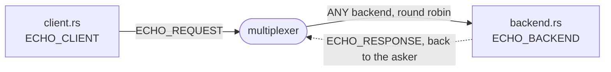

# echo-rust

The echo example in Rust: the backend and the client of
[examples/echo](../echo/) on the crate `mx-multiplexer`. `backend.rs` is a
`BaseMultiplexerServer` that upper-cases whatever it is asked and drains on
`SIGTERM`, `client.rs` a `SyncClient` that asks once and prints the
answer. They work with the Python and C++ backends and clients of
examples/echo as with each other, since the wire is the same; `echo.rules`
is that example's. A Cargo workspace of its own, which takes the crate from
this repository; [walkthrough.md](walkthrough.md) builds it from nothing,
runs it, and walks through its test.

```
./test.sh                                                        # the end-to-end test, with cargo
mxcontrol run_multiplexer --address 127.0.0.1:1980 --rules $PWD/echo.rules
cargo run --bin backend                                          # in another terminal
cargo run --bin client -- 127.0.0.1:1980 "hello multiplexer"     # in a third
```

`mxcontrol` is the multiplexer's command: `pip install mx-multiplexer`
puts it on the path, as the Debian package does, and in this repository
`bazel build //mxcontrol` builds it as `bazel-bin/mxcontrol/mxcontrol`,
which `test.sh` uses unless `MXCONTROL` names another. cargo comes from
rustup, Rust 1.85 or newer.

The backend prints `ready` once it is connected, the client prints the
answer, `HELLO MULTIPLEXER`. Asked to leave, `SIGTERM` or Ctrl-C, the
backend drains for five seconds as the last resort of its type ([how a
backend leaves](../../docs/leaving.md#what-a-draining-backend-still-takes)):
beside another backend the multiplexers route it nothing new, and alone it
keeps serving to the end, so a rolling restart costs no client a request
either way.

## The peers

A client and a backend, each connected to the multiplexer; one rule in
`echo.rules` sends every `ECHO_REQUEST` to `ANY` backend, round robin, and
the reply goes back to the client that asked. The walkthrough draws the
exchange.



## What is what

- `echo.rules`: examples/echo's rules file: the system rules, then
  `ECHO_BACKEND`, `ECHO_CLIENT`, `ECHO_REQUEST` routed to any backend, and
  `ECHO_RESPONSE`.
- `multiplexer_constants.rs`: the constants of `echo.rules`, generated by
  `mxcontrol generate_constants echo.rules --rust multiplexer_constants.rs`
  and committed.
- `backend.rs`: the backend, a `BaseMultiplexerServer`, with the
  five-second drain on `SIGTERM`.
- `client.rs`: the client, one query.
- `echo_test.rs`: the end-to-end test, the binaries against a multiplexer
  of its own; `test.sh` runs it.
- `Cargo.toml`: the two programs and the test, the crate from this
  repository, and libc for the backend's signals.
