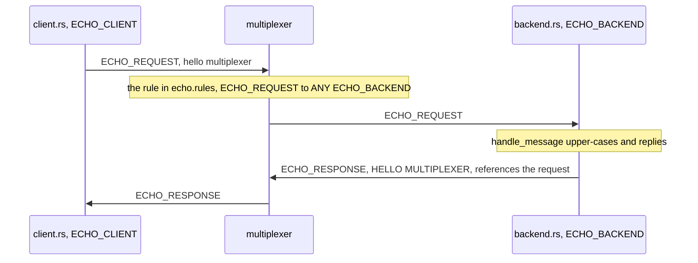

# Building the echo example in Rust, step by step

This page builds the example from nothing: the rules file, the generated
constants, the manifest, the backend and the client, every line shown as
it is added, then runs it, makes the backend leave, and walks through the
test. Every code block naming a file is that file in this directory, and
`examples/check_walkthroughs.py` keeps them identical, so what you read
here is what runs; the output shown comes from a real run, the time, the
host's name and the checkout's path left out. [README.md](README.md) is
the front door.

You need the multiplexer's command, `mxcontrol`, from `pip install
mx-multiplexer`, the Debian package or this repository's `bazel build
//mxcontrol`, and cargo from rustup, Rust 1.89 or newer. The first build
fetches the crate's dependencies from crates.io: mio, prost, bytes, libc
and log, and what prost's derive macro needs while it compiles.

## 1. The rules file

`echo.rules` is examples/echo's: the system rules every rules file starts
from, which `mxcontrol generate_rules echo.rules` wrote and which are left
out here, then the example's own part. A backend type and a passive
client type, since the client is a `SyncClient`, which runs the loop only
inside its calls; a request type routed to `ANY` backend, round robin; and
a reply type with no rule, since a reply is addressed to the client that
asked.

```protobuf file=echo.rules from="# The echo example:"
# The echo example: a backend that answers ECHO_REQUEST, and a passive client.

peer {
    type: 300
    name: "ECHO_BACKEND"
}

peer {
    type: 301
    name: "ECHO_CLIENT"
    is_passive: true
}

type {
    type: 300
    name: "ECHO_REQUEST"
    to {
        peer: "ECHO_BACKEND"
        whom: ANY
    }
}

type {
    type: 301
    name: "ECHO_RESPONSE"
}
```

## 2. The constants

A program names the types by the rules file's names: `mxcontrol
generate_constants` writes them as a Rust module, committed beside the
code and written again when the rules change.

```
mxcontrol generate_constants echo.rules --rust multiplexer_constants.rs
```

`multiplexer_constants.rs` holds the modules `types` and `peers`, each
with a `get_name()` that maps a number back to its name, and
`RULES_FINGERPRINT`, the rules file's CRC-32, which a running
multiplexer reports too:

```rust
pub mod types {
    ...
    pub const ECHO_REQUEST: u32 = 300;
    pub const ECHO_RESPONSE: u32 = 301;
    ...
}
```

## 3. The manifest

A Cargo workspace of its own, the two programs and the test at its top,
the crate from this repository by path; a program of yours takes it from
crates.io or from git ([docs/api_rust.md](../../docs/api_rust.md)). Its
`[lints]` makes an `unsafe` block without its SAFETY comment an error of
clippy's, as every manifest in this repository does; the backend has two
such blocks.

```toml file=Cargo.toml
# The echo example in Rust: the backend and the client of examples/echo on
# the crate mx-multiplexer, which this workspace takes from the repository;
# a program of yours takes it from crates.io or from git
# (docs/api_rust.md). A Cargo workspace of its own, the files at its top as
# examples/echo has them. libc is for the backend's signals, the one crate
# beside the library, which depends on it already.
[package]
name = "echo-rust"
version = "0.0.0"
edition = "2021"
publish = false

[[bin]]
name = "backend"
path = "backend.rs"

[[bin]]
name = "client"
path = "client.rs"

[[test]]
name = "echo_test"
path = "echo_test.rs"

[dependencies]
libc = "0.2"
mx-multiplexer = { path = "../../rust/mx-multiplexer" }

# Beyond clippy's defaults, in every cargo clippy, check.sh's, CI's or an
# editor's: an unsafe block without its SAFETY comment is an error.
[lints.clippy]
undocumented_unsafe_blocks = "deny"

[workspace]
```

## 4. The backend

A backend is a `Handler`, served here by `BaseMultiplexerServer`, which
runs the loop and the handler on the thread that calls `serve_forever()`,
one request at a time.

```rust file=backend.rs
//! Echo backend in Rust: answers every ECHO_REQUEST with the upper-cased
//! payload, the backend of examples/echo on the crate mx-multiplexer.
//!
//! Usage: backend [host:port]     (default 127.0.0.1:1980)
//!
//! SIGTERM or SIGINT asks the backend to leave. The library installs no
//! signal handler: the signals are blocked in every thread, and a thread of
//! the program's waits for them with sigwait and starts the drain through
//! the server's handle, which any thread may call.

use std::time::Duration;

use mx_multiplexer::{direct_only_routing, BaseMultiplexerServer, Handler, HandlerResult, Request};

mod multiplexer_constants; // generated from echo.rules
use multiplexer_constants::{peers, types};

```

The handler upper-cases the payload and replies: `reply()` addresses the
answer to the client that asked and makes it reference the request's id,
which is how the client knows it is the answer to its question. A handler
that returned an error, or panicked, would get the client a
`BACKEND_ERROR` saying so, at once.

```rust file=backend.rs
/// Upper-cases what it is asked.
struct Echo;

impl Handler for Echo {
    fn handle_message(&self, request: Request) -> HandlerResult {
        request.reply(types::ECHO_RESPONSE, request.payload().to_ascii_uppercase())?;
        Ok(())
    }
}

```

`main` blocks the signals that ask the backend to leave before anything
starts a thread, then builds the server: its drain routing is the last
resort of the type, so that during the drain the multiplexers route it
nothing new while another backend of its type is there, and everything
while none is. `connect()` waits for the handshake, so that `ready` means
reachable. A thread of the program's waits for `SIGTERM` or `SIGINT` and
starts the drain through the server's handle, which any thread may use;
`serve_forever()` returns once the drain is over, five seconds at most,
and the program ends with 0.

```rust file=backend.rs
fn main() -> Result<(), Box<dyn std::error::Error>> {
    let signals = block_leave_signals(); // before any thread starts, so that each has them blocked
    let address = std::env::args().nth(1).unwrap_or_else(|| "127.0.0.1:1980".to_string());
    // The drain as the last resort of the type: alone, the backend keeps
    // serving through it; beside another, it gets nothing new.
    let mut routing = direct_only_routing();
    routing.last_resort = true;
    let mut server =
        BaseMultiplexerServer::builder(peers::ECHO_BACKEND, [address]).drain_routing(routing).build(Echo)?;
    // The echo test reads "ready" and queries at once, so the line must mean
    // reachable: connect() first; serve_forever() would otherwise.
    server.connect()?;
    println!("ready");
    let handle = server.handle();
    std::thread::spawn(move || {
        wait_for(&signals);
        handle.start_draining();
    });
    // Drain for five seconds once asked, as the last resort: while another
    // backend is there the multiplexers route nothing new here, and alone
    // this one keeps serving to the end. A rolling restart costs nobody a
    // request.
    server.serve_forever(Duration::from_millis(500), Some(Duration::from_secs(5)))?;
    Ok(())
}

```

The library installs no signal handler. Blocked in every thread, the
signals wait for `sigwait`, on the thread that asked for them, rather than
interrupt whichever thread they land on; `libc` gives the three calls.

```rust file=backend.rs
/// Blocks SIGTERM and SIGINT in this thread, and so in every thread it
/// starts from now on, for `wait_for` to take them; returns the set.
fn block_leave_signals() -> libc::sigset_t {
    // SAFETY: the set is made empty by sigemptyset before it is used.
    unsafe {
        let mut signals: libc::sigset_t = std::mem::zeroed();
        libc::sigemptyset(&mut signals);
        libc::sigaddset(&mut signals, libc::SIGTERM);
        libc::sigaddset(&mut signals, libc::SIGINT);
        libc::pthread_sigmask(libc::SIG_BLOCK, &signals, std::ptr::null_mut());
        signals
    }
}

/// Waits until one of `signals` comes.
fn wait_for(signals: &libc::sigset_t) {
    let mut signal = 0;
    // SAFETY: sigwait reads the set and writes the signal's number.
    unsafe {
        libc::sigwait(signals, &mut signal);
    }
}
```

## 5. The client

A `SyncClient`, connected to the one address, sends one `ECHO_REQUEST`
and prints the answer. `wait()` returns the reply, or why there is none,
each an `Error` variant the client says in words.

```rust file=client.rs
//! Echo client in Rust: sends one ECHO_REQUEST and prints the answer, the
//! client of examples/echo on the crate mx-multiplexer.
//!
//! Usage: client [host:port] [text]     (default 127.0.0.1:1980 "hello multiplexer")

use std::process::ExitCode;
use std::time::Duration;

use mx_multiplexer::{Error, SyncClient};

mod multiplexer_constants; // generated from echo.rules
use multiplexer_constants::{peers, types};

fn main() -> ExitCode {
    let mut args = std::env::args().skip(1);
    let address = args.next().unwrap_or_else(|| "127.0.0.1:1980".to_string());
    let text = args.next().unwrap_or_else(|| "hello multiplexer".to_string());
    // host:port, or [address]:port for an IPv6 one; one that does not parse
    // is refused here, before anything connects.
    let mut client = match SyncClient::builder(peers::ECHO_CLIENT).connect([address]) {
        Ok(client) => client,
        Err(error) => {
            eprintln!("{error}");
            return ExitCode::FAILURE;
        }
    };
    // wait() sends the request through one connection and returns the
    // reply, or why there is none: OperationFailed when no backend of the
    // type is connected anywhere, OperationTimedOut when nothing answered.
    match client.query(types::ECHO_REQUEST, text).timeout(Duration::from_secs(10)).wait() {
        Ok(reply) => {
            println!("{}", String::from_utf8_lossy(&reply.message.payload));
            ExitCode::SUCCESS
        }
        Err(Error::OperationFailed) => {
            eprintln!("no ECHO_BACKEND is connected");
            ExitCode::FAILURE
        }
        Err(Error::OperationTimedOut) => {
            eprintln!("no answer within the timeout");
            ExitCode::FAILURE
        }
        Err(error) => {
            eprintln!("{error}");
            ExitCode::FAILURE
        }
    }
}
```

## 6. Running it

Open three terminals in `examples/echo-rust`. In the first, the
multiplexer; its log goes to stderr, one line per entry, the rules it
loaded, with their fingerprint, then the address:

```
mxcontrol run_multiplexer --address 127.0.0.1:1980 --rules $PWD/echo.rules
```

```
[INFO]  ts=…  pid=101436  ctx=….mxcontrol.run_multiplexer.multiplexer.server  flw=""  txt="rules loaded from …/examples/echo-rust/echo.rules: cf6eea04, 19 message types, 7 peer types"  from=multiplexer/server.cc:1086
[INFO]  ts=…  pid=101436  ctx=….mxcontrol.run_multiplexer  flw=""  txt="starting MX server on 127.0.0.1:1980"  from=mxcontrol/start_multiplexer_server.cc:178
```

In the second, the backend. cargo builds it and says what it runs, on
stderr; the backend prints `ready` once connected:

```
cargo run --bin backend
```

```
    Finished `dev` profile [unoptimized + debuginfo] target(s) in 0.00s
     Running `target/debug/backend`
ready
```

and the multiplexer logs the other side of the handshake, the backend's
instance id and its peer type from the rules file:

```
[INFO]  ...  txt="registered connection id=4350552090795566900 type=300 ('ECHO_BACKEND')"  ...
```

In the third, the client:

```
cargo run --bin client -- 127.0.0.1:1980 "hello multiplexer"
```

```
    Finished `dev` profile [unoptimized + debuginfo] target(s) in 0.00s
     Running `target/debug/client '127.0.0.1:1980' 'hello multiplexer'`
HELLO MULTIPLEXER
```

The multiplexer logs the client's connection and its end, the client
shutting down as it is dropped at the end of `main`:

```
[INFO]  ...  txt="registered connection id=13234868980303353625 type=301 ('ECHO_CLIENT')"  ...
[INFO]  ...  txt="unregistered connection id=13234868980303353625 type=301 ('ECHO_CLIENT')"  ...
```

The programs print nothing of their library's log: the crate logs through
the `log` facade, and a program that installs a logger sees its lines
([logging](../../docs/api_rust.md#logging)). The multiplexer tells anyone
who asks which rules it has in use, with the fingerprint the constants
carry:

```
$ mxcontrol rules status -M 127.0.0.1:1980
multiplexer 17639160489000666773: rules cf6eea04 (19 message types, 7 peer types) from …/examples/echo-rust/echo.rules, loaded …
```

## 7. What just happened



1. The client's query wrapped the text in a message of type
   `ECHO_REQUEST` and sent it to the multiplexer.
2. The rules file says `ECHO_REQUEST` goes to one `ECHO_BACKEND`, so the
   multiplexer forwarded it to the backend.
3. The backend's handler upper-cased the payload and replied, the reply
   addressed to the client's instance id and referencing the request's id.
4. The multiplexer delivered the reply straight to the client, and
   `wait()` returned it because the id matched.

[How a query is answered](../../docs/query.md) draws these steps, and what
happens when the backend fails or there is none.

## 8. The backend leaves

`SIGTERM` to the backend, or Ctrl-C in its terminal, starts the drain.
Alone, it is the last resort of its type, so a client asking during the
drain is still answered:

```
cargo run --bin client -- 127.0.0.1:1980 "during the drain"
```

```
    Finished `dev` profile [unoptimized + debuginfo] target(s) in 0.00s
     Running `target/debug/client '127.0.0.1:1980' 'during the drain'`
DURING THE DRAIN
```

Five seconds after the signal the drain is over, `serve_forever()`
returns, and the backend ends with 0; the multiplexer logs its connection
closing:

```
[INFO]  ...  txt="unregistered connection id=4350552090795566900 type=300 ('ECHO_BACKEND')"  ...
```

Asked now, with no backend anywhere, the client fails at once, with exit
code 1, rather than waiting for its timeout:

```
cargo run --bin client -- 127.0.0.1:1980 "nobody left"
```

```
    Finished `dev` profile [unoptimized + debuginfo] target(s) in 0.00s
     Running `target/debug/client '127.0.0.1:1980' 'nobody left'`
no ECHO_BACKEND is connected
```

and the multiplexer says why it could not route the request:

```
[ERROR]  ...  txt="routing while none present of type 300 (ECHO_BACKEND)"  ...
```

With a second backend running, the one asked to leave gets nothing new
during its drain and the other answers, so a rolling restart costs no
client a request ([how a backend leaves](../../docs/leaving.md)).

## 9. The test

`./test.sh` runs `cargo test` against the multiplexer `MXCONTROL` names,
or this repository's, built with Bazel. The test runs the two binaries,
which cargo builds for it, against a multiplexer it starts for each test
on a port the system picks, as examples/echo's `echo_test.py` does: the
backend read `ready` before anything asks, the client's output compared;
then `SIGTERM`, a query answered during the drain, and the backend's end
with 0. Every process it starts is killed when the test ends, however it
ends.

```rust file=echo_test.rs
//! The echo example end to end, as examples/echo's echo_test.py runs its
//! binaries: a multiplexer started for each test with echo.rules, on a port
//! the system picks; the backend, read "ready" before anything asks; the
//! client asking. Then the backend asked to leave with SIGTERM: alone, the
//! last resort of its type, it answers through its drain and leaves after
//! it with 0. The multiplexer is `$MXCONTROL`, or `mxcontrol` on the PATH.

use std::io::{BufRead, BufReader};
use std::path::PathBuf;
use std::process::{Child, Command, Stdio};
use std::time::{Duration, Instant};

/// A process the test started, killed when the test ends, however it ends.
struct Running(Child);

impl Drop for Running {
    fn drop(&mut self) {
        let _ = self.0.kill();
        let _ = self.0.wait();
    }
}

/// A directory of this test's own, for the port file.
fn scratch(name: &str) -> PathBuf {
    let directory = std::env::temp_dir().join(format!("echo-rust-{}-{name}", std::process::id()));
    std::fs::create_dir_all(&directory).expect("a scratch directory");
    directory
}

/// A multiplexer with echo.rules on a port the system picks, and its
/// address once it wrote it: 15 s at most, a bound that only detects a
/// failure.
fn multiplexer(name: &str) -> (Running, String) {
    let directory = scratch(name);
    let port_file = directory.join("port");
    let _ = std::fs::remove_file(&port_file);
    let mxcontrol = std::env::var_os("MXCONTROL").unwrap_or_else(|| "mxcontrol".into());
    let child = Command::new(mxcontrol)
        .args(["run_multiplexer", "--address", "127.0.0.1:0", "--rules"])
        .arg(PathBuf::from(env!("CARGO_MANIFEST_DIR")).join("echo.rules"))
        .arg("--port-file")
        .arg(&port_file)
        .stdout(Stdio::null())
        .stderr(Stdio::null())
        .spawn()
        .expect("mxcontrol runs: set MXCONTROL, as test.sh does");
    let running = Running(child);
    let until = Instant::now() + Duration::from_secs(15);
    loop {
        if let Ok(address) = std::fs::read_to_string(&port_file) {
            if !address.trim().is_empty() {
                let _ = std::fs::remove_dir_all(&directory);
                return (running, address.trim().to_string());
            }
        }
        assert!(Instant::now() < until, "the multiplexer wrote no port");
        std::thread::sleep(Duration::from_millis(20));
    }
}

/// The backend, once it printed "ready".
fn backend(address: &str) -> Running {
    let mut child = Command::new(env!("CARGO_BIN_EXE_backend"))
        .arg(address)
        .stdout(Stdio::piped())
        .spawn()
        .expect("the backend runs");
    let mut line = String::new();
    BufReader::new(child.stdout.take().expect("its stdout")).read_line(&mut line).expect("a line");
    assert_eq!("ready\n", line);
    Running(child)
}

/// What the client printed, asking `text`, and whether it succeeded.
fn ask(address: &str, text: &str) -> (bool, String) {
    let output = Command::new(env!("CARGO_BIN_EXE_client")).args([address, text]).output().expect("the client runs");
    (output.status.success(), String::from_utf8_lossy(&output.stdout).into_owned())
}

#[test]
fn the_client_gets_the_text_upper_cased_from_the_backend() {
    let (_mx, address) = multiplexer("query");
    let _backend = backend(&address);
    assert_eq!((true, "HELLO MULTIPLEXER\n".to_string()), ask(&address, "hello multiplexer"));
}

#[test]
fn the_last_backend_answers_through_its_drain_and_leaves_after_it() {
    let (_mx, address) = multiplexer("drain");
    let mut backend = backend(&address);
    let status = Command::new("kill").args(["-TERM", &backend.0.id().to_string()]).status().expect("kill runs");
    assert!(status.success());
    assert_eq!((true, "STILL HERE\n".to_string()), ask(&address, "still here"));
    let until = Instant::now() + Duration::from_secs(30);
    let code = loop {
        if let Some(status) = backend.0.try_wait().expect("the backend's status") {
            break status.code();
        }
        assert!(Instant::now() < until, "the backend did not leave after its drain");
        std::thread::sleep(Duration::from_millis(50));
    };
    assert_eq!(Some(0), code);
}
```

## What it does not do

- Several multiplexers. Each program takes one address; a client or a
  backend given several connects to all of them, and one that is down
  costs nothing ([operations](../../docs/operations.md)).
- A threaded or an async client. `ThreadedClient` runs the connections
  on a thread of its own, any thread may use it, and its calls are
  awaited on any executor; [a web server on
  tokio](../../docs/recipes/rust_web_server.md) shows it.
- Work. The handler upper-cases a few bytes, so what the client waits for
  is the broker and the two hops.

## Where to go next

- [Using the Rust library](../../docs/api_rust.md): the calls the example
  used and the rest of them.
- [The rules file](../../docs/rules.md): every field, what the reserved
  ranges are for.
- [Operations](../../docs/operations.md): several multiplexers, restarts,
  logs.
