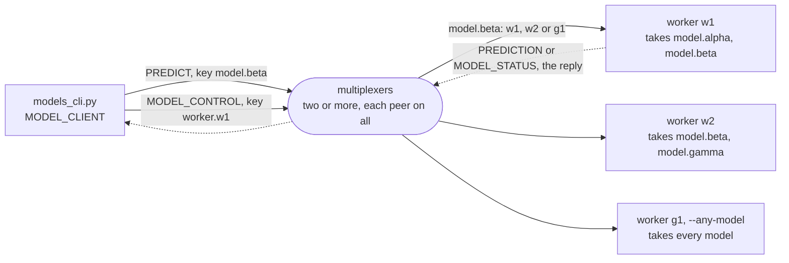

# models

A pool of workers that each hold some of a service's models, and
requests that go only to a worker that holds theirs. A request for a
prediction names its model in its key, `model.beta`, and each worker's
key filter for `PREDICT` lists the models it holds, so a multiplexer
routes the request round robin among the workers whose filter takes the
key ([keys](../../docs/keys.md)). A worker loads and unloads models
while it serves, told so by a request that names the worker in its key
the same way, `worker.w1`. It changes its filters and answers once every
multiplexer has them: after a load, the model's requests reach it; after
an unload, none is on its way any more, and the model is freed. A worker
started with `--any-model` has no filter for `PREDICT` and takes every
model, loading each on first use. The models are stand-ins that answer
at once, since the example is about where requests go.

The example is installed with pip: `mx-multiplexer` from PyPI, which
brings the multiplexer, `mxcontrol`, with it.
[walkthrough.md](walkthrough.md) builds it from nothing, every line of
the rules file, the worker and the command line explained as it is
added. It ends with the steps, a model nobody holds, one loaded, one
unloaded while its requests keep coming and a worker that takes every
model, and a walk through its test.

```
pip install -r requirements.txt
mxcontrol run_multiplexer --rules models.rules --address 127.0.0.1:1980   # the package's mxcontrol
mxcontrol run_multiplexer --rules models.rules --address 127.0.0.1:1981   # a second one, in another terminal
python worker.py 127.0.0.1:1980,127.0.0.1:1981 --name w1 --models alpha,beta     # a worker; w2 with beta,gamma
python models_cli.py 127.0.0.1:1980,127.0.0.1:1981 predict beta --repeat 4      # w1 and w2 answer
python models_cli.py 127.0.0.1:1980,127.0.0.1:1981 unload w1 beta              # once both multiplexers have it
```

From the answer to the unload on, every request for `beta` goes to w2,
and none fails while the model moves. `test.sh` runs the test in a
virtual environment against real multiplexers.

## The peers

Every peer connects to every multiplexer. Both rules route to `ANY`
worker whose key filter for the message's type takes its key; the reply
goes back to whoever asked. A worker's filter for `PREDICT` names the
models it holds, and its filter for `MODEL_CONTROL` its own name.



## What is what

- `models.rules`: the system rules, then `MODEL_CLIENT`, `MODEL_WORKER`,
  `PREDICT` and `MODEL_CONTROL` with their `ANY` rules, and
  `PREDICTION` and `MODEL_STATUS`, their replies;
  `multiplexer_constants.py` is what `mxcontrol generate_constants`
  wrote from it.
- `worker.py`: the keys, `Model`, a stand-in, and `Worker`, a
  `BaseMultiplexerServer` that sets its key filters before it connects,
  changes them as it loads and unloads, and answers a change from its
  `on_acknowledged`, once every multiplexer has it and every request
  routed before has been served.
- `models_cli.py`: the command line the steps use.
- `test.py`, `test.sh`: the test on the harness, and the script that
  makes a venv and runs it.
