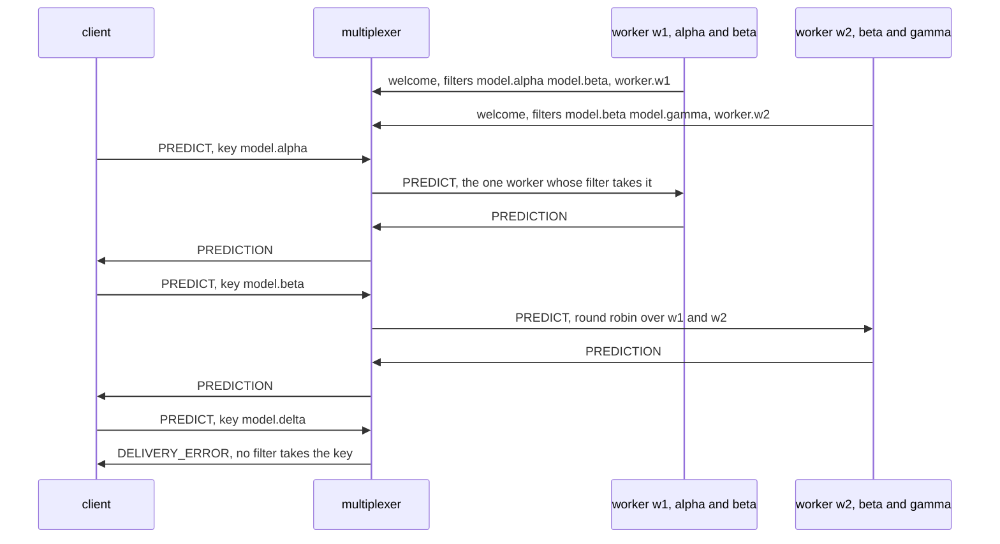
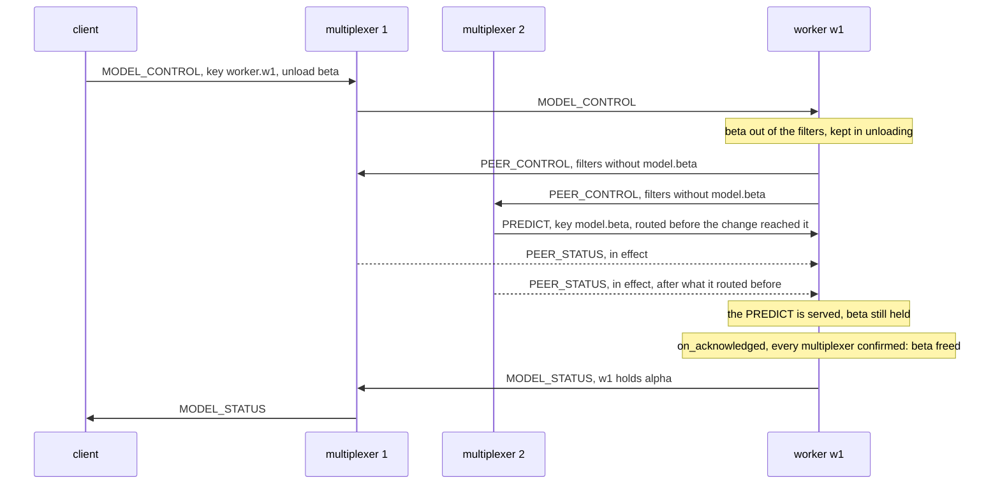

# Building the model workers, step by step

This page builds the example from nothing: the rules file, the worker
and the command line, in that order, with every line of those files
shown as it is added. Every code block is a piece of a file in this
directory, and `examples/check_walkthroughs.py` keeps them identical to
the files, so what you read here is what runs. [README.md](README.md) is
the front door: what the example is, a picture of its peers, and how to
run it. How the messages go, drawn, the steps, the test and what the
example does not do are at the end of this page.

The idea in one sentence: a request says in its key which model it is
for, and each worker says in its key filter which models it holds, so
the multiplexers send a request only to a worker that can answer it; a
worker that unloads a model waits for every multiplexer to confirm its
new filter before it frees the model, since until then requests for it
may still be on their way. [Keys](../../docs/keys.md) describes keys and
filters in general.

## 1. The rules file

The file opens with the system rules every rules file starts from, the
protocol's own types 1 to 99 and the six the libraries and `mxcontrol`
use by name ([docs/rules.md](../../docs/rules.md)), which `mxcontrol
generate_rules models.rules` wrote; they are left out here. Then the
example's two peer types: `MODEL_CLIENT` for whoever asks, the command
line here, and `MODEL_WORKER` for the workers. Neither is marked
`is_passive`: the command line is built on `ThreadedClient`, whose io
thread runs the library's loop all the time, and the worker on a server
class, which runs it between its handlers.

```protobuf file=models.rules from="# The example's peers and messages."
# The example's peers and messages.

peer {
    type: 201
    name: "MODEL_CLIENT"
    comment: "whoever asks for predictions or tells a worker what to hold: the command line"
}

peer {
    type: 202
    name: "MODEL_WORKER"
    comment: "a backend on BaseMultiplexerServer holding some models, its key filters naming them and itself; run as many as you like"
}

```

`PREDICT` is the request for a prediction, routed to `ANY` one worker,
and `PREDICTION` its reply, which needs no rule: a reply is addressed to
the peer that asked. The rule says nothing about models. Which worker
may take which request is the workers' to say, in their key filters, so
the rules file is the one it would be without keys, and the pool can
change what it holds without a change to it.

```protobuf file=models.rules
type {
    type: 301
    name: "PREDICT"
    comment: "a request, key model.NAME, payload the input as text; ANY worker whose key filter takes the key answers with PREDICTION"
    to {
        peer: "MODEL_WORKER"
        whom: ANY
    }
}

type {
    type: 302
    name: "PREDICTION"
    comment: "the reply to PREDICT, payload the answer and who gave it, as text"
}

```

`MODEL_CONTROL` asks one worker to load or unload a model, and
`MODEL_STATUS` is its answer. The request names the worker in its key,
`worker.w1`, the way `PREDICT` names a model, and each worker's filter
for `MODEL_CONTROL` takes its own name only. A worker's instance id
would reach it too, with `to`, but the id is new at every start and the
command line would have to find it first; a name is what an operator
knows. A name nobody runs is no special case: no filter takes the key,
and the multiplexer answers `DELIVERY_ERROR` at once, as it does for a
model nobody holds.

```protobuf file=models.rules
type {
    type: 303
    name: "MODEL_CONTROL"
    comment: "a request to one worker, key worker.NAME, payload load MODEL or unload MODEL as text; answered with MODEL_STATUS once every multiplexer has the worker's new filters"
    to {
        peer: "MODEL_WORKER"
        whom: ANY
    }
}

type {
    type: 304
    name: "MODEL_STATUS"
    comment: "the reply to MODEL_CONTROL, payload what the worker holds, as text"
}
```

With the file written, `mxcontrol generate_constants models.rules
--python multiplexer_constants.py --pyi multiplexer_constants.pyi`
writes the module the code below imports, so that it says
`types.PREDICT` rather than 301.

## 2. The keys and the model

[worker.py](worker.py) holds the keys, the model and the worker, and the
program that runs it. It opens with what it is and `NAME`, what a
model's or a worker's name may be: lower-case letters, digits, dots and
dashes, so that a name cannot carry a pattern's syntax into a key.

A key is plain text that the sender makes: `model.` and the model's
name, `worker.` and the worker's. A filter is a list of RE2 patterns,
each matched against the whole key, and `only()` makes the pattern that
takes one key and nothing else: `re.escape("model.beta")` is
`model\.beta`, the dot quoted, since a bare one would take any
character, `model-beta` too. RE2 reads Python's escapes as Python does,
and the multiplexer spots such a pattern as an exact key: it finds the
workers that list a key with one hash lookup, however many models the
pool holds.

```python file=worker.py
"""A model worker: a backend on `BaseMultiplexerServer` that holds some of
a service's models and answers `PREDICT` for them, its key filters naming
the models it holds and the worker itself.

    python worker.py [ADDRESSES] [--name NAME] [--models M1,M2,... | --any-model]

ADDRESSES is host:port of every multiplexer, comma-separated, default
127.0.0.1:1980. A PREDICT request names its model in its key, model.NAME,
and a multiplexer routes it only to a worker whose filter for PREDICT
takes the key: one that holds the model, or one started with --any-model,
which has no filter for PREDICT and so takes every model, loading each on
first use. A MODEL_CONTROL request names a worker in its key,
worker.NAME, and asks that worker to load or unload a model. The worker
answers once every multiplexer has its new filters and every request
routed under the old ones has been served, and only then frees a model
it unloaded: the rules route no request for it any more. One can still
come addressed, a query's last stage after a search the worker answered
just before the change, and gets an error, as a request for a model the
worker never held does."""

import argparse
import re
import socket
import sys

from multiplexer.endpoints import parse_endpoint
from multiplexer.Multiplexer_pb2 import MultiplexerMessage
from multiplexer.mxclient import ConnectionWrapper
from multiplexer.servers import BaseMultiplexerServer

from multiplexer_constants import peers, types

NAME = re.compile(r"[a-z0-9][a-z0-9.-]*")  # what a model's or a worker's name may be


def model_key(model: str) -> str:
    """The key of a request for `model`."""
    return "model." + model


def worker_key(name: str) -> str:
    """The key of a request to the worker named `name`."""
    return "worker." + name


def only(key: str) -> str:
    """The pattern that takes `key` and no other: a multiplexer matches a
    pattern against the whole key, and re.escape() quotes the dots and
    dashes that RE2, as Python, would read as syntax."""
    return re.escape(key)


```

The model is a stand-in. What the example is about is where a model is
held, so loading one takes nothing and its prediction is its input with
its name around it, which the steps can read. A real model loads its
weights in its constructor, which takes time and memory, and that is
why a worker holds some models and not all.

```python file=worker.py
class Model:
    """A stand-in for a model. What the example is about is where models
    are held, so loading one takes nothing and its prediction is its input,
    marked with its name. A real one loads its weights here, which is what
    makes a worker hold only some, and runs them in predict()."""

    def __init__(self, name: str):
        self.name = name

    def predict(self, text: str) -> str:
        """The answer to `text`."""
        return f"{self.name}({text})"


```

## 3. The worker

The worker is a `BaseMultiplexerServer`, the plain class: one thread
runs the loop, which reads a message, calls the handler, then calls
`periodic_task()`, and goes round again. It keeps two things: the
models it holds, by name, and the models it has unloaded but not yet
freed, `unloading`.

The constructor sets the key filters before anything connects, so that
the welcome each multiplexer gets carries them, and nothing reaches the
worker under no filter, which would be every key. `key_filters()` makes
them from what the worker holds. Its own name for `MODEL_CONTROL`. For
`PREDICT`, a pattern per model, and an empty list when it holds none:
an empty filter takes no key, where no filter at all takes every key.
That difference is the `--any-model` worker's: it has no filter for
`PREDICT`, and takes every model.

```python file=worker.py
class Worker(BaseMultiplexerServer):
    """Answers PREDICT for the models it holds, and MODEL_CONTROL addressed
    to it by name. Its key filters say which, from before it connects and
    then as it loads and unloads; a model it unloads it goes on serving
    until the change is acknowledged."""

    multiplexer_client_type = peers.MODEL_WORKER

    def __init__(self, addresses: list[tuple[str, int]], name: str, models: list[str] | None):
        """`models` are held from the start; None makes a worker that takes
        every model, loading each on first use."""
        super().__init__(addresses)
        self.name = name
        self.any_model = models is None
        self.models = {model: Model(model) for model in models or ()}
        # Unloaded and out of the filters, and still served: requests
        # routed under the old filters may be on their way until the
        # change is acknowledged.
        self.unloading: dict[str, Model] = {}
        self.served = 0
        self.ready_pending = False  # set by main(): "ready" is printed once a multiplexer welcomed the worker
        self.set_key_filters(self.key_filters())  # before connecting, so that the welcome carries them

    def key_filters(self) -> dict[int, list[str]]:
        """The filters for what the worker holds now: its name for
        MODEL_CONTROL, and for PREDICT the models it holds, an empty list
        when it holds none, which takes no key. A worker that takes every
        model has no filter for PREDICT."""
        filters = {types.MODEL_CONTROL: [only(worker_key(self.name))]}
        if not self.any_model:
            filters[types.PREDICT] = [only(model_key(model)) for model in sorted(self.models)]
        return filters

```

A prediction takes its model from the key. The model is one the worker
holds, or one it has unloaded and not yet freed: a request routed before
the multiplexers had the new filter is served all the same. A worker
that takes every model loads one it does not hold, on first use. A
request no model answers, one without a key, or one addressed to this
worker with `to`, which ignores filters, gets `BACKEND_ERROR`, so that
its sender learns at once rather than at its timeout.

```python file=worker.py
    def handle_message(self, mxmsg: MultiplexerMessage) -> None:
        """A prediction, or a change of what the worker holds."""
        if mxmsg.type == types.PREDICT:
            self.predict(mxmsg)
        elif mxmsg.type == types.MODEL_CONTROL:
            self.control(mxmsg)
        else:
            self.no_response()

    def predict(self, mxmsg: MultiplexerMessage) -> None:
        """Answer with the model the key names: one held, one being
        unloaded, or, for a worker that takes every model, one loaded now."""
        name = mxmsg.key.removeprefix("model.")
        model = self.models.get(name) or self.unloading.get(name)
        if model is None and self.any_model and mxmsg.key == model_key(name) and NAME.fullmatch(name):
            model = self.models[name] = Model(name)
        if model is None:  # no key, or a request sent here with `to`
            self.report_error(f"{self.name} holds no model for the key {mxmsg.key!r}")
            return
        self.served += 1
        answer = model.predict(mxmsg.message.decode())
        self.send_message(message=f"{answer} by {self.name}", type=types.PREDICTION)

```

A change loads or unloads a model and sets the filters again.
`set_key_filters()` replaces the filters whole, and tells every
multiplexer the new ones with `PEER_CONTROL`; each answers with
`PEER_STATUS` once they are in effect there, after everything it
routed under the old ones. A model unloaded goes to `unloading`, not
away. The handler does not answer: `no_response()` says so, and the
answer waits for the change's acknowledgement, which `on_acknowledged`
brings.

```python file=worker.py
    def control(self, mxmsg: MultiplexerMessage) -> None:
        """Load or unload a model and change the filters to match; the
        answer waits for the change's acknowledgement (acknowledged())."""
        action, _, name = mxmsg.message.decode().partition(" ")
        if action not in ("load", "unload") or not NAME.fullmatch(name):
            self.report_error(f"{self.name} knows load MODEL and unload MODEL, not {mxmsg.message.decode()!r}")
            return
        unloaded = None
        if action == "load" and name not in self.models:
            self.models[name] = self.unloading.pop(name, None) or Model(name)
        elif action == "unload" and name in self.models:
            unloaded = self.unloading[name] = self.models.pop(name)
        connection = self.last_connwrap  # the request's, for the answer
        self.set_key_filters(self.key_filters(), on_acknowledged=lambda: self.acknowledged(mxmsg, connection, unloaded))
        self.no_response()

```

`acknowledged()` is the change's `on_acknowledged`. The library calls
it on the loop's thread, between two messages, once every multiplexer
has confirmed the filters and every request routed under the old ones
has been handled: no multiplexer routes a request for an unloaded model
here any more, and none waits in the worker. That is the moment to free
the model, unless a load since took it back, and to answer the change,
in effect everywhere now. One request for the model can still come,
addressed: a query's last stage, after a search the worker answered just
before the change, which `to` brings whatever the filters
([keys](../../docs/keys.md)). `predict()` answers it with an error, so
that the query fails at once rather than at its timeout.

Outside a handler `send_message()` has no request to reply to, so the
answer names the peer that asked, the request, and the connection the
request came on, which `control()` kept: while it lives the answer goes
that way, as a reply does, and through another live one otherwise. Sent
round robin instead, it could leave through a multiplexer the asker is
not connected to, which would drop it. Each change brings its own
callback, so two in a row each answer their own request and free their
own model. The confirmation also ends the serve loop's wait for a
message, so the answer comes within milliseconds, not at the next poll.

```python file=worker.py
    def acknowledged(
        self, request: MultiplexerMessage, connection: ConnectionWrapper | None, unloaded: Model | None
    ) -> None:
        """The change `request` asked for is acknowledged: every
        multiplexer has the filters, and every request routed under the
        old ones has been served. A model it unloaded is freed, unless a
        load since took it back, since the rules route none of its
        requests any more; and the change is answered, in effect
        everywhere now, through `connection`, the one the request came
        on, while it lives, as a reply goes. On the loop's thread, between
        two messages."""
        if unloaded is not None and self.unloading.get(unloaded.name) is unloaded:
            del self.unloading[unloaded.name]
        self.send_message(
            message=self.holding(),
            type=types.MODEL_STATUS,
            to=request.sender,
            references=request.id,
            workflow=request.workflow,
            multiplexer=connection,
        )

    def holding(self) -> str:
        """What the worker holds, as MODEL_STATUS says it."""
        held = ", ".join(sorted(self.models)) or "no model"
        if self.any_model:
            return f"{self.name} takes every model, holds {held}"
        return f"{self.name} holds {held}"

```

The line the steps and the test's programs wait for, `ready`, is the
program's: `main()` asks for it, and it means that a multiplexer has
welcomed the worker, its filters with it. It comes right after
connecting, when that found one; otherwise from `periodic_task()`,
which the serve loop calls at least once a second, once a reconnect
has. A worker the test serves on a thread prints nothing.

```python file=worker.py
    def say_ready_once_connected(self) -> None:
        """Print the "ready" main() asked for, with what the worker holds,
        once a multiplexer has welcomed the worker: whoever runs the steps,
        and the test, wait for the line and then send, so it must mean
        reachable."""
        if self.ready_pending and self.conn.connections_count() > 0:
            print(f"ready: {self.holding()}", flush=True)
            self.ready_pending = False

    def periodic_task(self) -> None:
        """Say "ready" once a multiplexer welcomed the worker, if none had
        when main() connected; at least once a second."""
        self.say_ready_once_connected()


```

## 4. The program

`main()` reads the worker's name, its host name by default, and the
models it holds from the start, or `--any-model`, and refuses a name
outside `NAME`. It connects before it says it is ready, so that the line
means the worker is registered with every multiplexer it could reach,
its filters with it: whoever waits for the line, the steps or the test,
may send at once. With none reachable it says so on stderr instead, and
the line comes later, from `periodic_task()`. Then it serves until it
is killed.

```python file=worker.py
def main() -> None:
    """Serve until killed."""
    parser = argparse.ArgumentParser(description=(__doc__ or "").split("\n\n")[0])
    parser.add_argument(
        "addresses", nargs="?", default="127.0.0.1:1980", help="host:port of every multiplexer, comma-separated"
    )
    parser.add_argument("--name", default=socket.gethostname().lower(), help="the worker's name; default the host's")
    held = parser.add_mutually_exclusive_group()
    held.add_argument("--models", default="", help="the models held from the start, comma-separated")
    held.add_argument(
        "--any-model", action="store_true", help="no filter for PREDICT: every model, loaded on first use"
    )
    args = parser.parse_args()
    models = None if args.any_model else [model for model in args.models.split(",") if model]
    for name in [args.name] + (models or []):
        if not NAME.fullmatch(name):
            parser.error(f"{name!r}: a name is lower-case letters, digits, dots and dashes")
    worker = Worker([parse_endpoint(text) for text in args.addresses.split(",")], args.name, models)
    # connect() waits for the handshakes, so that "ready" can come at once;
    # with no multiplexer reachable, the loop goes on trying and says it
    # once one welcomes the worker.
    worker.ready_pending = True
    worker.connect()
    worker.say_ready_once_connected()
    if worker.ready_pending:
        print("no multiplexer reachable yet; ready once one is", file=sys.stderr, flush=True)
    worker.serve_forever()


if __name__ == "__main__":
    main()
```

## 5. The command line

[models_cli.py](models_cli.py) is what the steps below use. `predict`
asks a model for predictions with a `ThreadedClient`, one request after
another, `--repeat` of them or as many as `--seconds` take, and prints
each answer with how long it took, or with `--tally` one line at the
end. The key is the only thing about the model that the request
carries; the text is the input. A query that fails says so and how:
`OperationFailed` when the multiplexers said that nobody takes the key,
`OperationTimedOut` when nothing came back in time.

```python file=models_cli.py
"""The command line the steps use: asks for predictions, one request after
another, and tells a worker to load or unload a model.

    python models_cli.py ADDRESSES predict MODEL [TEXT] [--repeat N | --seconds S] [--tally]
    python models_cli.py ADDRESSES load WORKER MODEL
    python models_cli.py ADDRESSES unload WORKER MODEL

ADDRESSES is host:port of every multiplexer, comma-separated. predict
asks N times, or again and again for S seconds, and prints each answer
and how long it took, or with --tally one line once all are in: how many
answers each worker gave, and how many requests failed. load and unload
print the worker's answer, which comes once every multiplexer has its new
filters. --timeout, before the command, is each stage's timeout."""

import argparse
import collections
import time

from multiplexer.endpoints import parse_endpoint
from multiplexer.mxclient import MultiplexerClientError
from multiplexer.threaded_client import BackendError, ThreadedClient

from multiplexer_constants import peers, types
from worker import model_key, worker_key


def predict(client: ThreadedClient, args: argparse.Namespace) -> None:
    """Ask `args.model` for predictions, one request after another:
    `args.repeat` of them, or as many as `args.seconds` take."""
    answered: collections.Counter[str] = collections.Counter()
    failed = 0
    deadline = time.monotonic() + args.seconds
    asked = 0
    while (time.monotonic() < deadline) if args.seconds else (asked < args.repeat):
        asked += 1
        started = time.monotonic()
        try:
            reply = client.query(args.text, type=types.PREDICT, key=model_key(args.model), timeout=args.timeout)
            answer = reply.message.decode()
            answered[answer.rsplit(" by ", 1)[1]] += 1
        except (MultiplexerClientError, BackendError) as error:
            answer = f"failed: {type(error).__name__}"
            failed += 1
        if not args.tally:
            print(f"{answer}, in {time.monotonic() - started:.1f} s", flush=True)
    if args.tally:
        workers = ", ".join(f"{worker} {count}" for worker, count in sorted(answered.items()))
        print(f"{answered.total()} answers, {workers or 'from nobody'}; {failed} failed", flush=True)


```

`load` and `unload` send `MODEL_CONTROL` keyed with the worker's name,
and print its answer, which comes once every multiplexer has the
worker's new filters. `--timeout`, before the command, is each stage's
timeout.

```python file=models_cli.py
def control(client: ThreadedClient, args: argparse.Namespace) -> None:
    """Ask the worker `args.worker` to load or unload `args.model`."""
    started = time.monotonic()
    try:
        request = f"{args.command} {args.model}"
        reply = client.query(request, type=types.MODEL_CONTROL, key=worker_key(args.worker), timeout=args.timeout)
        answer = reply.message.decode()
    except (MultiplexerClientError, BackendError) as error:
        answer = f"failed: {type(error).__name__}"
    print(f"{answer}, in {time.monotonic() - started:.1f} s", flush=True)


def main() -> None:
    """One command."""
    parser = argparse.ArgumentParser(description=(__doc__ or "").split("\n\n")[0])
    parser.add_argument("addresses", help="host:port of every multiplexer, comma-separated")
    parser.add_argument("--timeout", type=float, default=10.0, help="each stage's timeout, in seconds")
    commands = parser.add_subparsers(dest="command", required=True)
    asking = commands.add_parser("predict", help="ask a model for a prediction")
    asking.add_argument("model")
    asking.add_argument("text", nargs="?", default="hello")
    how_many = asking.add_mutually_exclusive_group()
    how_many.add_argument("--repeat", type=int, default=1, help="how many requests, one after another")
    how_many.add_argument("--seconds", type=float, default=0.0, help="ask again and again for this long instead")
    asking.add_argument("--tally", action="store_true", help="one line at the end instead of one per answer")
    for command in ("load", "unload"):
        changing = commands.add_parser(command, help=f"ask a worker to {command} a model")
        changing.add_argument("worker")
        changing.add_argument("model")
    args = parser.parse_args()
    addresses = [parse_endpoint(text) for text in args.addresses.split(",")]
    with ThreadedClient(addresses, type=peers.MODEL_CLIENT) as client:
        (predict if args.command == "predict" else control)(client, args)


if __name__ == "__main__":
    main()
```

## 6. What is left

[test.py](test.py) runs all of it against real multiplexers, which
"Testing it with the harness" below walks through, and `test.sh` runs
the test in a virtual environment with `requirements.txt`, the library
alone. The steps below hold no surprise but one: requests keep coming
while a model moves, and none fails.

## How it fits together

A worker's filters reach every multiplexer in its welcome. A request
names its model in its key, and a multiplexer offers it round robin to
the workers whose filter takes the key; with none, it answers
`DELIVERY_ERROR` at once, and the query fails without waiting for its
timeout.



An unload is answered once every multiplexer has the new filters. A
multiplexer may route the worker a request for the model after the
worker changed its mind and before the `PEER_CONTROL` reached it; that
request arrives before the multiplexer's `PEER_STATUS`, since both come
down one connection in order, and the worker still has the model to
serve it with. The answer, and the freeing, wait for the last
confirmation.



## The steps

Two multiplexers on ports 1980 and 1981, and two workers, w1 holding
alpha and beta and w2 holding beta and gamma, all on one machine, with
the library and the multiplexer built from this repository's tree. Each
command's output is what the last run printed; the library's own log
lines go to stderr and are left out.

```
$ mxcontrol run_multiplexer --rules models.rules --address 127.0.0.1:1980 > mx1.log 2>&1 & echo $! > mx1.pid
$ mxcontrol run_multiplexer --rules models.rules --address 127.0.0.1:1981 > mx2.log 2>&1 & echo $! > mx2.pid
$ mx=127.0.0.1:1980,127.0.0.1:1981
$ python worker.py $mx --name w1 --models alpha,beta > w1.log 2>&1 & echo $! > w1.pid
$ python worker.py $mx --name w2 --models beta,gamma > w2.log 2>&1 & echo $! > w2.pid
$ grep ready w1.log w2.log
w1.log:ready: w1 holds alpha, beta
w2.log:ready: w2 holds beta, gamma
```

**1. Each model to the workers that hold it.** Only w1 holds alpha and
only w2 gamma, so each answers every request for its model. Both hold
beta, and each multiplexer offers beta's requests to the two in turn.
The client sends its queries through the two multiplexers in turn as
well, which is why the answers come in pairs.

```
$ python models_cli.py $mx predict alpha --repeat 2
alpha(hello) by w1, in 0.0 s
alpha(hello) by w1, in 0.0 s
$ python models_cli.py $mx predict gamma --repeat 2
gamma(hello) by w2, in 0.0 s
gamma(hello) by w2, in 0.0 s
$ python models_cli.py $mx predict beta --repeat 4
beta(hello) by w1, in 0.0 s
beta(hello) by w1, in 0.0 s
beta(hello) by w2, in 0.0 s
beta(hello) by w2, in 0.0 s
```

**2. A model nobody holds.** No filter takes `model.delta`, so the
multiplexer answers `DELIVERY_ERROR` at once, and the query fails with
`OperationFailed` without waiting out its timeout. The multiplexer's
log says why, its first line of the kind naming the key:
`no key filter of a peer of type 202 (MODEL_WORKER) takes the key of a
message of type 301 (PREDICT), the first key "model.delta"`.

```
$ python models_cli.py $mx predict delta
failed: OperationFailed, in 0.0 s
```

**3. A model loaded.** w2 loads delta and answers once both
multiplexers have its new filters, within milliseconds: their
confirmations wake the worker's loop. From the answer on, delta's
requests go to w2. Each
multiplexer logs what the worker takes now: `peer … (MODEL_WORKER)
takes keys: type 301: "model\.beta" "model\.delta" "model\.gamma";
type 303: "worker\.w2"`.

```
$ python models_cli.py $mx load w2 delta
w2 holds beta, delta, gamma, in 0.0 s
$ python models_cli.py $mx predict delta --repeat 2
delta(hello) by w2, in 0.0 s
delta(hello) by w2, in 0.0 s
```

**4. A model unloaded while its requests keep coming.** One client asks
for beta for ten seconds, request after request, in the background; a
few seconds in, w1 unloads beta. The requests routed to w1 before the
change are served, the answer comes once both multiplexers have it, and
from then on every request for beta goes to w2. None of them failed.

```
$ python models_cli.py $mx predict beta --seconds 10 --tally > beta.out & echo $! > beta.pid
$ python models_cli.py $mx unload w1 beta
w1 holds alpha, in 0.0 s
$ wait $(cat beta.pid); cat beta.out
97463 answers, w1 13134, w2 84329; 0 failed
$ python models_cli.py $mx predict beta --repeat 4 --tally
4 answers, w2 4; 0 failed
```

**5. A worker that takes every model.** g1 has no filter for `PREDICT`.
It takes epsilon, which nobody holds, loading it on first use, and it
takes its turn with the workers that hold a model, w1 for alpha and w2
for delta, since a worker with no filter takes every key. A pool of
such workers behind a few that keep the busiest models loaded is a way
to serve any model at all; to keep a model away from them, they would
need filters too.

```
$ python worker.py $mx --name g1 --any-model > g1.log 2>&1 & echo $! > g1.pid
$ grep ready g1.log
ready: g1 takes every model, holds no model
$ python models_cli.py $mx predict epsilon --repeat 2
epsilon(hello) by g1, in 0.0 s
epsilon(hello) by g1, in 0.0 s
$ python models_cli.py $mx predict alpha --repeat 4 --tally
4 answers, g1 2, w1 2; 0 failed
$ python models_cli.py $mx predict delta --repeat 4 --tally
4 answers, g1 2, w2 2; 0 failed
```

Then everything stops:

```
$ kill $(cat g1.pid w1.pid w2.pid mx1.pid mx2.pid)
```

## Testing it with the harness

[test.py](test.py) is the example's test and a template for testing
key filters of your own; `multiplexer.testing` is what this repository's
own tests run on, and [docs/api_python.md](../../docs/api_python.md#testing)
lists all of it. What the test uses, in the order it appears:

- **`Cluster(2, rules=RULES)`** starts two real multiplexers on ports
  the system picked, from the `mxcontrol` the package installed, or the
  binary `MXCONTROL` names, reading the example's rules file. Cleanups,
  `addCleanup`, stop what was started even when a setup fails, in the
  reverse order.
- **`BackendThread(lambda: Worker(...)).start()`** builds a worker on a
  thread of its own, serves it there, and returns once it is registered
  with both multiplexers. Its welcome carried its filters, so a request
  sent the moment `start()` returns is routed by them.
- **A `ThreadedClient`** asks, its queries going through the two
  multiplexers in turn. `predict()` returns who answered each request,
  and the tests compare sets: which workers answered, not how often,
  so that the round robin's order is no reason to fail.
- **Where requests go.** alpha's reach only w1, gamma's only w2, and
  beta's both. w3 holds nothing, its filter empty, and takes nothing:
  delta's request fails with `OperationFailed`, as does a change for a
  worker nobody runs.
- **A model moved while requests keep coming.** w2 loads beta. Then a
  thread asks for beta, request after request, each marked with whether
  it was sent after the answer to the unload that follows; the test
  waits for twenty answers, has w1 unload beta, and waits for twenty
  more sent after the answer. Every wait counts answers, never time.
  None failed, w1 answered before the change, and only w2 after it.
- **A request routed under the old filter.** `UnloadTest` makes the
  race of the second diagram happen every time: one multiplexer, so
  that the client's messages reach the worker in the order sent, and a
  `HeldWorker`, whose first prediction waits until the test releases
  it. The unload and a second request for beta queue behind the held
  one, the second routed to w1 since w1 has not read the unload yet;
  released, w1 unloads, then serves the second request with the model
  it has not freed, and only then answers the unload.
- **A change answered the way it came.** A `SyncClient` on the first
  multiplexer only sends w1 two loads, one after the other, and gets
  both answers. Answered round robin over w1's two connections, one of
  them would leave through the second multiplexer, which drops a message
  for a peer it does not have, and the receive would time out.
- **A worker without a filter.** g1 takes epsilon, which nobody holds,
  and alpha in turn with w1; unloaded, epsilon is freed, and the next
  request loads it again.
- **The programs.** `ProgramTest` runs `worker.py` and `models_cli.py`
  as the steps do, and checks their lines.
- **The constants.** `ConstantsTest` runs `mxcontrol
  generate_constants` on the rules file and compares what it writes
  with the committed `multiplexer_constants.py` and `.pyi`.

Freeing a model at once, answering a change before the confirmation,
leaving the filters as they were, giving a worker that holds nothing no
filter rather than an empty one, or a filter to the worker that takes
every model each fail the test. It takes about a second. Run it with
`test.sh`, or by hand:

```
python -m unittest -v test
```

What to copy for a peer of your own: filters set before connecting; a
change answered from its `on_acknowledged`; and a handler held by an
event the test owns, to make the race a test would otherwise wait for
happen on cue.

## What it does not do

- Decide where models go. Nothing here loads a model where its requests
  fail or unloads one nobody asks for; a scheduler of your own would,
  with the same `MODEL_CONTROL` requests.
- Load a real model without stopping the loop. A load runs in the
  handler, which is nothing for a stand-in; a real one takes seconds,
  during which the worker serves nothing. A real worker loads on a
  thread of its own and changes its filters once the weights are in.
- Refuse a filter. A multiplexer refuses a pattern that does not
  compile, which `only()` cannot write; a worker whose change is refused
  is never acknowledged, and its caller times out, the multiplexer and
  the library logging why.
- Show a worker dying with a request. The stand-in answers at once, so
  none is in flight to lose. A query that loses its worker searches for
  another, and the search carries the request's key, so the request is
  sent again only to a worker that holds the model
  ([keys](../../docs/keys.md#where-a-keyed-message-goes)).
- Account for memory. A worker holds whatever it is told to, and the
  one with `--any-model` everything it was ever asked for, until told
  to unload it.
