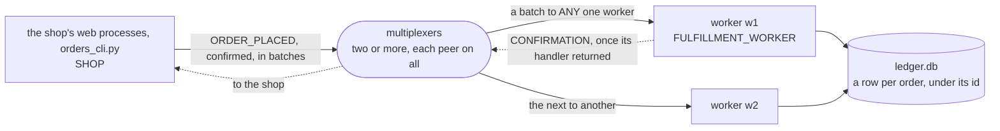

# orders

A shop that must not lose an order, even when the worker that took it
dies. The shop sends an `ORDER_PLACED` event for every order placed, and
fulfillment workers record each order in a ledger, an SQLite file they
share. The shop sends the orders as
[confirmed sends](../../docs/delivery.md#confirmed-sends): its library
keeps every order until a worker's library says the worker's handler
returned from it, the order in the ledger by then, and sends it again
until then. An order's callback hears 1 only then, and `flush_all()`
returns True only once every order placed before it is in the ledger. A
worker that dies with orders in hand loses nothing: what nothing
confirmed goes again after `retry_after`, to the workers left. Delivery is
at least once, so the ledger is idempotent, a row per order under the
order's id, and skips an order that comes twice. An order no worker
confirms by its batch's deadline is given up on, and the shop is told.

Confirmed sends are new: the example needs `mx-multiplexer` newer than
3.0.0. It is installed with pip: `mx-multiplexer` from PyPI, which
brings the multiplexer, `mxcontrol`, with it.
[walkthrough.md](walkthrough.md) builds it from nothing, every line of
the rules file, the shop, the ledger, the worker and the command line
explained as it is added. It ends with the measured steps, orders
confirmed in batches, a worker that dies with orders in hand, the orders
that came twice, orders given up on, and the latency of a confirmation
in batches and one by one, and with a walk through its test.

```
pip install -r requirements.txt
mxcontrol run_multiplexer --rules orders.rules --address 127.0.0.1:1980   # the package's mxcontrol
mxcontrol run_multiplexer --rules orders.rules --address 127.0.0.1:1981   # a second one, in another terminal
python worker.py 127.0.0.1:1980,127.0.0.1:1981 --name w1                  # a worker; another with --name w2
python orders_cli.py place 127.0.0.1:1980,127.0.0.1:1981 --orders 10000   # every order confirmed once recorded
python orders_cli.py ledger                                               # what the ledger holds
```

In a web process the shop is two lines, one `Shop` per process, made in
the process that uses it: a server that forks its workers needs the
holder of [the web server recipe](../../docs/recipes/web_server.md).

```python
from shop import Shop

shop = Shop([("10.0.0.1", 1980), ("10.0.0.2", 1980)])   # once per process, every multiplexer
shop.place(order, callback)                              # in a request, from any thread: callback(1) once recorded
```

`test.sh` runs the test in a virtual environment against real
multiplexers.

## The peers

Every peer connects to every multiplexer. One rule routes the orders, to
`ANY` one worker, a batch of them whole; the worker's library sends the
confirmations back to the shop, addressed to it, which needs no rule.



## What is what

- `orders.rules`: the system rules, then `SHOP`, `FULFILLMENT_WORKER`
  and `ORDER_PLACED` with its `ANY` rule; `multiplexer_constants.py` is
  what `mxcontrol generate_constants` wrote from it, and `orders.proto`
  the payload, compiled to `orders_pb2.py`.
- `shop.py`: `Shop`, what a web process places its orders with: one
  `ThreadedClient`, `ORDER_PLACED` confirmed, in batches or one by one.
- `ledger.py`: `Ledger`, the SQLite file the workers share, a row per
  order under its id, an order that comes again skipped and counted.
- `worker.py`: `Worker`, a `BaseMultiplexerServer` that records each
  order in the ledger, raises on an order for nothing, dies at its Nth
  order with `--crash-at`, and leaves on `SIGTERM`.
- `orders_cli.py`: the command line the steps use: `place`, `latency`
  and `ledger`.
- `test.py`, `test.sh`: the test on the harness, and the script that
  makes a venv and runs it.
