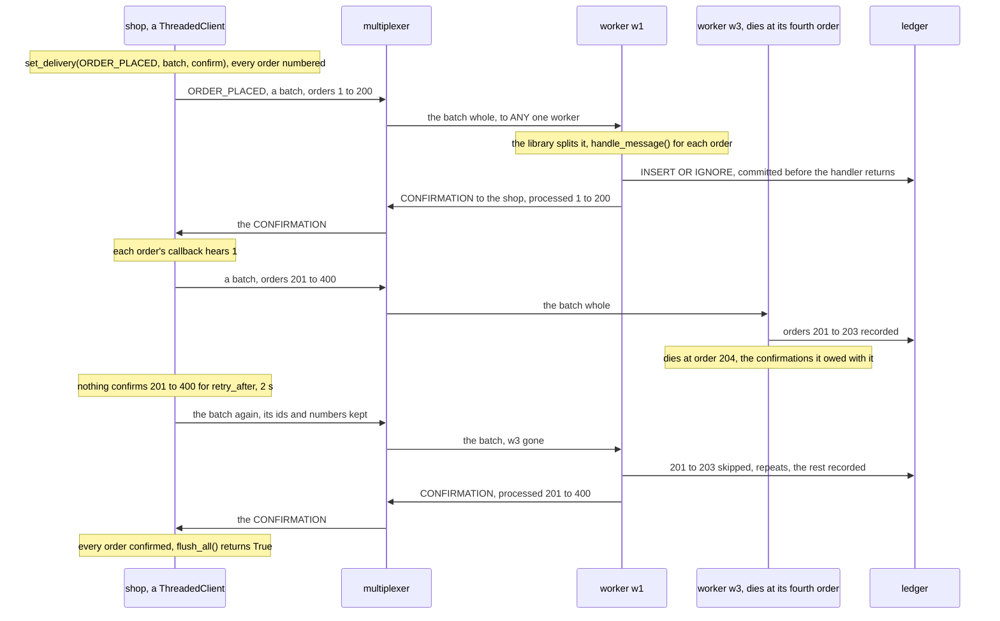

# Building the orders, step by step

This page builds the example from nothing: the rules file, the payload,
the shop, the ledger, the worker and the command line, in that order,
with every line of those files shown as it is added. Every code block is
a piece of a file in this directory, and `examples/check_walkthroughs.py`
keeps them identical to the files, so what you read here is what runs.
[README.md](README.md) is the front door: what the example is, a picture
of its peers, and how to run it. How the messages go, drawn, the measured
steps, the test and what the example does not do are at the end of this
page.

The idea in one sentence: the shop sends each order as a confirmed send,
which its library keeps until a worker's library says the worker's
handler returned from it, and sends again until then; the worker records
the order in the ledger before its handler returns, and the ledger holds
one row per order id, so an order that comes twice is recorded once.
[Confirmed sends](../../docs/delivery.md#confirmed-sends) describes them
in general. They are new: the example needs a library newer than 3.0.0.

## 1. The rules file

The file opens with the system rules every rules file starts from, the
protocol's own types 1 to 99 and the six the libraries and `mxcontrol`
use by name ([docs/rules.md](../../docs/rules.md)), which `mxcontrol
generate_rules orders.rules` wrote; they are left out here. Then the
example's two peer types: `SHOP` for whoever places orders, the shop's
web processes and the command line, and `FULFILLMENT_WORKER` for the
workers. Neither is marked `is_passive`: the shop is built on
`ThreadedClient`, whose io thread runs the library's loop all the time,
and a worker on a server class, which runs it between its handlers.

```protobuf file=orders.rules from="# The example's peers and messages."
# The example's peers and messages.

peer {
    type: 201
    name: "SHOP"
    comment: "whoever places orders: the shop's web processes, and the command line"
}

peer {
    type: 202
    name: "FULFILLMENT_WORKER"
    comment: "a backend on BaseMultiplexerServer that records every order it gets in the ledger, the SQLite file the workers share"
}

```

`ORDER_PLACED` is the event, one order, routed to `ANY` one worker. A
confirmed type goes to one consumer at a time, which is what `ANY` does:
the worker that takes an order confirms it, and nobody else records it
([one consumer a message](../../docs/delivery.md#confirmed-sends)). The
rule reports delivery errors, the default: with no worker connected, the
multiplexer answers a batch with a `DELIVERY_ERROR`, and that is what
makes the shop's library send it again after a short pause, rather than
wait out its `retry_after`; the program never sees it. The confirmations
need no rule. `CONFIRMATION` is one of the system rules' types, and a
worker's library sends it addressed to the shop, by its instance id.

```protobuf file=orders.rules
type {
    type: 301
    name: "ORDER_PLACED"
    comment: "one order, an event, payload Order; ANY fulfillment worker records it, nobody answers; the shop sends it confirmed, in batches"
    to {
        peer: "FULFILLMENT_WORKER"
        whom: ANY
    }
}
```

With the file written, `mxcontrol generate_constants orders.rules
--python multiplexer_constants.py --pyi multiplexer_constants.pyi` writes
the module the code below imports, so that it says `types.ORDER_PLACED`
rather than 301.

## 2. The payload

A message's payload is bytes; the example's is a protocol buffer,
compiled once with `protoc --python_out=. --pyi_out=. orders.proto`.

```protobuf file=orders.proto
// The payload of the orders example. Compiled once with `protoc
// --python_out=. --pyi_out=. orders.proto`; the generated orders_pb2.py
// and its stub are committed next to it.
syntax = "proto3";

package orders;

```

An order is who ordered how many of what, under an id. The id is the
shop's, given to the order when it is placed, and it is what the ledger
records the order by: the multiplexer's message id would not do, since an
order the shop places again, after it was given up on, is a new message
with the same order in it.

```protobuf file=orders.proto
// ORDER_PLACED: one order, under the id the shop gave it when it was
// placed, which the ledger records it by.
message Order {
  string id = 1;
  string customer = 2;
  string item = 3;
  uint32 quantity = 4;
}
```

## 3. The shop

[shop.py](shop.py) is what a web process places its orders with: one
`Shop` per process, made once, and `place()` from any thread of it. It
opens with what it is and the three numbers that shape a confirmed
send, which the end of this section explains.

```python file=shop.py
"""Shop: what the shop's web processes place orders with. One ORDER_PLACED
event per order, sent as a confirmed send (docs/delivery.md): the library
keeps every order until a fulfillment worker's library says the worker
recorded it, sends it again until then, and tells the order's callback 1
once it was, 0 once it gave up on it.

    with Shop(addresses) as shop:
        shop.place(Order(id=new_order_id(), customer="alice", item="mug", quantity=2), callback)

One ThreadedClient connected to every multiplexer, its io thread sending
what place() hands it and hearing the confirmations; every method is safe
from any thread, which is what a web process's threads need. The orders
go in batches, an order waiting at most MAX_DELAY for others, or one by
one, each at once. What nothing confirmed for RETRY_AFTER goes again; an
order not confirmed within TIMEOUT of its batch's first order is given up
on, its callback hearing 0 and `on_drop` NOT_CONFIRMED, and so is one a
worker's handler raised on, FAILED. A flush, close() and the end of a
`with` block let every batch go at once and wait for the confirmations."""

import uuid
from typing import Callable

from multiplexer.endpoints import Endpoint, parse_endpoint
from multiplexer.mxclient import DropReason
from multiplexer.threaded_client import ThreadedClient

from multiplexer_constants import peers, types
from orders_pb2 import Order

MAX_DELAY = 0.005  # seconds an order waits for others to share its batch
RETRY_AFTER = 2.0  # seconds without a confirmation after which a batch's orders go again
TIMEOUT = 60.0  # seconds a batch has, from its first order, to be confirmed


def parse_addresses(text: str) -> list[Endpoint]:
    """ "host:port,host:port", an IPv6 address as [address]:port, as the list the library takes."""
    return [parse_endpoint(item) for item in text.split(",")]


```

A fresh id for each order, a random UUID, which any process makes alone.

```python file=shop.py
def new_order_id() -> str:
    """A fresh order id, as the shop gives one to an order when it is placed."""
    return uuid.uuid4().hex


```

`Shop` holds one `ThreadedClient`, connected to every multiplexer, whose
io thread heartbeats and reconnects on its own, writes what `place()`
hands it and hears the confirmations. `set_delivery()` comes first,
before anything is sent: from then on every `ORDER_PLACED` the client
sends goes by it. Its two switches say how. `batch` puts the orders
together, several in one message, a batch going once it holds a thousand
orders, `max_records`'s default, or once its first order has waited
`max_delay`; without it each order goes at once, alone. `confirm` keeps
every order in the library until a worker's library confirms it, and
sends it again until then: at once when its connection ended, after a
short pause when nobody took it, and after `retry_after` when nothing
confirmed it. `timeout` is a batch's, from its first order: an order not
confirmed by then is given up on, and so is the rest of its batch.
`confirm` False is there only for step 1's contrast, the orders sent as
plain events. `connect_all()` then starts a connection to every
multiplexer at once and waits for the welcomes, ten seconds at most.

```python file=shop.py
class Shop:
    """One ThreadedClient connected to every multiplexer, its orders confirmed sends."""

    def __init__(
        self,
        addresses: list[Endpoint],
        one_by_one: bool = False,
        confirm: bool = True,
        max_delay: float = MAX_DELAY,
        timeout: float = TIMEOUT,
        on_drop: Callable[[int, DropReason], None] | None = None,
    ):
        """Connect to every multiplexer, all at once, waiting ten seconds at
        most; one that is not reachable yet is tried again in the
        background. `one_by_one` sends every order at once, alone, rather
        than in batches; `confirm` False sends them as plain events, done
        once written. `on_drop(message_id, reason)` hears of every order
        given up on, on the io thread."""
        self._client = ThreadedClient([], type=peers.SHOP, on_drop=on_drop)
        self._client.set_delivery(
            types.ORDER_PLACED,
            batch=not one_by_one,
            max_delay=max_delay,
            confirm=confirm,
            retry_after=RETRY_AFTER,
            timeout=timeout,
        )
        self._client.connect_all(addresses)

```

An order is sent with `send_message()`, which returns at once, its
message id, and `callback`, which the io thread calls once the order's
end is known: 1 once a worker's library confirmed it, its handler having
returned from it, and 0 once the shop gave up on it. `on_drop`, given to
the constructor, hears why, ahead of the callback: `NOT_CONFIRMED` for an
order nobody confirmed by its batch's deadline, `FAILED` for one a
worker's handler raised on, which is not sent again.

```python file=shop.py
    def place(self, order: Order, callback: Callable[[int], None] | None = None) -> int:
        """Send `order` and return its message id, which `on_drop` names;
        returns at once. `callback(1)` runs on the io thread once a worker
        recorded the order, `callback(0)` once the shop gave up on it."""
        return self._client.send_message(order, type=types.ORDER_PLACED, callback=callback)

```

The rest: `flush()`, which lets the open batches go and waits for every
order placed before it to be confirmed, and returns False once one was
given up on; `sent_again`, how many times the shop sent an order again;
`close()`, which waits a second at most for what is still unconfirmed,
and gives up on the rest; and a `with` block.

```python file=shop.py
    def flush(self, timeout: float = TIMEOUT) -> bool:
        """Let every batch go, and wait until every order placed before the
        call was confirmed or given up on, or `timeout` seconds: whether
        every one was confirmed."""
        return self._client.flush_all(timeout)

    @property
    def sent_again(self) -> int:
        """How many times the shop sent an order again, nothing having confirmed it."""
        return self._client.sent_again()

    def close(self) -> None:
        """Let the batches go and wait for their confirmations, a second at
        most, giving up on the rest, then disconnect; the shop is done."""
        self._client.shutdown()

    def __enter__(self) -> "Shop":
        """The shop, for a `with` block, at whose end it is closed."""
        return self

    def __exit__(self, *exc: object) -> None:
        """close(), however the block ended."""
        self.close()
```

**The three numbers.** `MAX_DELAY` is 5 ms: an order waits that long at
most for others to share its batch, so a shop placing many orders at once
sends hundreds in one message, and a lone order is confirmed 5 ms later
than it would be alone, as step 5 measures. `RETRY_AFTER` is 2 s: how long
nothing may confirm a batch before what is left of it goes again. It must
be longer than an order waits in a worker's queues and handler, or an
order still waiting there goes again and is handled twice
([confirmed sends](../../docs/delivery.md#confirmed-sends)); a worker
records an order in a few tens of microseconds, so 2 s leaves room for a
backlog of tens of thousands, and an order a dead worker held waits 2 s,
as step 2 shows. `TIMEOUT` is 60 s: how long a batch has, from its first
order, to be confirmed; until then the shop keeps every order of it in
its memory, sending again what nobody confirmed, and then gives up on it,
as step 4 shows with a deadline of a second.

## 4. The ledger

[ledger.py](ledger.py) is the ledger: one SQLite file the workers share,
through `sqlite3` from the standard library, a row per order under the
order's id, its primary key. A worker that died with an order recorded
and its confirmation not yet sent leaves the shop sending the order
again, so the ledger must take an order twice and record it once. The
row counts the repeats, which the steps show.

```python file=ledger.py
"""The ledger: every order the fulfillment workers recorded, a row each in
one SQLite file they share (sqlite3, from the standard library), under the
order's id, the primary key.

    ledger = Ledger("ledger.db")
    ledger.record(order, "w1")   # True: recorded; False: a repeat, skipped and counted

Recording is idempotent. A confirmed send arrives at least once
(docs/delivery.md, "At least once"): an order whose confirmation was lost
with a worker that died comes again, and finds its row there. INSERT OR
IGNORE then leaves the row as it was, and the repeat is only counted, in
the row's `repeats`. Each record() is one transaction, committed before it
returns, so before the worker's handler returns and the library confirms
the order to the shop. Several workers write the file at once: WAL lets
readers go on beside the one writer, and a writer waits for another, up
to `timeout`. A Ledger belongs to the thread that made it, as its sqlite3
connection does."""

import sqlite3

from orders_pb2 import Order

SCHEMA = """CREATE TABLE IF NOT EXISTS orders (
    id TEXT PRIMARY KEY,
    customer TEXT NOT NULL,
    item TEXT NOT NULL,
    quantity INTEGER NOT NULL,
    worker TEXT NOT NULL,
    repeats INTEGER NOT NULL DEFAULT 0
)"""


```

The connection. WAL, the write-ahead log, lets the command line read the
file while the workers write it, and the workers write it one after
another, each waiting up to `timeout` for the others. Two workers that
start at once on a new file both switch it to WAL; one is told at once
that the file is locked, and its second try waits for the other's
switch. `synchronous=NORMAL` makes a commit cheap, 16 µs here where
`FULL` took 250 µs, an fsync each; a commit is in the file either way
once it returns, which is what a worker's death needs.

```python file=ledger.py
class Ledger:
    """One connection to the ledger's file, made with the file and its table when there are none."""

    def __init__(self, path: str, timeout: float = 30.0):
        """The ledger in the file at `path`, made when there is none; a
        write waits up to `timeout` seconds for another worker's."""
        self.db = sqlite3.connect(path, timeout=timeout)
        try:
            self.db.execute("PRAGMA journal_mode=WAL")
        except sqlite3.OperationalError:
            # Two workers switching a new file at once: one is told at once
            # that it is locked, and its second try waits for the other's switch.
            self.db.execute("PRAGMA journal_mode=WAL")
        # A commit is in the file once it returns, so a worker that dies
        # loses nothing it committed. NORMAL leaves the last commits to a
        # power cut; FULL would keep those too, at an fsync each.
        self.db.execute("PRAGMA synchronous=NORMAL")
        with self.db:
            self.db.execute(SCHEMA)

```

`record()` is the one write: `INSERT OR IGNORE` adds the order's row, or
does nothing when the ledger has a row under its id already, and
`rowcount` says which. A repeat only adds one to the row's `repeats`. The
`with` block is one transaction, committed as it ends, so when `record()`
returns the order is in the file, before the worker's handler returns
and so before the shop hears of it.

```python file=ledger.py
    def record(self, order: Order, worker: str) -> bool:
        """Record `order` as `worker`'s, committed when this returns: True
        when it is new, False when the ledger has it already, a repeat,
        which leaves its row as it was but for the count."""
        with self.db:  # one transaction: committed at the end of the block, rolled back if it raises
            inserted = self.db.execute(
                "INSERT OR IGNORE INTO orders (id, customer, item, quantity, worker) VALUES (?, ?, ?, ?, ?)",
                (order.id, order.customer, order.item, order.quantity, worker),
            )
            if inserted.rowcount == 1:
                return True
            self.db.execute("UPDATE orders SET repeats = repeats + 1 WHERE id = ?", (order.id,))
            return False

```

What the command line reads: how many orders, how many each worker
recorded, and the repeats, by the worker that recorded the order first.

```python file=ledger.py
    def count(self) -> int:
        """How many orders the ledger holds."""
        return self.db.execute("SELECT COUNT(*) FROM orders").fetchone()[0]

    def by_worker(self) -> dict[str, int]:
        """How many orders each worker recorded first, by its name."""
        return dict(self.db.execute("SELECT worker, COUNT(*) FROM orders GROUP BY worker ORDER BY worker"))

    def repeats(self) -> dict[str, tuple[int, int]]:
        """The repeats skipped, by the worker that recorded the order first:
        how many of its orders came again, and how many times in all."""
        rows = self.db.execute(
            "SELECT worker, COUNT(*), SUM(repeats) FROM orders WHERE repeats > 0 GROUP BY worker ORDER BY worker"
        )
        return {worker: (orders, times) for worker, orders, times in rows}

    def close(self) -> None:
        """Close the connection; what was recorded is in the file."""
        self.db.close()
```

## 5. The worker

[worker.py](worker.py) is a `BaseMultiplexerServer`, the plain server
class: one thread runs the loop, which reads a message, calls the
handler, then `periodic_task()`, and goes round again. Recording an
order takes tens of microseconds, so the handler needs no thread of its
own, which `BaseThreadedMultiplexerServer` would give it. The docstring
is the program's help.

```python file=worker.py
"""A fulfillment worker: a backend on `BaseMultiplexerServer` that records
every order it gets in the ledger, the SQLite file every worker shares.

    python worker.py [ADDRESSES] --name NAME [--ledger FILE] [--crash-at N]

ADDRESSES is host:port of every multiplexer, comma-separated, default
127.0.0.1:1980. The shop sends its orders as confirmed sends: the library
confirms an order to the shop once handle_message() returned from it, the
order committed to the ledger by then, and FAILED when it raised, on an
order no worker can record, which the shop then gives up on rather than
send again. An order may come twice, its confirmation lost with a worker
that died: the ledger records it once and counts the repeat. With
--crash-at N the worker dies at the Nth order it gets, before recording
it, as a crash would end it: what it held goes again, to the workers left.
SIGTERM makes it leave: the multiplexers route it nothing new, it records
what was on its way, confirms it and exits."""

import argparse
import os
import signal
import sys

from multiplexer.Multiplexer_pb2 import MultiplexerMessage
from multiplexer.mxclient import CLOSE_FLUSH_SECONDS
from multiplexer.servers import BaseMultiplexerServer

from ledger import Ledger
from multiplexer_constants import peers, types
from orders_pb2 import Order
from shop import parse_addresses


```

A worker opens the ledger as it starts, and keeps its counts: the orders
it was handed, those it recorded and the repeats it skipped. `crash_at`
is for step 2: the worker dies at the order of that number.

```python file=worker.py
class Worker(BaseMultiplexerServer):
    """The ledger, and the handler that records each order in it; on the serve loop's one thread."""

    multiplexer_client_type = peers.FULFILLMENT_WORKER

    def __init__(self, addresses: list[tuple[str, int]], name: str, ledger: str, crash_at: int = 0):
        """The worker `name` for the multiplexers in `addresses`, recording
        in the ledger at the path `ledger`, dying at its `crash_at`th order
        when that is not 0; connect() or serve_forever() connects."""
        super().__init__(addresses)
        self.name = name
        self.ledger = Ledger(ledger)
        self.crash_at = crash_at
        self.taken = 0  # the orders handle_message() got
        self.recorded = 0
        self.repeats = 0
        self.leave = False  # set by SIGTERM; periodic_task() starts the drain
        self.ready_pending = False  # set by main(): "ready" is printed once a multiplexer welcomed the worker

```

The handler. A batch never reaches it: the library splits a batch back
into its orders as it reads it, and `handle_message()` gets each order
alone, with its number among the shop's, `mxmsg.confirmation`, which the
handler need not read. The library confirms the order to the shop once
the handler returns, and `FAILED` if it raises. So the order is recorded
before the handler returns, and an order no worker can record raises: an
order for nothing, here, which a worker would raise on as often as it
came, and which the shop gives up on rather than send again.
`no_response()` comes first: an event needs no answer, and without it a
raise would send the shop a `BACKEND_ERROR` as well. With `--crash-at`,
the worker dies with `os._exit()` at the order of that number, before
recording it: no cleanup and no confirmation, as `kill -9` or a crash
would end it. The orders of the batch it handled before that are in the
ledger, and the confirmations it owed for them die with it, since the
library sends what it owes once it has nothing more in hand for the
handler, or owes 256, and the rest of the batch was still in hand.

```python file=worker.py
    def handle_message(self, mxmsg: MultiplexerMessage) -> None:
        """An order recorded in the ledger, once, committed before this returns."""
        self.no_response()  # an event: no answer, not even the BACKEND_ERROR a raise would send the shop
        if mxmsg.type != types.ORDER_PLACED:
            return  # nothing else is routed here
        self.taken += 1
        if self.taken == self.crash_at:
            print(f"{self.name}: dying at order {self.taken}, before recording it", flush=True)
            os._exit(3)  # no cleanup, no confirmation: as a crash, or kill -9, ends it
        order = Order.FromString(mxmsg.message)
        if order.quantity < 1:
            raise ValueError(f"order {order.id} is for no {order.item}")  # FAILED: the shop gives up on it
        if self.ledger.record(order, self.name):
            self.recorded += 1
        else:
            self.repeats += 1

```

`periodic_task()` runs after every message and after every poll of the
loop, half a second here. It starts the drain once `SIGTERM` came, and
says `ready` once a multiplexer has welcomed the worker: whoever runs the
steps, and the test, wait for that line and then place orders. Closing
sends the confirmations the worker owes, then closes the ledger.

```python file=worker.py
    def periodic_task(self) -> None:
        """After every message and every poll: the drain started once
        SIGTERM came, and "ready" said once a multiplexer welcomed the worker."""
        if self.leave:
            self.start_draining()
        self.say_ready_once_connected()

    def say_ready_once_connected(self) -> None:
        """Print the "ready" main() asked for once a multiplexer has
        welcomed the worker: whoever runs the steps, and the test, wait
        for the line and then place orders."""
        if self.ready_pending and self.conn.connections_count() > 0:
            print(f"ready: {self.name}", flush=True)
            self.ready_pending = False

    def close(self, timeout: float = CLOSE_FLUSH_SECONDS) -> None:
        """The connections closed, what the worker owes the shop confirmed
        first, then the ledger."""
        super().close(timeout)
        self.ledger.close()


```

And the program: the worker, and a `SIGTERM` handler that sets a flag.
The library installs no signal handler, and a Python one runs only once
the loop's wait returns to Python, within the half-second poll, so the
handler only asks, and `periodic_task()` starts the drain between two
messages: the multiplexers route the worker nothing new, it records what
was on its way and confirms it, and it leaves once each multiplexer has
acknowledged the change, five seconds at most ([how a backend
leaves](../../docs/leaving.md)).

```python file=worker.py
def main() -> None:
    """Serve until SIGTERM, then leave."""
    parser = argparse.ArgumentParser(description=(__doc__ or "").split("\n\n")[0])
    parser.add_argument(
        "addresses", nargs="?", default="127.0.0.1:1980", help="host:port of every multiplexer, comma-separated"
    )
    parser.add_argument("--name", required=True, help="the worker's name, which the ledger records its orders under")
    parser.add_argument("--ledger", default="ledger.db", help="the ledger's file, which every worker shares")
    parser.add_argument("--crash-at", type=int, default=0, help="die at the Nth order, before recording it")
    args = parser.parse_args()
    worker = Worker(parse_addresses(args.addresses), args.name, args.ledger, args.crash_at)

    def leave(signum: int, frame: object) -> None:
        """SIGTERM: a flag the serve loop reads, between two messages."""
        worker.leave = True

    # The handler runs when the serve loop's wait comes back to Python, at
    # the latest once its poll is over.
    signal.signal(signal.SIGTERM, leave)
    worker.ready_pending = True
    worker.connect()  # waits for the handshakes, so that "ready" can come at once
    worker.say_ready_once_connected()
    if worker.ready_pending:
        print("no multiplexer reachable yet; ready once one is", file=sys.stderr, flush=True)
    worker.serve_forever(poll=0.5, drain_seconds=5)
    print(
        f"{worker.name} left after recording {worker.recorded:,} orders and skipping {worker.repeats:,} repeats",
        flush=True,
    )


if __name__ == "__main__":
    main()
```

## 6. The command line

[orders_cli.py](orders_cli.py) is what the steps below use: `place`
places orders as fast as it goes and says how they ended, `latency` times
the confirmations of orders placed one at a time, and `ledger` says what
the ledger holds.

```python file=orders_cli.py
"""The command line the steps use: orders placed and how they ended, the
time from an order's send to its confirmation, and what the ledger holds.

    python orders_cli.py place ADDRESSES [--orders N] [--one-by-one] [--unconfirmed]
                                         [--timeout SECONDS] [--empty N] [--ledger FILE]
    python orders_cli.py latency ADDRESSES [--orders N] [--one-by-one]
    python orders_cli.py ledger [--ledger FILE]

ADDRESSES is host:port of every multiplexer, comma-separated. place places
N orders as fast as it goes, the first N of them for nothing with --empty,
which a worker raises on; then it flushes, and prints how the orders
ended, as their callbacks and on_drop heard it, how many the shop sent
again, and how many of them the ledger held when flush_all() returned.
--unconfirmed sends them as plain events, for the contrast. latency places
N orders one at a time, each once the one before was confirmed, and
prints how long a confirmation took, at the median and the 99th
percentile. ledger prints how many orders the ledger holds, by the worker
that recorded each, and the repeats it skipped."""

import argparse
import collections
import queue
import statistics
import time
from contextlib import closing

from multiplexer.mxclient import DropReason

from ledger import Ledger
from orders_pb2 import Order
from shop import MAX_DELAY, TIMEOUT, Shop, new_order_id, parse_addresses

CUSTOMERS = ["alice", "bob", "carol", "dave", "erin"]
ITEMS = ["mug", "teapot", "kettle", "tray"]
SLACK = 10.0  # seconds past its batch's timeout that only a failure waits for an order's end


```

An order of the steps: the customers and the items take turns, under a
fresh id.

```python file=orders_cli.py
def make_order(number: int) -> Order:
    """The `number`th order of a run, under a fresh id: the customers and
    the items take turns, one to three of an item."""
    return Order(
        id=new_order_id(),
        customer=CUSTOMERS[number % len(CUSTOMERS)],
        item=ITEMS[number % len(ITEMS)],
        quantity=1 + number % 3,
    )


```

`Ends` counts how the orders ended, as the shop's io thread tells it: the
callbacks, 1 or 0, and `on_drop`'s reasons, by name.

```python file=orders_cli.py
class Ends:
    """How the orders ended, as their callbacks and on_drop heard it, on the shop's io thread."""

    def __init__(self) -> None:
        self.done = 0
        self.given_up = 0
        self.why: collections.Counter[str] = collections.Counter()

    def ended(self, done: int) -> None:
        """An order's callback: 1 once a worker recorded it, or, unconfirmed,
        once it was written; 0 once the shop gave up on it."""
        if done:
            self.done += 1
        else:
            self.given_up += 1

    def dropped(self, message_id: int, reason: DropReason) -> None:
        """on_drop: why the shop gave up on an order, told ahead of its callback."""
        self.why[reason.name] += 1


```

`place` puts it together: the ledger counted, the orders placed, the
first `--empty` of them for nothing, then `flush_all()`, and the ledger
counted again the moment it returned, which is what step 1 is about. It
prints how the orders ended, how many the shop sent again, if any, and
what the flush said and the ledger held then.

```python file=orders_cli.py
def place(args: argparse.Namespace) -> None:
    """Place the orders, flush, and say how they ended."""
    ends = Ends()
    shop = Shop(
        parse_addresses(args.addresses),
        one_by_one=args.one_by_one,
        confirm=not args.unconfirmed,
        timeout=args.timeout,
        on_drop=ends.dropped,
    )
    with closing(Ledger(args.ledger)) as ledger, shop:
        before = ledger.count()
        started = time.monotonic()
        for number in range(args.orders):
            order = make_order(number)
            if number < args.empty:
                order.quantity = 0  # for nothing: a worker raises on it
            shop.place(order, ends.ended)
        flushed = shop.flush(args.timeout + SLACK)
        took = time.monotonic() - started
        held = ledger.count() - before  # read the moment flush_all() returned
        sent_again = shop.sent_again
    say_how_it_went(args, ends, sent_again, flushed, took, held)


def say_how_it_went(
    args: argparse.Namespace, ends: Ends, sent_again: int, flushed: bool, took: float, held: int
) -> None:
    """What place prints: how the orders ended, how many the shop sent
    again, if any, and what flush_all() said and the ledger held then."""
    how = "one by one" if args.one_by_one else "in batches"
    how = f"sent {how}, unconfirmed" if args.unconfirmed else f"confirmed {how}"
    done = f"{ends.done:,} {'written' if args.unconfirmed else 'confirmed'}" if ends.done else "none confirmed"
    given_up = f"{ends.given_up:,} given up on" if ends.given_up else "none given up on"
    if ends.why:
        given_up += f" ({', '.join(f'{reason} {count:,}' for reason, count in sorted(ends.why.items()))})"
    print(f"{args.orders:,} orders, {how}: {done}, {given_up}")
    if sent_again:
        print(f"the shop sent {sent_again:,} again, nothing having confirmed them")
    print(f"flush_all() returned {flushed} after {took:.2f} s, when the ledger held {held:,} of them")


```

`latency` places one order at a time, the next once the last was
confirmed, so that no order waits behind another, and takes the time in
the callback, on the io thread, as the confirmation comes.

```python file=orders_cli.py
def latency(args: argparse.Namespace) -> None:
    """Place the orders one at a time, each once the one before was
    confirmed, and say how long the confirmations took."""
    took: list[float] = []
    heard: queue.SimpleQueue[tuple[int, float]] = queue.SimpleQueue()
    with Shop(parse_addresses(args.addresses), one_by_one=args.one_by_one) as shop:
        for number in range(args.orders):
            sent = time.perf_counter()
            # The time is taken in the callback, on the io thread, as the confirmation comes.
            shop.place(make_order(number), lambda done: heard.put((done, time.perf_counter())))
            done, at = heard.get(timeout=TIMEOUT + SLACK)
            if not done:
                raise SystemExit(f"order {number} was given up on")
            took.append(at - sent)
    how = "one by one" if args.one_by_one else f"in batches with a delay of {MAX_DELAY * 1000:g} ms"
    p99 = statistics.quantiles(took, n=100)[98] if len(took) > 1 else took[0]
    print(
        f"{args.orders:,} orders, one at a time, confirmed {how}: confirmed {statistics.median(took) * 1000:.2f} ms"
        f" after the send at the median, {p99 * 1000:.2f} ms at the 99th percentile"
    )


```

`ledger` reads the counts and the repeats.

```python file=orders_cli.py
def show_ledger(args: argparse.Namespace) -> None:
    """How many orders the ledger holds, by worker, and the repeats it skipped."""
    with closing(Ledger(args.ledger)) as ledger:
        by_worker = ledger.by_worker()
        repeats = ledger.repeats()
    workers = ", ".join(f"{worker} {orders:,}" for worker, orders in by_worker.items())
    print(f"{sum(by_worker.values()):,} orders{': ' + workers if workers else ''}")
    if not repeats:
        print("no repeats")
        return
    times = sum(count for _, count in repeats.values())
    whose = " and ".join(
        f"{orders:,} order{'s' if orders > 1 else ''} {worker} recorded" for worker, (orders, _) in repeats.items()
    )
    print(f"{times:,} repeat{'s' if times > 1 else ''} skipped, of {whose}")


```

And the commands and their options.

```python file=orders_cli.py
def main() -> None:
    """One command."""
    parser = argparse.ArgumentParser(description=(__doc__ or "").split("\n\n")[0])
    commands = parser.add_subparsers(dest="command", required=True)
    placing = commands.add_parser("place", help="place orders as fast as they go and say how they ended")
    placing.add_argument("addresses", help="host:port of every multiplexer, comma-separated")
    placing.add_argument("--orders", type=int, default=1000, help="how many")
    placing.add_argument("--one-by-one", action="store_true", help="each order at once, alone, not in batches")
    placing.add_argument("--unconfirmed", action="store_true", help="as plain events, for the contrast")
    placing.add_argument("--timeout", type=float, default=TIMEOUT, help=f"seconds a batch has, {TIMEOUT:g} by default")
    placing.add_argument(
        "--empty", type=int, default=0, help="the first N orders for nothing, which a worker raises on"
    )
    placing.add_argument("--ledger", default="ledger.db", help="the ledger's file, counted before and after")
    timing = commands.add_parser("latency", help="place orders one at a time and time their confirmations")
    timing.add_argument("addresses", help="host:port of every multiplexer, comma-separated")
    timing.add_argument("--orders", type=int, default=1000, help="how many")
    timing.add_argument("--one-by-one", action="store_true", help="each order alone, not in batches")
    reading = commands.add_parser("ledger", help="what the ledger holds")
    reading.add_argument("--ledger", default="ledger.db", help="the ledger's file")
    args = parser.parse_args()
    {"place": place, "latency": latency, "ledger": show_ledger}[args.command](args)


if __name__ == "__main__":
    main()
```

## 7. What is left

[test.py](test.py) runs all of it against real multiplexers, which
"Testing it with the harness" below walks through, and `test.sh` runs
the test in a virtual environment with `requirements.txt`, the library
and protobuf.

## How it fits together

The shop's library numbers every order it sends, one count for the
client, and sends a batch of them as one message, the numbers in it. The
multiplexer gives the batch to one worker, and that worker's library
splits it back into the orders, each handed to `handle_message()` with
its number. As the handler returns from one, the library owes the shop a
confirmation of its number, and once it has nothing more in hand for the
handler, or owes 256, it sends the shop one `CONFIRMATION` for all it owes.
The shop's library ends each order then, its callback hearing 1. A
worker that dies owing confirmations leaves its batch unconfirmed, and
after `retry_after` the shop sends what is left of it again, with the ids
and the numbers it had, to a worker that is there.



## The steps

Two multiplexers on ports 1980 and 1981 and two workers, w1 and w2, all
on one machine, with the library and the multiplexer built from this
repository's tree, optimized as a release is (`bazel build -c opt`).
Each command's output is what the last run printed; the library's own
log lines go to stderr, which the workers' logs hold too, and are left
out.

```
$ mxcontrol run_multiplexer --rules orders.rules --address 127.0.0.1:1980 > mx1.log 2>&1 & echo $! > mx1.pid
$ mxcontrol run_multiplexer --rules orders.rules --address 127.0.0.1:1981 > mx2.log 2>&1 & echo $! > mx2.pid
$ mx=127.0.0.1:1980,127.0.0.1:1981
$ python worker.py $mx --name w1 > w1.log 2>&1 & echo $! > w1.pid
$ python worker.py $mx --name w2 > w2.log 2>&1 & echo $! > w2.pid
$ grep ready w1.log w2.log
w1.log:ready: w1
w2.log:ready: w2
```

**1. An order is confirmed once it is in the ledger.** The shop places
ten thousand orders, as fast as Python goes, confirmed in batches, and
flushes. Then ten thousand more, sent in batches but unconfirmed, as
plain events, for the contrast.

```
$ python orders_cli.py place $mx --orders 10000
10,000 orders, confirmed in batches: 10,000 confirmed, none given up on
flush_all() returned True after 0.23 s, when the ledger held 10,000 of them
$ python orders_cli.py place $mx --orders 10000 --unconfirmed
10,000 orders, sent in batches, unconfirmed: 10,000 written, none given up on
flush_all() returned True after 0.06 s, when the ledger held 787 of them
$ python orders_cli.py ledger
20,000 orders: w1 9,070, w2 10,930
no repeats
```

Confirmed, `flush_all()` returned True once every order was confirmed,
and so recorded: the ledger held all ten thousand when it returned.
Unconfirmed, it returned True once every order was written to a socket,
in a quarter of the time, when the ledger held 787 of them:
the rest were on their way through the multiplexers and the workers'
queues, and were recorded a moment later, as the ledger says. Written is
not recorded. A program that reported "placed" after an unconfirmed
flush would report orders that a worker dying then would lose, and
nothing would tell the shop.

**2. A worker dies with orders in hand.** w3 joins, a worker that dies at
its fourth order, and the shop places ten thousand orders again.

```
$ python worker.py $mx --name w3 --crash-at 4 > w3.log 2>&1 & echo $! > w3.pid
$ grep ready w3.log
ready: w3
$ python orders_cli.py place $mx --orders 10000
10,000 orders, confirmed in batches: 10,000 confirmed, none given up on
the shop sent 675 again, nothing having confirmed them
flush_all() returned True after 2.02 s, when the ledger held 10,000 of them
$ grep dying w3.log
w3: dying at order 4, before recording it
```

Every order was confirmed, none given up on, but `flush_all()` returned
after 2 s rather than a quarter of a second: w3 took a batch, recorded
three orders and died at the fourth, holding the rest. Nothing confirmed
what it had taken, 675 orders, for `RETRY_AFTER`, so the shop sent
them again, with the ids and the numbers they had, and the multiplexers,
which had seen w3 go, gave them to the workers left.

**3. At least once.** The three orders w3 recorded came again too: it
had recorded them, and their confirmations died with it, owed for the
batch it was still handling. So they reached the ledger twice.

```
$ python orders_cli.py ledger
30,000 orders: w1 14,395, w2 15,602, w3 3
3 repeats skipped, of 3 orders w3 recorded
```

w3 recorded three orders, and the ledger skipped three repeats, of those
three, so every order is in it once. This is what a confirmed send
promises: at least once ([at least
once](../../docs/delivery.md#confirmed-sends)). An order whose
confirmation was lost, its worker gone before the confirmation went, is
processed again, with the id it was first sent with, and may arrive after
orders placed after it; so is one that a worker held longer than
`retry_after`. A program that must process each order once keeps the ids
it processed, as the ledger does, under the order's own id.

**4. Given up on.** First an order no worker can record: ten orders, the
first two for nothing, which a worker raises on. Then the workers leave,
and the shop places ten orders with no worker at all, with a deadline of
a second for this step, where 60 s would have it wait a minute.

```
$ python orders_cli.py place $mx --orders 10 --empty 2
10 orders, confirmed in batches: 8 confirmed, 2 given up on (FAILED 2)
flush_all() returned False after 0.01 s, when the ledger held 8 of them
$ grep -h ^ValueError w1.log w2.log
ValueError: order 13ecc6b77cd84d7ebc6b4b0f069ce1ce is for no mug
ValueError: order 9dbdeeab1ddc4b0e93b5cbb3ec575505 is for no teapot
$ kill $(cat w1.pid w2.pid)
$ grep left w1.log w2.log
w1.log:w1 left after recording 14,395 orders and skipping 0 repeats
w2.log:w2 left after recording 15,610 orders and skipping 3 repeats
$ python orders_cli.py place $mx --orders 10 --timeout 1
10 orders, confirmed in batches: none confirmed, 10 given up on (NOT_CONFIRMED 10)
the shop sent 30 again, nothing having confirmed them
flush_all() returned False after 1.00 s, when the ledger held 0 of them
```

The two orders for nothing were given up on at once: the worker's
handler raised, its library confirmed them `FAILED`, and the shop told
`on_drop` `FAILED` and their callbacks 0, without sending them again,
since a worker would raise on them as often as they came; `flush_all()`
returned False, one of the orders having been given up on. Each worker
then left on `SIGTERM`, w2 having skipped the three repeats. With no
worker at all, a multiplexer answered each send of the batch with a
`DELIVERY_ERROR`, which the program never sees, and the shop sent it
again after a pause that starts at 0.1 s and doubles, three times within
the second, which is 30 sends for the ten orders, until the batch's
deadline, a second after its first order: then it gave every order up,
`on_drop` hearing `NOT_CONFIRMED`, the callbacks 0, and `flush_all()`
returned False. The multiplexers logged an error for the batches that
found no worker, as for any message that goes nowhere.

**5. One by one.** w1 comes back. The shop places a thousand orders one
at a time, each once the last was confirmed, in batches and then one by
one, `confirm=True` without `batch`; then ten thousand as fast as it
goes, both ways.

```
$ python worker.py $mx --name w1 > w1.log 2>&1 & echo $! > w1.pid
$ grep ready w1.log
ready: w1
$ python orders_cli.py latency $mx --orders 1000
1,000 orders, one at a time, confirmed in batches with a delay of 5 ms: confirmed 5.18 ms after the send at the median, 5.47 ms at the 99th percentile
$ python orders_cli.py latency $mx --orders 1000 --one-by-one
1,000 orders, one at a time, confirmed one by one: confirmed 0.04 ms after the send at the median, 0.21 ms at the 99th percentile
$ python orders_cli.py place $mx --orders 10000
10,000 orders, confirmed in batches: 10,000 confirmed, none given up on
flush_all() returned True after 0.24 s, when the ledger held 10,000 of them
$ python orders_cli.py place $mx --orders 10000 --one-by-one
10,000 orders, confirmed one by one: 10,000 confirmed, none given up on
flush_all() returned True after 0.35 s, when the ledger held 10,000 of them
```

In batches, a lone order waits its batch's 5 ms for others before it
goes, and is confirmed about 5.2 ms after it was placed. One by one, it
goes at once, in a message of its own that numbers it, and its
confirmation comes back as soon as the worker's handler returned:
0.04 ms at the median, the round trip through a multiplexer and the
worker's handler, its commit included. Batches carry more a second, ten
thousand orders in 0.24 s where one by one took 0.35 s: one by one, every
order is a message the multiplexer routes and the worker's library reads
alone, where a batch carries hundreds. Each confirmation gathers what one
read brought either way, so a worker confirms many orders in one message
when they come fast. One by one suits an order a person waits for, a
checkout page that says "placed" once the order is recorded; batches
suit orders that come in bulk, an import or a nightly sync.

Then everything stops:

```
$ kill $(cat w1.pid)
$ grep left w1.log
w1 left after recording 22,000 orders and skipping 0 repeats
$ python orders_cli.py ledger
52,008 orders: w1 36,395, w2 15,610, w3 3
3 repeats skipped, of 3 orders w3 recorded
$ kill $(cat mx1.pid mx2.pid)
```

**The numbers depend** first on Python. The shop spends microseconds of
Python on an order, an `Order` built and serialized and handed to the
library, and a worker tens of microseconds, the parse and the commit, so
one worker records some forty thousand orders a second. They depend next
on this machine, an AMD Ryzen Threadripper PRO 9965WX with 24 cores,
which other work shared while the steps ran, and on the build,
optimized here. [Delivery](../../docs/delivery.md#what-it-costs) has
the library's own numbers for confirmed sends, millions a second from
C++ and Rust peers.

## Testing it with the harness

[test.py](test.py) is the example's test and a template for testing a
confirmed producer of your own; `multiplexer.testing` is what this
repository's own tests run on, and
[docs/api_python.md](../../docs/api_python.md#testing) lists all of it.
What the test uses, in the order it appears:

- **`Cluster(2, rules=RULES)`** starts two real multiplexers on ports the
  system picked, from the `mxcontrol` the package installed, or the
  binary `MXCONTROL` names, reading the example's rules file. Cleanups,
  `addCleanup`, stop what was started even when a setup fails, in the
  reverse order.
- **`BackendThread(lambda: Worker(...)).start()`** builds a worker on a
  thread of its own, serves it there, and returns once it is registered
  with every multiplexer, so that an order placed the moment `start()`
  returns is routed to it; `stop()` asks it to leave.
- **Batches the test makes.** The shop's delay is an hour, which never
  runs out here, and its timeout two, and `place_in_batches()` places the
  orders ten at a time, a `flush(0)`, which lets the open batch go and
  waits for nothing, after each ten. So every batch holds ten orders,
  whatever the machine's speed.
- **Confirmed once in the ledger.** Two workers on threads, a hundred
  orders. Each order's callback runs on the shop's io thread, one at a
  time, and reads the ledger through a connection of its own as the
  confirmation comes: no order is confirmed before its row is there.
  `flush_all()` returns True, and the ledger holds every order the
  moment it does.
- **A worker that dies.** One multiplexer, so that the batches go to the
  two workers in turn: a survivor on a thread, and `worker.py --crash-at
  4` as a process, since its death ends its process. The flush returns
  True once what the doomed worker held went again, after `RETRY_AFTER`;
  the doomed worker exited with 3 at its fourth order; the ledger holds
  the hundred orders, three of them the doomed worker's, each of those
  three skipped once as a repeat; and the shop sent ten orders again at
  least, the batch it died in.
- **Given up on.** A worker as a process, its stderr, where a handler's
  traceback goes, left out, and three orders, the second for nothing: it
  alone is given up on, `FAILED`, told to `on_drop`, and not sent again.
  Then three orders with no worker and a deadline of a second, the one
  wait of the test that is not a failure's: each is told `NOT_CONFIRMED`
  and its callback 0.
- **The wire.** A **`RawPeer`** of the workers' type, the harness speaking
  the wire format by hand, takes the orders of a shop sending one by one:
  each comes alone, in a batch of one that numbers it, 1, 2 and 3, and no
  callback runs until the raw peer sends one `CONFIRMATION` for the
  three, as a worker's library would; then every callback hears 1.
- **The programs.** `ProgramTest` runs `worker.py` and `orders_cli.py` as
  the steps do: `place`, confirmed and not, an order for nothing,
  `latency` both ways, the workers leaving on `SIGTERM` with their counts,
  which add up to every order placed, the plain events too, `ledger`, and
  `place` with no worker.
- **The constants.** `ConstantsTest` runs `mxcontrol generate_constants`
  on the rules file and compares what it writes with the committed
  `multiplexer_constants.py` and `.pyi`.

A shop that sends its orders unconfirmed fails the first test, its
orders confirmed before the ledger has them, and a ledger that inserts
without `OR IGNORE` fails the second, the survivor's handler raising on
the repeats. The test takes about six seconds, two of them the dying
worker's `RETRY_AFTER` and one the deadline. Run it with `test.sh`, or by
hand:

```
python -m unittest -v test
```

What to copy for a confirmed stream of your own: a delay that never runs
out and a flush that waits for nothing, so that the batches are what the
test makes them; a consumer that dies by a count, as a process; the
consumer's records read the moment `flush_all()` returns; and waits on
events, never on time, but for the one deadline under test.

## What it does not do

- Process each order exactly once. A confirmed send arrives at least
  once, and the ledger makes the repeats harmless, under the order's id.
  A worker that did more than write the ledger, charge a card or send an
  email, would make each of those idempotent too, keyed by the order's
  id, or do them once from the ledger.
- Keep an order through the shop's death. The library keeps every order
  in the shop's memory until it is confirmed: a shop process that dies
  loses the orders it held unconfirmed, and nothing tells anyone. A shop
  that must not lose one writes it to its own database first, in the
  request, and sends from there.
- Keep any number of orders. While every worker stalls, the orders pile
  up in the shop's memory, as many as are placed in a batch's timeout,
  60 s, and are given up on then
  ([confirmed sends](../../docs/delivery.md#confirmed-sends)).
- Keep the orders in the order they were placed. An order sent again
  arrives after orders placed after it, and through two multiplexers two
  batches may arrive in either order
  ([order](../../docs/delivery.md#order)).
- Survive a power cut. `synchronous=NORMAL` leaves the last commits to
  one; `FULL` would keep them, at an fsync for each order. One SQLite file
  on one machine is the ledger here; workers on several machines would
  share a database server, with the same `INSERT ... ON CONFLICT DO
  NOTHING` under the order's id.
