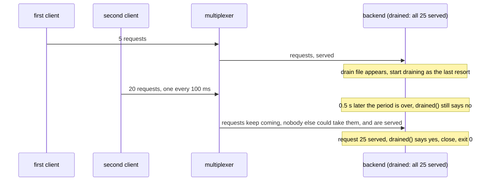

# Backend drains until done

A backend decides for itself when its drain is over, by overriding drained(); alone of its type, it drains as the last resort.

The only backend is asked to leave after a few requests, with a drain period
of half a second but a rule of its own: it refuses to leave before it has
served every request of the run. Being alone of its type it drains as the
last resort, so the multiplexer keeps routing to it what nobody else could
take. A first client's five requests come before it is asked, a second
client's twenty after its drain began, one every 100 ms, the last of them
seconds after the period is over. The drain lasts as long as the rule
says, the backend serves everything, and exits cleanly only then.

## What happens



## What is checked

- Every query of both clients is answered; none fails.
- The backend served all 25, the second client's twenty after its drain
  began, and exited with 0 only then, well past its half-second drain
  period.

## Run

```
bazel test //tests/scenarios:backend_drains_until_done_py_py
```

The two suffixes are the languages of the roles, first the backend's and
then the client's.
