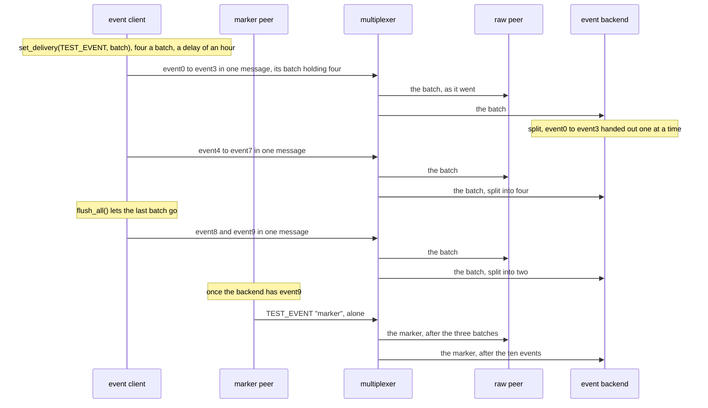

# Batched events

Events one library sends in batches reach a backend of any library one at a time, in order, as they were sent.

An event client sets batching for `TEST_EVENT`, four messages a batch
with a delay of an hour, which never runs out here, and sends ten events
keyed `sensor.7` without waiting for them; then it flushes. Two batches go
full and the flush lets the third, of two, go: each is one message of the
events' type and key, with an id of its own, its `batch` field holding the
events, each serialized as it would have gone alone. A raw peer of the
event backends' type reads what went on the wire, and an event backend,
of the client's library or another, gets the events back one at a time.

## What happens



## What is checked

- The event client: every event sent without an error, and the flush after the last wrote everything (`flushed` with `is_sent`).
- The event backend: the ten events one at a time, in the order they were sent, each with the id, the payload, the sender and the key it was sent with, and then the marker.
- The wire, as the raw peer read it: before the marker, three messages and nothing alone, each of `TEST_EVENT`, keyed `sensor.7`, from the event client, with an id that is none of the events', its `batch` a `MessageBatch` of four, four and two of the events, in the order they were sent, each with its own id, payload, sender and key.

The batches go when full and at the flush, never by their delay, so the
scenario waits on no time. The marker goes once the backend has reported
the last event, which came in the last batch: an event handed out twice,
a batch handed out whole instead of split, and anything the client sent
alone would have come before the marker, to the backend or on the wire.

## Run

```
bazel test //tests/scenarios:batched_events_py_cc
```

The two suffixes are the languages of the roles, first the event backend's
and then the event client's: `batched_events_py_cc` has a Python backend
split the batches of a C++ client. Every one of the nine combinations is
a target.

The scenario is [batched_events.py](batched_events.py); the roles it spawns are described in
[tests/README.md](../../README.md).
