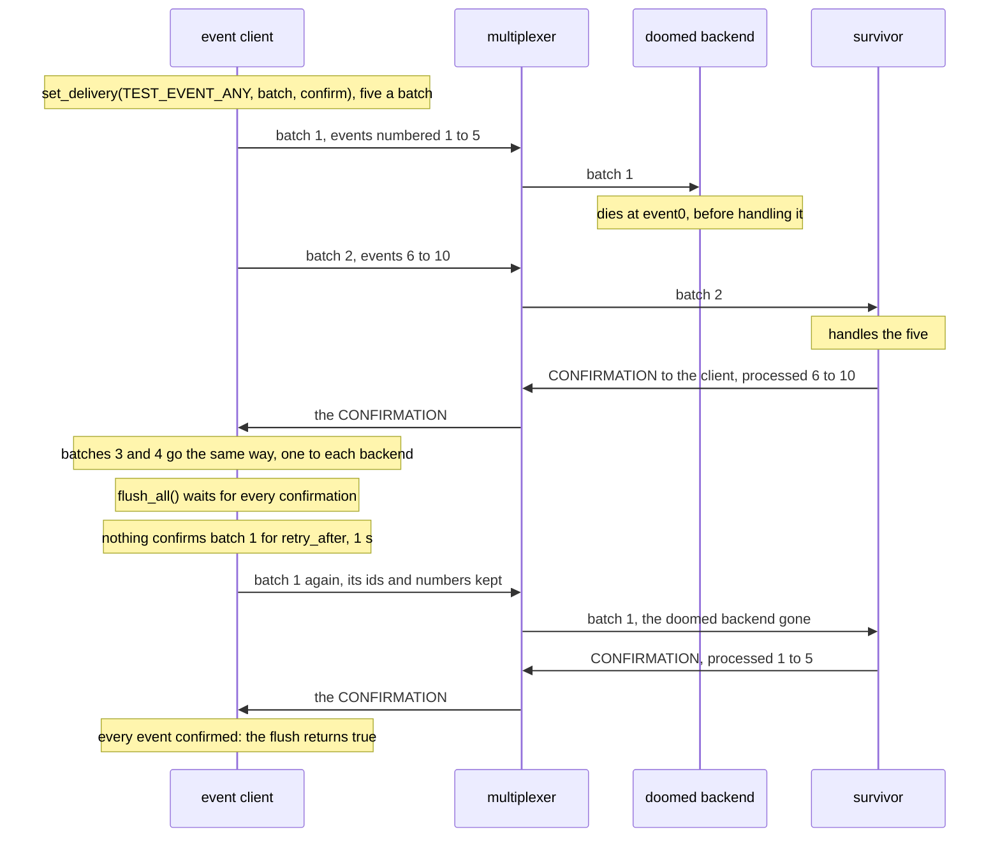

# Confirmed events

Confirmed events reach a backend at least once, though the one they first went to dies holding them.

An event client sends twenty events of `TEST_EVENT_ANY` as confirmed sends
([confirmed sends](../../../docs/delivery.md#confirmed-sends)), five a
batch with a delay of an hour, which never runs out here, and a
`retry_after` of 1 s; then it flushes, which waits for every
confirmation. The rule gives each batch to one event backend, the two in
turn. The first backend dies at the first event it gets, before handling
it, so that nothing of what it held is confirmed. Once nothing confirmed
those events for `retry_after`, the client sends them again, with their
ids and numbers, and the multiplexer gives them to the backend left, which
confirms them as it confirmed its own: one `CONFIRMATION` once a batch is
handled. A second test tells the same story with the events confirmed one
by one, not batched: each goes at once in a batch of its own, numbered,
and the survivor's library confirms what each read of its connection
brought.

## What happens



## What is checked

- The event client: every event sent without an error, and the flush after the last confirmed everything (`flushed` with `is_sent`): no event given up on.
- The doomed backend: it exits with 3 at its first event, having handled none.
- The survivor: every one of the twenty events, at least once.
- The multiplexer's recording: at least two batches reached the survivor, and no more `CONFIRMATION`s from it reached the client than batches reached it, each confirming what a batch held at once, never an event alone.
- One by one: the same, every event confirmed and the survivor holding each at least once, each in a batch of its own, twenty at least, and no more `CONFIRMATION`s than those.

The batches go full and the flush waits on the confirmations: the only
time in the scenario is `retry_after`, which the events the doomed
backend held wait out before they go again. A consumer that confirms an
event alone, or none at all, and a producer that does not send again what
nothing confirmed, each fail a check.

## Run

```
bazel test //tests/scenarios:confirmed_events_py_cc
```

The two suffixes are the languages of the roles, first the event
backends' and then the event client's: `confirmed_events_py_cc` has
Python backends confirm the batches of a C++ client. Every one of the nine
combinations is a target.

The scenario is [confirmed_events.py](confirmed_events.py); the roles it
spawns are described in [tests/README.md](../../README.md).
