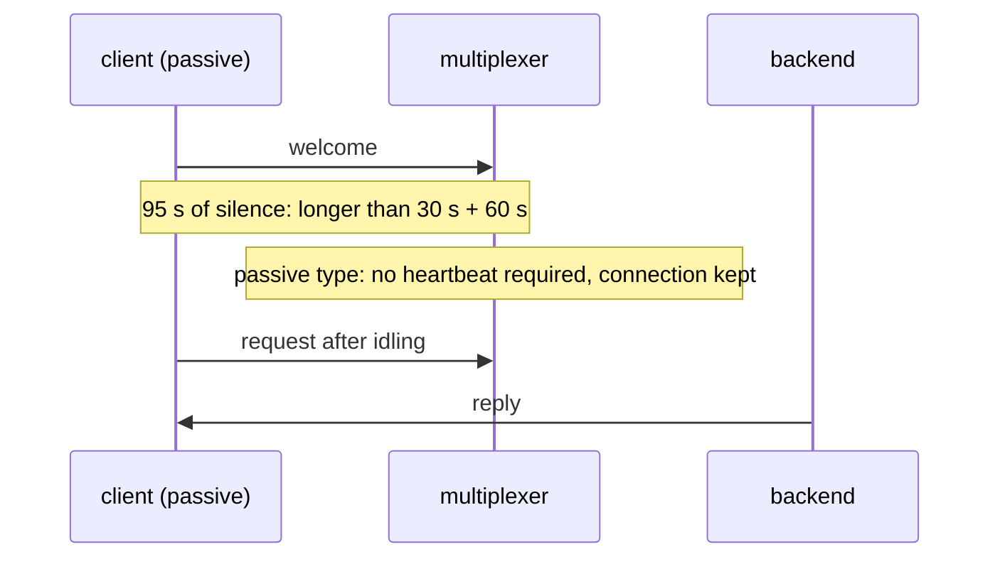

# Idle client

A passive client idles past both drop intervals and still works.

A client the multiplexer dropped would reconnect on its own and answer
just the same, so the multiplexer's log is what tells: the client, and the
backend idling beside it, registered once each, never dropped and back.

## What happens



## What is checked

- A passive client that idles past both drop intervals is still connected and its query works.
- The multiplexer's log registers the client once and the backend once:
  neither was dropped and reconnected, which the answer and the
  connection count alone could not tell, since a dropped peer reconnects
  3 s later on its own.
- Slow: it really waits.

## Run

```
bazel test //tests/scenarios:idle_client_py
```

The suffix is the language of the client and the backend: `_py` Python,
`_cc` C++, `_rust` Rust.

The scenario is [idle_client.py](idle_client.py); the roles it spawns are described in
[tests/README.md](../../README.md).
