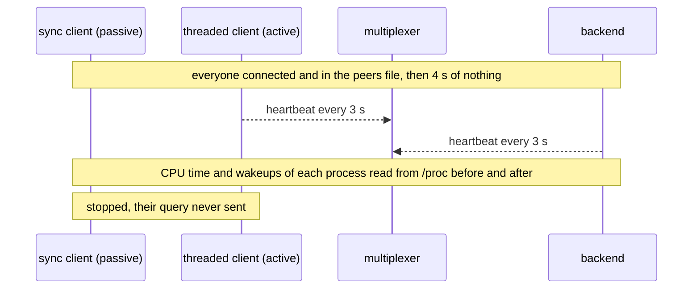

# Idle CPU

An idle deployment uses no CPU: every wait loop sleeps, none spins.

A multiplexer, a backend, a synchronous client and a threaded client sit
idle for a while, heartbeats and all. The CPU time of every process over
that window, read from /proc, stays within a few hundredths of a second: a
loop that spins would burn a whole core into it. Its threads are woken a
few times a second, counted from /proc as well, far fewer than a loop
that polls on a short timer, which costs too little CPU to show, is woken
at every turn. This is the check that a wait somewhere did not turn into a
busy loop.

## What happens



## What is checked

- Each of the four processes used under 0.15 s of CPU during the 4 s idle window.
- Each was woken fewer than 25 times a second, all its threads together:
  the backend's 0.25 s poll and the heartbeats make a few, a loop on a
  5 ms timer would make two hundred.
- Neither client sent anything: their queries were to come after an hour.
  [idle_client](../idle_client/README.md) and
  [threaded_idle](../threaded_idle/README.md) show that a client's call
  after idling works.

## Run

```
bazel test //tests/scenarios:idle_cpu_py_py
```

The two suffixes are the languages of the roles, first the backend's and
then the client's.
