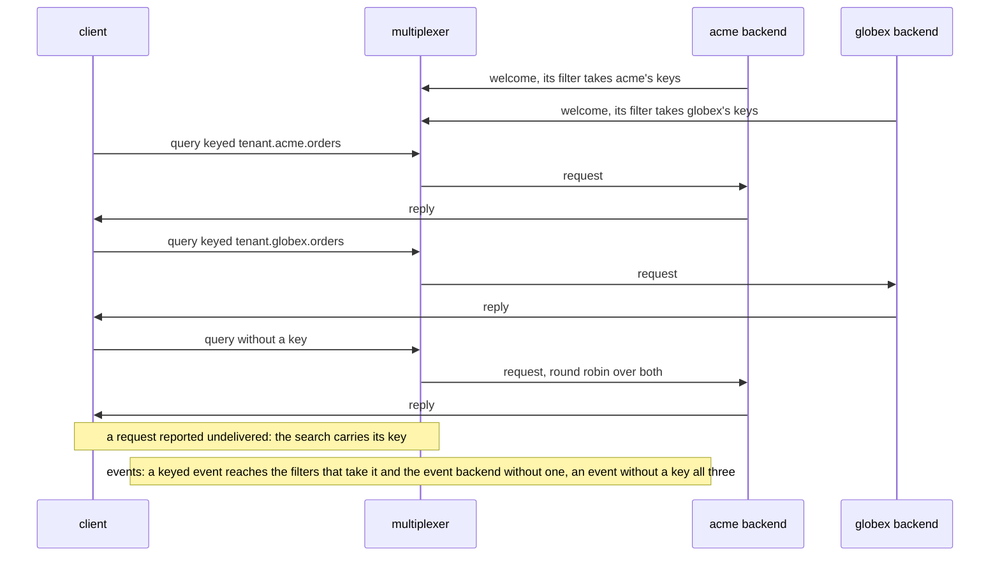

# Key routing

Keys reach the backends whose filter takes them, through every client and server class.

Three runs, the roles of one language each. Two backends of one type split
a request type by tenant: one's key filter takes acme's keys, the other's
globex's, both set before they connect, first on `BaseMultiplexerServer`
and then on `BaseThreadedMultiplexerServer`. A client in every mode,
`SyncClient`, `ThreadedClient`, `AsyncClient` and threads sharing one
`ThreadedClient`, has each tenant's queries answered by that tenant's
backend alone, and its queries without a key by both. A query whose
request is reported undelivered searches for a backend with the request's
key, so that a failover stays with the backends that take it. Of three
event backends, two with a filter for one group each and one with none, a
keyed event reaches those that take its key, and an event without a key
all three.

## What happens



## What is checked

- Pools, on each server class and from each client mode: every query keyed `tenant.acme.orders` is answered by the acme backend, every one keyed `tenant.globex.orders` by the globex one, and those without a key by both; none fails.
- The search, from `SyncClient` and `ThreadedClient`: the only backend, a peer speaking the protocol by hand whose filter takes acme's keys, reports the keyed request undelivered as a multiplexer would; the search that follows carries the request's key, and so does the request sent again to the backend that answered the search, which gets its reply.
- Events: an event keyed `group.1` reaches the event backend whose filter takes `group.1` and the one without a filter, never the one whose filter takes `group.2`; an event without a key, sent once the keyed one was routed, reaches all three, so a keyed event routed where it should not go would have arrived before it.

## Run

```
bazel test //tests/scenarios:key_routing_py
```

The suffix is the roles' language: `_py` the Python roles, `_cc` the C++
ones, the backends and the clients alike.

The scenario is [key_routing.py](key_routing.py); the roles it spawns are described in
[tests/README.md](../../README.md), keys in [docs/keys.md](../../../docs/keys.md).
