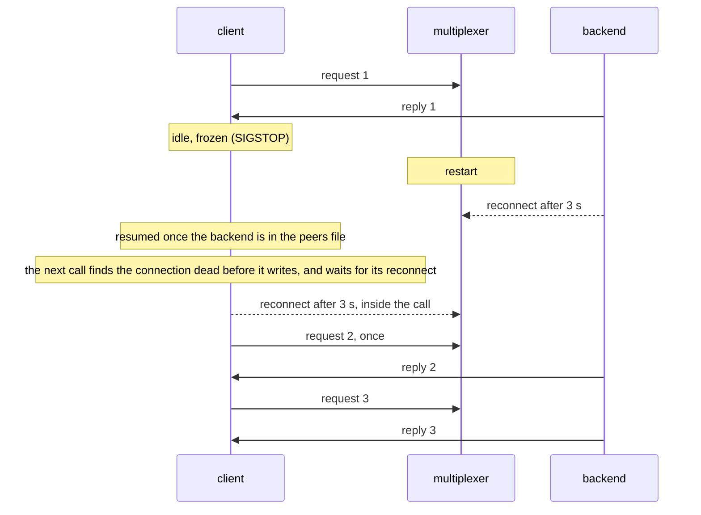

# Mx restarts

The multiplexer restarts under a live backend and a passive client; nobody notices.

The backend, a `BaseMultiplexerServer` that runs its loop all the time,
reconnects after AUTO_RECONNECT_TIME. The client's next call finds its
connection dead before it writes, waits for the reconnect inside the call
and sends then, so every query is answered and none fails. The client is
frozen in its idle time across the restart, until the backend is
registered again: a passive client notices nothing meanwhile, and its
next call comes after both, however long the restart takes.

## What happens



## What is checked

- No query fails across the restart; the second one takes a few seconds,
  less than its 30 s timeout, which a query that waited for it would take
  whole.
- The backend saw every request, at least once each.

## Run

```
bazel test //tests/scenarios:mx_restarts_py
```

The suffix is the language of the client and the backend: `_py` Python,
`_cc` C++, `_rust` Rust.

The scenario is [mx_restarts.py](mx_restarts.py); the roles it spawns are described in
[tests/README.md](../../README.md).
