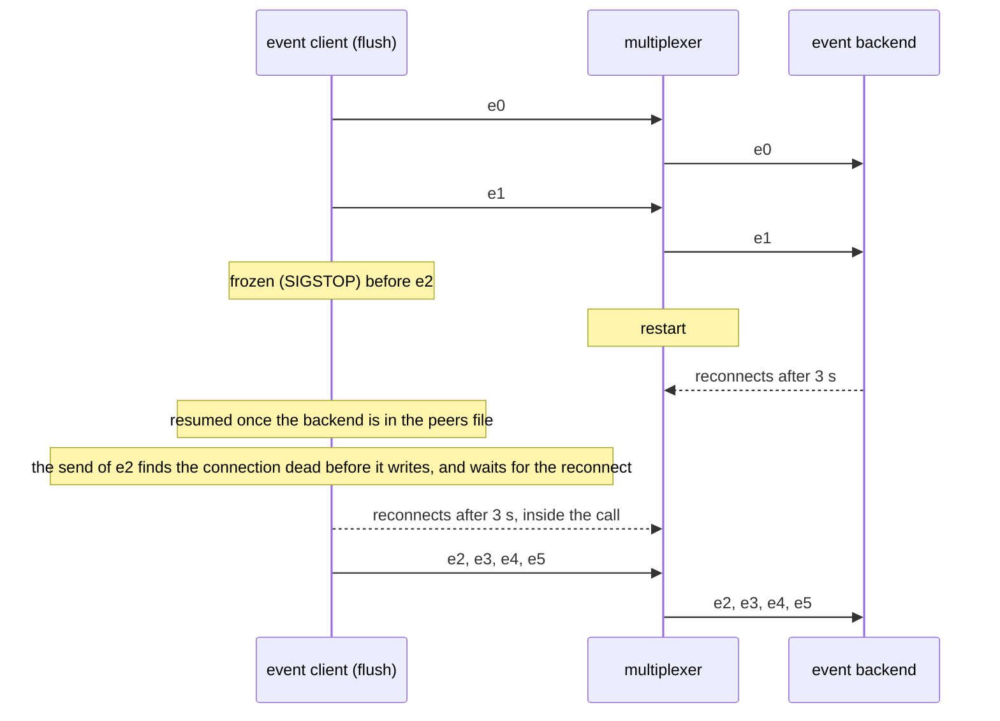

# Mx restarts under events

The multiplexer restarts between two events; a flushing sender loses none of its calls.

A passive event client sends one event every second and flushes each. It
is frozen after the second one, the multiplexer restarts, and the sender
is resumed once the backend, which reconnects on its own, is registered
again. Its next send finds the connection dead before it writes, waits
for the reconnect inside the call and writes the event then, so every
send succeeds, and the backend receives every event sent after both are
back.

## What happens



## What is checked

- Every send returns as written, none fails, and the sender's connection count is back to 1.
- The backend receives the events sent after both peers reconnected, the last one included.

## Run

```
bazel test //tests/scenarios:mx_restarts_under_events_py_py
```

The two suffixes are the languages of the roles, first the event backend's
and then the event client's.
