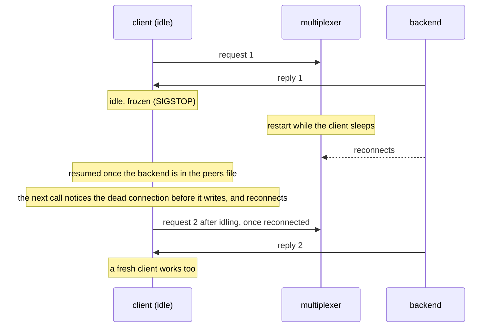

# Mx restarts under idle client

The multiplexer restarts while a passive client is idle; its next call still works.

The client learns of the dead connection inside that call, before it
writes, waits for the reconnect there and sends then. It is frozen in its
idle time across the restart, until the backend is registered again, so
that its next call comes after both. A fresh client works too.

## What happens



## What is checked

- The idle client's next call succeeds.
- A client started after the restart works as well.

## Run

```
bazel test //tests/scenarios:mx_restarts_under_idle_client_py
```

The suffix is the language of the client and the backend: `_py` Python,
`_cc` C++, `_rust` Rust.

The scenario is [mx_restarts_under_idle_client.py](mx_restarts_under_idle_client.py); the roles it spawns are described in
[tests/README.md](../../README.md).
