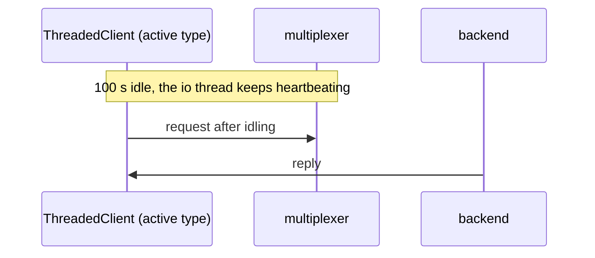

# Threaded idle

A ThreadedClient of an active peer type idles past the drop intervals and still works.

Its io thread answers heartbeats while the program does nothing, which is
what lets the peer type be non-passive. A client the multiplexer dropped
would reconnect on its own and answer just the same, so the multiplexer's
log is what tells: the client, and the backend idling beside it,
registered once each. Slow: waits out 30 s + 60 s and more.

## What happens



## What is checked

- The connection is never dropped although the peer type is not passive, and the query after idling works.
- The multiplexer's log registers the client once and the backend once:
  neither was dropped and reconnected, which the answer and the
  connection count alone could not tell, since a dropped peer reconnects
  3 s later on its own.
- Slow: it really waits.

## Run

```
bazel test //tests/scenarios:threaded_idle_py
```

The suffix is the client's language: `_py` a Python client, `_cc` a C++
one, `_rust` a Rust one; the backend is the Python one.

The scenario is [threaded_idle.py](threaded_idle.py); the roles it spawns are described in
[tests/README.md](../../README.md).
